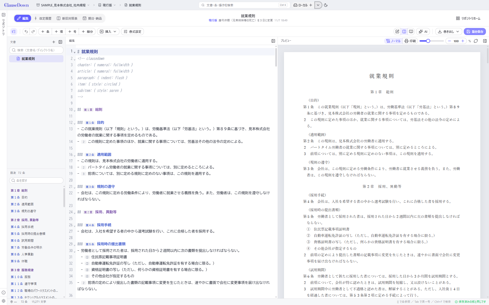

# ClauseDown

ClauseDown は法律案・条例・契約書・規約・規程など、「第○条」と条文を並べる文書を書き、版を管理する Windows 用のデスクトップアプリです。
士業（弁護士・司法書士・行政書士・社労士など）、企業の法務・人事、議員や法制の担当者など、条文を書く人に向けて作っています。

文書は Markdown で書き、版は Git で記録します。画面では Git の用語を使わないので、Git や VS Code を知らない事務担当者でも、編集・版の保存・改定案・確認依頼・新旧対照表・施行日・納品までを扱えます。

> [!NOTE]
> このアプリは私が業務で使用していた [MPE](https://shd101wyy.github.io/markdown-preview-enhanced) 設定とスクリプトをAIの助けで受肉させたものです、多くの場合 VSCode と MPE を使用されたほうが軽量かつ多機能かと思います。

> **[操作マニュアルを読む](docs/manual/README.md)**　画面の画像を使って、文書の作り方から新旧対照表・施行日・納品までの操作を順に説明しています。



## できること

- **[条文を書く](docs/manual/README.md#6-条文を書く)**：条・項・号の番号はアプリが計算します。条を足すと後ろの番号を振り直し、条参照（「第2条」）も追いかけます。法令式・契約書式など番号の付け方を選べます。
- **[版を記録する](docs/manual/README.md#7-版を保存する)**：区切りごとに版を保存し、改定履歴で過去の版を見たり戻したりします。
- **[新旧対照表を作る](docs/manual/README.md#9-新旧対照表を作る)**：2 つの版を条ごとに並べ、変わった文字に下線を引きます。PDF・Word に書き出せます。
- **[改定案で書き直す](docs/manual/README.md#10-改定案で書き直し確認を受けて現行版に反映する)**：現行版を変えずに書き直し、確認依頼・承認を経て現行版に反映します。現行版と同じ箇所を変えたときは、重なった箇所を 1 か所ずつ選んで統合します。
- **[施行日と納品を記録する](docs/manual/README.md#11-施行日を記録し納品する)**：版に施行日を付け、条文と新旧対照表を PDF・Word にまとめて納品し、記録を残します。
- **[期日を管理する](docs/manual/README.md#12-期日を管理する)**：施行・公布・提出・届出・更新などの日付をタイムラインで管理し、デスクトップに通知します。iCalendar（.ics）にも書き出せます。
- **[ほかの PC・ほかの人と共有する](docs/manual/README.md#13-ほかの-pcほかの人と共有する)**：GitHub・GitLab（社内の GitLab を含む）と同期します。確認依頼は GitHub のプルリク・GitLab のマージリクエストにもなります。リポジトリの複製・フォークもできます。
- **[AI に頼む](docs/manual/README.md#15-ai-に確認や書き直しを頼む)**：リーガルチェックや文言の手直しを、Claude・OpenAI 互換のサービス・Ollama（ローカル の中）などに頼めます。外部の AI（Claude Code など）から MCP でつなぐこともできます。
- **[法令を取り込む](docs/manual/README.md#14-houritsu-の法令を取り込む書き出す)**：[houritsu](https://github.com/Kohei-Wada/houritsu) の形式の法令（e-Gov 法令検索の法令を Markdown にしたもの）を取り込み、同じ形式で書き出せます。

## 使い方

操作の手順はすべて [操作マニュアル](docs/manual/README.md)

1. [起動と画面の構成](docs/manual/README.md#2-起動と画面の構成)
2. [サンプルリポジトリで試す](docs/manual/README.md#サンプルリポジトリで試す)：設定の「Developer」で「サンプルリポジトリを追加」を押すと、社内規程・契約書・条例と要綱・houritsu の形式の法令の 4 つのリポジトリが、版の履歴・改定案・期日付きでできます
3. [文書を作る](docs/manual/README.md#5-文書を作る)・[条文を書く](docs/manual/README.md#6-条文を書く)
4. [版を保存する](docs/manual/README.md#7-版を保存する)
5. [新旧対照表を作る](docs/manual/README.md#9-新旧対照表を作る)
6. [改定案で書き直し、確認を受けて現行版に反映する](docs/manual/README.md#10-改定案で書き直し確認を受けて現行版に反映する)

ほかの章は、マニュアルの[目次](docs/manual/README.md#目次)から開けます。

## 文書の書き方

文書は Markdown で書きます。番号は書かず、行の先頭の記号で章・条・項・号を表します。

```md
# 就業規則                 ← 文書の題名
<!-- clausedown
article: { title: inline }
-->
## 総則                    ← 章（第一章　総則）
### 目的 {#purpose}        ← 条（第1条）。{#名前} を付けると条参照できる
- この規則は、…            ← 第1項（番号なし）
- 前項の規定にかかわらず、… ← 第2項
  - 正社員                 ← 号（一、二…）
    - 有期                 ← 号の細分（イ、ロ…）
- [[purpose]]の規定により… ← 「第1条」に置き換わる。[[purpose:2]] で「第1条第2項」
```

| 書き方 | 意味 |
|---|---|
| `### 見出し {branch}` | 枝番号の条（第15条の2） |
| `### {deleted}` | 削除された条（第5条　削除） |
| `### 見出し {n=10}`・`{n=10 b=2}` | 条の番号を指定する（第10条・第10条の2）。続く条はそこから数える |
| 号の行頭の `{n=3}`・`{b=2}` | 号の番号を指定する（三・直前の号の枝番号〔一の二など〕） |
| `## 附則 {supplement}` | 附則（条番号を 1 から振り直す） |
| `## {closing}` | 後文・署名欄（番号を付けない） |
| `## 別表第一 {appendix}` | 別表。表・図・文章をそのまま載せる（番号を付けない） |
| 項・号の下に字下げして書いた表 | その項・号に付く表。新旧対照表ではセルの中身で比べる |
| 表のセルの `>`・`^` | 右隣・上のセルと結合する（Markdown Preview Enhanced の拡張テーブル記法） |
| ` ```mermaid ` の囲み | 図（流れ図など）。[Pele](https://pele.run/) で SVG にする。Word には画像で入る |
| 最初の `##` より前の本文 | 前文 |
| 文書の先頭の `---` で囲んだ YAML | 文書の情報（houritsu の法令番号など）。条文としては読まない |
| `{break}` だけの行 | 次の要素の前で改ページ |
| `::: {size=9pt cols=25,75}` から `:::` までの行 | 囲んだ条・項・号・表・後文に、文字の大きさ・フォント（`font`）・寄せ（`right` など）・行の高さ（`line`）・表の列の幅を指定する（Pandoc の書き方）。`{right}` だけの行は次の要素だけに適用 |
| 文の中の `[文字]{size=12pt}` | 囲んだ文字だけに指定する |

番号の付け方は題名の直後の `<!-- clausedown ... -->` に YAML で書きます。画面の「書式設定」からも変えられます。

| キー | 選択肢（先頭が既定） |
|---|---|
| `chapter.numeral` | kanji / arabic / fullwidth / none |
| `article.numeral` | arabic / kanji / fullwidth |
| `article.title` | above（前の行）/ inline（条番号の右）/ none |
| `article.numbering` | continuous / perChapter |
| `paragraph.firstNumbered` | false / true |
| `paragraph.numeral` | fullwidth / arabic / circled |
| `paragraph.indent` | nested（項・号を条より下げる）/ flush（項を条と同じ位置に置く・法令式） |
| `item.style` | kanji / paren / circled |
| `subitem.style` | iroha / paren / roman |

---

## 技術者向けの情報

### 構成

| 部分 | 技術 | 場所 |
|---|---|---|
| 画面 | Nuxt 4（SSR なし）＋ Nuxt UI ＋ Pinia ＋ CodeMirror 6 | `src/renderer/` |
| main プロセス | Electron ＋ isomorphic-git（PC に Git は不要） | `src/main/` |
| 共通 | 条文の解析・番号・書式設定・条単位の差分・3 方向の統合・HTML／Word の出力・houritsu の変換 | `src/shared/` |
| サンプルの文書 | サンプルリポジトリの元の文書。アプリに組み込み、版の履歴は `src/main/samples.ts` で作る | `example_repository/` |
| テスト | vitest・Playwright（画面） | `test/`・`test/e2e/` |

- 画面の見た目は Nuxt UI の部品と scoped CSS で作っています。Tailwind のクラスは書いていません（Nuxt UI が内部で Tailwind を使います）。
- 製品版では、`nuxt generate` の出力（`out/renderer`）を Electron が `app://` で配ります。
- オフラインで動くように、Web フォントは取得せず、アイコン（Lucide）はアプリに同梱しています。

### 開発

```sh
npm install
npm run dev        # Nuxt の開発サーバー＋Electron
npm test           # 単体テスト（同期・GitHub／GitLab 連携のテストは git http-backend を使うので Git が必要）
npm run test:e2e   # 画面のテスト（ビルドしてから Electron で起動し、主な画面を開いて操作する）
npm run typecheck  # main 側（tsconfig.node.json）と Nuxt 側の両方
npm run build      # out/ に main・preload・画面を出力
npm run dist       # インストーラを作る（release/）
```

VS Code のターミナルでは `ELECTRON_RUN_AS_NODE=1` が設定されていることがあります。`npm run dev` は自動で外しますが、`electron .` などを直接実行するときは外してください。

### GitHub・GitLab との接続の準備

リモートには GitHub、gitlab.com、社内に置いた GitLab が使えます。設定 →「GitHub/GitLab」で、サーバーごとにログインします。認証情報はサーバーごとに分けて暗号化して保存し、トークンはそのサーバーにしか送りません。

利用者がログインしてリポジトリに App をインストールする手順は、操作マニュアルの「[GitHub に接続する](docs/manual/README.md#github-に接続する)」「[GitLab.com に接続する](docs/manual/README.md#gitlabcom-に接続する)」にあります。

**GitHub**：ClauseDown には GitHub App（[ClauseDown](https://github.com/apps/clausedown)）が組み込まれています。

1. 「GitHub/GitLab」→ GitHub の「インストールする」で、自分のアカウント（または組織の Organization）に App をインストールし、使うリポジトリだけを選ぶ（組織で一度だけ）
2. 各 PC で「ログイン」を押し、ブラウザに表示されたコードを入力する

App が読み書きできるのは、インストールのときに選んだリポジトリだけです。権限は Contents と Pull requests の読み書き（と Metadata の読み取り）です。ログインのトークンは 8 時間で切れ、アプリが自動で更新します。client secret は使いません（device flow）。リポジトリのフォークにはこの権限では足りないことがあります。そのときは GitHub のエラーをそのまま画面に出します。

自分の GitHub App を使う場合は、次の手順で作ります。

1. GitHub の Settings → Developer settings → GitHub Apps → New GitHub App
2. 「Enable Device Flow」にチェック。Webhook は不要。トークンの期限切れ（User-to-server token expiration）は有効のまま
3. Repository permissions：Contents = Read and write、Pull requests = Read and write、Metadata = Read-only
4. Client ID を「詳しい設定」に入力する（または `CLAUSEDOWN_GITHUB_CLIENT_ID` 環境変数）

**GitLab（gitlab.com・社内の GitLab）**：確認依頼はマージリクエスト、承認は GitLab の承認、修正依頼とコメントは GitLab のコメント、納品は GitLab のリリース（納品物を添付）になります。サブグループ（`group/sub/project`）や、`https://example.co.jp/gitlab` のようなパス付きの設置にも対応しています。プロジェクトでは「Developer」以上の役割が必要です。依頼した本人の承認は、GitLab の設定にかかわらずアプリが数えません。

- **gitlab.com**：ClauseDown の OAuth アプリが組み込まれているので、「ログイン」を押してブラウザに表示されたコードを入力します。GitHub App と違い、GitLab にはリポジトリを選んで許可する仕組みがないため、ログインした人が使えるすべてのプロジェクトが対象になります。
- **社内の GitLab**：「社内の GitLab」に URL（https のみ）を入れます。ブラウザでログインするには（GitLab の device authorization grant）、その GitLab の管理者が OAuth アプリを登録します。
  1. 管理者エリア → アプリケーションで新規作成
  2. 名前：ClauseDown。リダイレクト URI：使わないので任意の https の URL
  3. **「Confidential」はオフ**（client secret を使わないため）、**「Device authorization grant」はオン**
  4. スコープ：`api`、`read_repository`、`write_repository`
  5. できた Application ID を、サーバーの追加時（または「詳しい設定」）に入力する
- **アクセストークンで使う**：GitLab の「アクセストークン」で同じスコープのトークンを作り、「詳しい設定」に入力します。device flow に対応していない古い GitLab でも使えます。

### 設定と保存先

| 区分 | 開き方 | 保存先 |
|---|---|---|
| アプリ全体 | 左のペインのいちばん下の「設定」 | ローカル（userData の `settings.json`。書き換える前の内容を `settings.json.bak` に残す） |
| このリポジトリ | タイトルバーのリポジトリ名 ▾ →「このリポジトリの設定」 | 書式・メモ：作業フォルダの `.clausedown/`（文書と一緒に版管理）<br>承認の決まり・期日の種類：記録用ブランチの `settings/` |

印刷・PDF・Word の書式（本文のフォント・文字の大きさ・行間・余白・ページ番号・新しい文書の書式）は、次の順に重ね、下ほど優先します。項目ごとに上書きするので、書いていない項目は上の設定を使います。

1. ローカル の設定（アプリ全体の設定）
2. リポジトリ全体：`.clausedown/style.json`
3. ディレクトリごと：`.clausedown/styles/<ディレクトリ>.json`（下のディレクトリは `.clausedown/styles/株式会社A/人事.json` のように置く）

```json
{ "style": { "font": "BIZ UD明朝 Medium", "fontSize": 11 } }
```

画面で書式を変えると、「書式を変更」という版を自動で保存します。改定案を開いているときはその案の中だけが変わり、現行版に反映すると全体に適用されます。承認の決まりは改定案の中から書き換えられないように、ファイルではなく記録用ブランチに置いています。

### Git の扱い

画面では Git の用語を使わず、次のように言い換えています。

| 画面の言葉 | Git |
|---|---|
| 現行版 | `main`（なければ `master`） |
| 改定案 | `案/<名前>` ブランチ |
| 版を保存 | commit（版に含めるのは、すでに版にあるファイルと `.md` だけ） |
| 同期 | 全ブランチの fetch（prune 付き）＋早送り / push |
| 現行版に反映 | 改定案を main に merge（常にマージコミット）。リモートで確認依頼が出ていれば、GitHub のプルリク・GitLab のマージリクエストをマージ |
| 確認依頼・承認・修正依頼 | アプリの記録（下記）。GitHub ならプルリクとレビュー、GitLab ならマージリクエストと承認・コメントも作る |
| 施行版 | 注釈付きタグ `施行/<ディレクトリ>/<文書名>/<日付>`。付け直したタグは force で送信する |
| 納品 | 記録（下記）。GitHub・GitLab なら `納品/…` タグとリリース（納品物を添付） |
| 期日 | 記録（下記）の `events/<id>.json`。種類は `settings/event-kinds.json` |
| 複製 | 作業フォルダを `.git` ごとコピーし、リモートを外す |
| フォーク | GitHub・GitLab の API でフォークを作り、`origin` をフォークに、元を `upstream` にする |

- **記録用ブランチ** `clausedown-records`：確認依頼・納品・期日・リポジトリの決まり（承認必須か・承認者・期日の種類）を、1 件 1 ファイルの JSON で、種類ごとのディレクトリ（`reviews/`・`deliveries/`・`events/`・`settings/`）に置きます。画面には出しません。追記中心なので、2 台の PC で同時に記録しても統合で消えません。書き換えるファイル（決まり・期日）は、分かれる前から変えた側を残します。期日を消すときは、ファイルを消さず「消した」印を書きます。もう一方の PC の記録から戻ってこないようにするためです。
- **承認の決まり**：「承認必須」にすると、承認されていない改定案は現行版に反映できません。承認後に改定案を変えると承認し直しです。アプリだけでは運用上の制限なので、GitHub のブランチ保護や GitLab の保護ブランチ・承認ルールも併せて使ってください。
- **統合**：行単位の 3 方向の統合です（jsdiff の差分をもとにした実装。手元の計測では、2 万行の文書でも 30 ミリ秒ほどで終わる）。別の箇所の変更は自動で両方残し、同じ箇所を両方が変えたところだけを画面で 1 か所ずつ解決します。解決の内容をすべて確かめてから作業フォルダに書くので、途中で止まっても半端な状態は残りません。
- **同時の操作**：同期・版の保存・統合・AI の書き込み・記録の書き込みなど、リポジトリを書き換える処理は、リポジトリごとに 1 つずつ順に実行します。
- **書き込み**：文書と設定は、一時ファイルに書いてから名前を変える方法で書きます。
- **改行コード**：CRLF / LF の違いだけでは変更とみなしません（Windows の core.autocrlf への対策）。
- **認証情報**：Electron の `safeStorage`（Windows では DPAPI）で暗号化して保存します。
- エンジニアは同じリポジトリを VS Code や git コマンドでそのまま扱えます。

### 期日の仕組み

- 期日・施行日（施行タグ）・納品の記録を、同じタイムラインに出します。
- 繰り返し（毎年・毎月）は月末や 2/29 を月末に丸めます。繰り返す期日の古い回は毎月なら 90 日、毎年なら 400 日より前のものを期限切れに数えません。
- 通知はアプリの起動中に 1 時間ごとに確かめ、1 件につき一度だけ出します。
- iCalendar（.ics）には 1 年前から 5 年先までの、済みでない期日と施行日を入れます。繰り返しは RRULE にせず回ごとの予定にします（月末に丸める決まりを RRULE では書けないため）。回ごとに変わらない識別子（UID）を付けます。取り込み直したときに前の予定を置き換えるか重ねるかは、カレンダーのアプリによって違います。

### AI の仕組み

AI にできるのは「文書を読む」「機械的なチェック」「作業フォルダの文書を書き換える」までです。版の保存・現行版への反映・施行日・納品・確認依頼は、人が画面で行います。

| 使い方 | 準備 | 仕組み |
|---|---|---|
| エディタの「AI」パネル | 設定 →「AI」で使う AI を選ぶ（下の表） | アプリが選んだ AI を直接呼ぶ。よく使う指示（リーガルチェック・文言を整える・条参照を直す・改定内容の説明）はボタンで選べる |
| 外部の AI（Claude Code など） | 設定 →「AI」で「外部の AI からつなぐ（MCP）」をオンにし、表示されたコマンドを実行する | アプリの起動中だけ `http://127.0.0.1:<ポート>/mcp` で MCP サーバーを開く。接続用トークンが必要で、ブラウザからの呼び出しと 127.0.0.1 / localhost 以外の Host は断る |

| 使う AI | つなぎ方 | 文書の送り先 |
|---|---|---|
| Claude（Anthropic） | API キー（既定のモデル `claude-opus-5-5`） | Anthropic |
| OpenAI・Gemini など（OpenAI 互換） | 接続先（OpenAI／Google Gemini／DeepSeek／LM Studio／その他の URL）と API キー | その接続先 |
| Ollama（ローカル の中） | 不要（`http://127.0.0.1:11434`）。道具（tools）に対応したモデル（qwen3・llama3.1・gpt-oss など）を `ollama pull` しておく | PC の外に出ない |
| OpenRouter | ブラウザでログイン（OAuth PKCE。キーは自動で受け取る） | OpenRouter と、選んだモデルの会社 |
| GitHub Models | 「GitHub/GitLab」の GitHub のログインを使う（無料枠・回数制限あり） | GitHub（Microsoft） |

- キーは接続先ごとに分けて暗号化して保存し、その接続先にしか送りません。接続先は https か、ローカル の中（http の 127.0.0.1 / localhost）だけです。
- Claude では thinking・プロンプトキャッシュなど Claude 専用の機能を使います。ほかの AI は OpenAI 互換の Chat Completions（tools）で呼びます。道具をうまく使えないモデルもあるので、まず「接続を試す」と、短い依頼で試してください。
- 道具（`src/main/ai-tools.ts`）は、アプリ内の AI と MCP で共通で、次のものがあります。`list_repos`・`list_docs`・`read_doc`（行番号と計算した番号〔第3条第2項〕付き）・`check_doc`・`edit_doc`・`write_doc`・`list_versions`・`read_doc_version`・`compare_versions`。
- 書き換えられるのは、登録済みのリポジトリの中の `.md` だけです（隠しフォルダ・`.clausedown/`・`.git` には書き込めません）。
- AI が書き換えたとき、エディタにまだ保存していない入力があれば、3 方向で統合します。同じ箇所が重なったときは、エディタの内容を残します。
- AI への指示（役割・Markdown の書き方・リーガルチェックの書式）は `src/shared/ai-presets.ts` にあり、MCP のプロンプトとしても出しています。

### houritsu の形式の変換

- **見分け方**：文書の先頭の YAML に `law_id` と `law_num` があり、ClauseDown の書式設定（`<!-- clausedown`）が無ければ、houritsu の形式とみなします。リポジトリを追加したときに、各文書の先頭 16KB だけを読んで見分けます。
- **取り込み**：
  - 先頭の YAML は残し、法令式の書式設定を足します。
  - 章の見出しは元の文のまま残し（`chapter.numeral: none`）、編・節・款・目の見出しは消します。
  - 条・号の番号が自動の番号と違う箇所だけに `{n=… b=…}` を付けます。変換したあとで条文を解析し直し、条の番号を元の番号と比べ、合わないものを知らせます。
  - HTML の表は Markdown の表にします。結合したセルは `>`・`^` で残します。
  - 変換した文書はまとめて 1 つの版にします。途中で失敗したときは、書き換えた文書を前の版の内容に戻します。
- **書き出し**：条・項・号の番号を本文に書き込み、続いて削除された条を「第X条から第Y条まで」「第X条及び第Y条」にまとめます。

## ライセンス

[MIT License](LICENSE)

---

`example_repository/houritsu/` の法令は houritsu（Kohei-Wada、CC BY 4.0）の Markdown を使っています。
また、houritsu形式のMDを自動変換でインポートエクスポートが可能です。
