# ClauseDown 操作マニュアル

ClauseDown は法律案・条例・契約書・規程など「第○条」と条文を並べる文書を書き、版を記録し、改定の確認から施行・納品までを管理する Windows・macOS 用のアプリです。
このマニュアルは文書を作って直す人（事務担当者・法務担当者・士業の方）に向けて、画面ごとの操作を説明します。

## 目次

- [ClauseDown 操作マニュアル](#clausedown-操作マニュアル)
  - [目次](#目次)
  - [1. このマニュアルで使う言葉](#1-このマニュアルで使う言葉)
  - [2. 起動と画面の構成](#2-起動と画面の構成)
    - [初めて起動したとき](#初めて起動したとき)
    - [トップページ](#トップページ)
    - [文書・条・改定案・操作を名前で探す](#文書条改定案操作を名前で探す)
  - [3. リポジトリを用意する](#3-リポジトリを用意する)
    - [サンプルリポジトリで試す](#サンプルリポジトリで試す)
    - [リポジトリを複製する](#リポジトリを複製する)
    - [リポジトリをフォークする](#リポジトリをフォークする)
    - [リポジトリを切り替える](#リポジトリを切り替える)
  - [4. リポジトリホームで文書と改定案を見渡す](#4-リポジトリホームで文書と改定案を見渡す)
    - [ディレクトリをたどる](#ディレクトリをたどる)
    - [表示を切り替える](#表示を切り替える)
    - [右クリックとドラッグで操作する](#右クリックとドラッグで操作する)
  - [5. 文書を作る](#5-文書を作る)
  - [6. 条文を書く](#6-条文を書く)
    - [条・項・号の書き方](#条項号の書き方)
    - [ボタンで条・項・号を足す](#ボタンで条項号を足す)
    - [条参照：ほかの条を番号で指す](#条参照ほかの条を番号で指す)
    - [定義語のチェック](#定義語のチェック)
    - [校閲](#校閲)
    - [書式設定：章や項の番号の付け方を変える](#書式設定章や項の番号の付け方を変える)
    - [検索と置換](#検索と置換)
    - [改ページ・文字の大きさ・寄せを指定する](#改ページ文字の大きさ寄せを指定する)
    - [表のセルを結合する](#表のセルを結合する)
    - [数式を書く](#数式を書く)
    - [PDF・Word・Markdown に書き出す](#pdfwordmarkdown-に書き出す)
    - [書いた内容の保存](#書いた内容の保存)
  - [7. 版を保存する](#7-版を保存する)
  - [8. 改定履歴で過去の版を見る](#8-改定履歴で過去の版を見る)
  - [9. 新旧対照表を作る](#9-新旧対照表を作る)
  - [10. 改定案で書き直し、確認を受けて現行版に反映する](#10-改定案で書き直し確認を受けて現行版に反映する)
    - [改定案を作る](#改定案を作る)
    - [改定案で作業する](#改定案で作業する)
    - [確認を依頼する・確認する](#確認を依頼する確認する)
    - [現行版に反映する](#現行版に反映する)
  - [11. 施行日を記録し、納品する](#11-施行日を記録し納品する)
    - [施行日を付ける](#施行日を付ける)
    - [期日・有効期間・納品のタブ](#期日有効期間納品のタブ)
    - [納品する](#納品する)
  - [12. 課題を管理する](#12-課題を管理する)
    - [課題を作る](#課題を作る)
    - [版と課題を結び付ける](#版と課題を結び付ける)
    - [課題を閉じる](#課題を閉じる)
    - [コメントで話し合う](#コメントで話し合う)
    - [GitHub・GitLab に接続しているとき](#githubgitlab-に接続しているとき)
  - [13. 期日・有効期間を管理する](#13-期日有効期間を管理する)
    - [期日・有効期間の画面](#期日有効期間の画面)
    - [有効期間と指定した日の版](#有効期間と指定した日の版)
    - [期日の追加](#期日の追加)
    - [済みと期限切れ](#済みと期限切れ)
    - [期日の種類を変える](#期日の種類を変える)
    - [デスクトップへの通知](#デスクトップへの通知)
    - [カレンダーのアプリに書き出す](#カレンダーのアプリに書き出す)
  - [14. ほかの PC・ほかの人と共有する](#14-ほかの-pcほかの人と共有する)
    - [GitHub.com に接続する](#githubcom-に接続する)
    - [GitLab.com に接続する](#gitlabcom-に接続する)
    - [社内の GitLab に接続する](#社内の-gitlab-に接続する)
    - [リポジトリをリモートに送る](#リポジトリをリモートに送る)
    - [同期する](#同期する)
  - [15. houritsu の法令を取り込む・書き出す](#15-houritsu-の法令を取り込む書き出す)
    - [取り込む](#取り込む)
    - [書き出す](#書き出す)
  - [16. AI に確認や書き直しを頼む](#16-ai-に確認や書き直しを頼む)
    - [Claude Desktop・Claude Code から使う](#claude-desktopclaude-code-から使う)
  - [17. 設定](#17-設定)
    - [アプリ全体の設定](#アプリ全体の設定)
    - [あなたの情報](#あなたの情報)
    - [Developer](#developer)
    - [リポジトリの設定](#リポジトリの設定)
    - [ダークモード](#ダークモード)
    - [アプリを更新する](#アプリを更新する)
  - [18. ショートカットキー](#18-ショートカットキー)

---

## 1. このマニュアルで使う言葉

ClauseDown は内部で Git という版管理の仕組みを使っています。画面では Git の用語を使わず、次の言葉で表します。

| 言葉 | 意味 |
|---|---|
| リポジトリ | 文書をまとめて管理する単位です。PC の 1 つのフォルダに当たります。「A 社の規程類」「B 社の契約書」のように、依頼主と文書の種類ごとに作ると管理しやすくなります (git: repository)|
| 文書 | 就業規則・契約書など、1 つの条文の文書です。リポジトリの中に 1 つのファイルとして置かれます |
| ディレクトリ | リポジトリの中で文書を分けて入れるフォルダです |
| 版 | ある時点の文書の内容を記録したものです。「版を保存」を押すと 1 つ増えます。保存した版は後から見返したり、比べたりできます (git: commit)|
| 現行版 | 正式な最新の版の並びです。確認が済んだ内容だけを置きます (git: main(master) branch)|
| 改定案 | 現行版を変えずに書き直すための作業用の写しです。確認と承認を受けてから現行版に反映します (git: feature branch)|
| 確認依頼・承認 | 改定案の内容を、ほかの人に確かめてもらう手続きです。リポジトリの設定で、承認を受けないと現行版に反映できないようにできます (git: pull request)|
| 施行版 | 施行日を記録した版です。「2026 年 4 月 1 日から施行する版」のように、日付と版を結び付けます (git: tag, release)|
| 納品 | 施行版の条文や新旧対照表を PDF・Word にまとめて保存し、渡した記録を残すことです |
| 期日 | 施行・公布・提出・届出・申請・契約の開始や更新など、文書に関わる日付です |
| 有効期間 | 施行版が効力を持つ期間です。その版の施行日から、次の施行版の施行日の前日までです |
| リモート | GitHub や GitLab など、版を置いて共有するインターネット上の置き場所です。リモートが無くても、ローカル の中だけで使えます |
| 同期 | リモートの版をローカル に取得し、ローカル の版をリモートに送信することです |

---

## 2. 起動と画面の構成

アプリを起動すると、ロゴのアニメーションが流れたあと、トップページが開きます。アニメーションは画面をクリックするかキーを押すと飛ばせます。Windows の設定で「アニメーション効果」をオフにしていると流れません。

### 初めて起動したとき

リポジトリをまだ登録していないときは、トップページに「はじめに」として 2 つの手順を出します。「設定する」を押すと、その設定の画面に移ります。

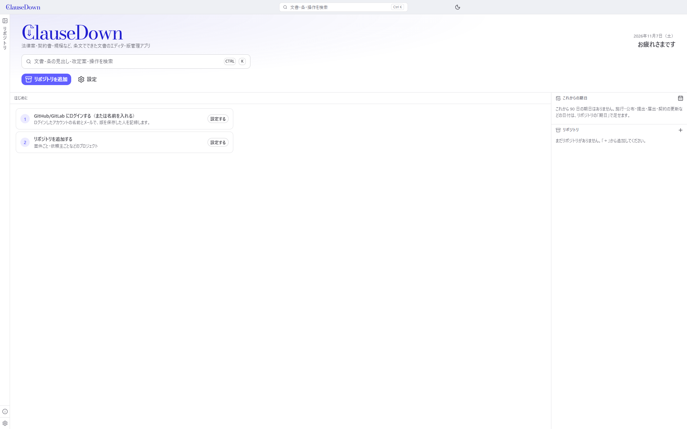

1. **GitHub/GitLab にログインする（または名前を入れる）**：版を保存した人として記録する名前を決めます（[17 章](#あなたの情報)）。
2. **リポジトリを追加する**：文書を入れるリポジトリを作るか、登録します（[3 章](#3-リポジトリを用意する)）。まず試すなら、設定の「Developer」で「サンプルリポジトリを追加」を押します。

### トップページ

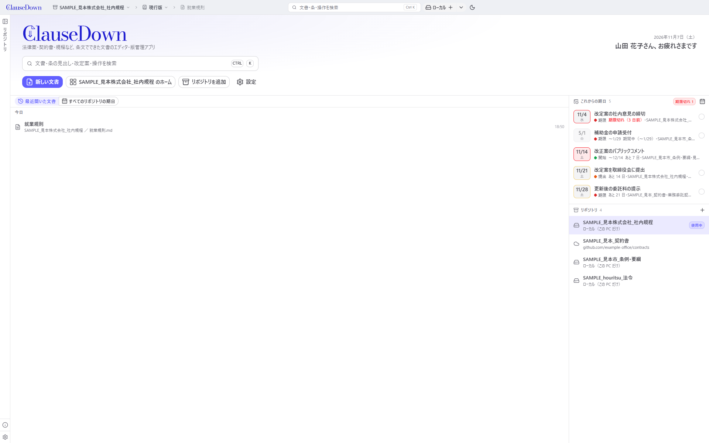

画面は次の 3 つの部分でできています。

- **タイトルバー（いちばん上の帯）**：左から順に、ロゴ（押すとトップページに戻る）、今のリポジトリ、作業中の案（現行版か改定案か）、開いている文書、検索の欄、同期の状態、ライトモードとダークモードの切り替えが並びます。
- **左のペイン**：登録しているリポジトリの一覧です。起動したときは左端の細い帯に畳んであり、帯を押すと開きます。名前を押すと、そのリポジトリに切り替わります。いちばん下に「このソフトについて」と「設定」があります。
- **右の大きな部分**：選んだ画面の中身です。

タイトルバーのリポジトリ・作業中の案・文書は、今いる場所を表します。

- リポジトリ名か作業中の案を押すと開くメニューから「リポジトリホーム」を選ぶと、リポジトリホームに移ります。
- 文書の名前はリポジトリホームや設定を開いている間も、直前に開いていた文書を薄く表示します。押すと、その文書を前と同じタブ（編集・改定履歴など）で開き直します。

トップページの下半分は左に「最近開いた文書」、右に「これからの期日」と「リポジトリ」の一覧を出します。確認を頼まれている改定案があるときは「あなたの確認待ち」も出します。「これからの期日」には登録しているすべてのリポジトリの期日のうち、期限を過ぎたものと 90 日先までのものを、期限を過ぎたものを先にして並べます。右端の丸を押すと、その期日を済みにできます。

左上の切り替えを「すべてのリポジトリの期日・有効期間」にすると、下半分がすべてのリポジトリをまとめたタイムラインになります。

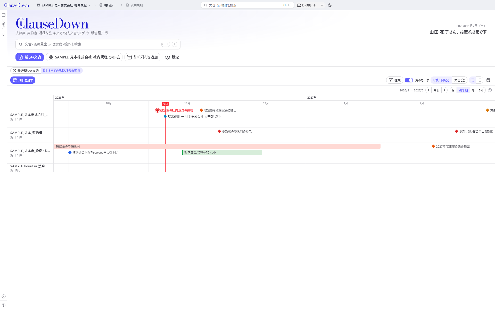

### 文書・条・改定案・操作を名前で探す

タイトルバーの検索の欄を押すか Ctrl＋K を押すと、検索の窓が開きます。編集の欄で書いている途中でも開きます。文字を入れると、文書・条・改定案・操作（「新しい文書」「設定」など）のうち名前が合うものを出します。選んで Enter を押すと、その文書や改定案を開きます。

条は、リポジトリのすべての文書の条の見出しと番号から探します。「慶弔」や「第10条」のように入れます。数字は全角でも半角でもかまいません。条を選ぶと、その文書を開いてその条に移ります。

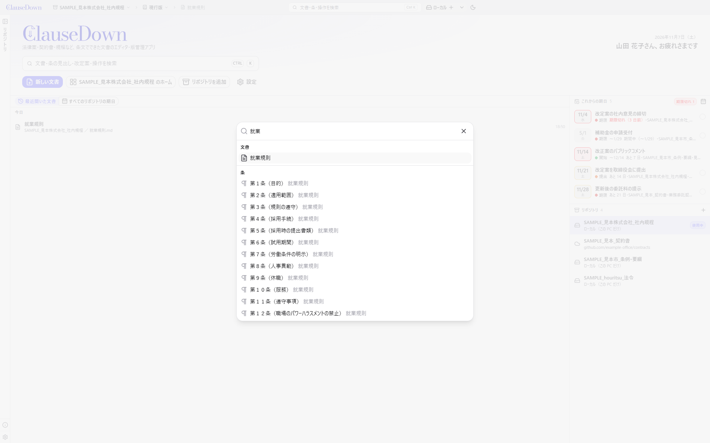

---

## 3. リポジトリを用意する

文書を作る前に、文書を入れるリポジトリを 1 つ用意します。トップページの「リポジトリを追加」か、左のペインの「＋」を押すと、設定の「リポジトリの一覧」が開きます。

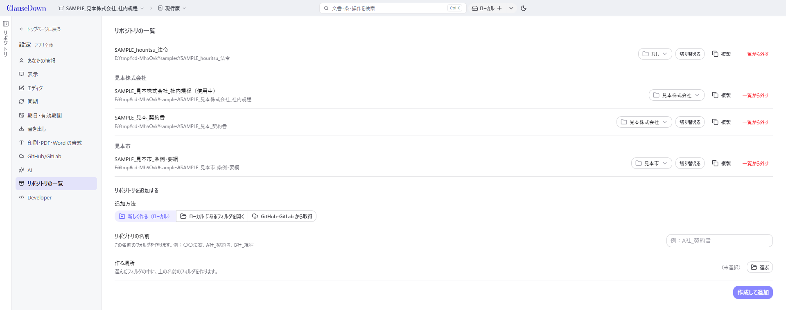

「追加方法」で次の 3 つから選びます。

- **新しく作る（ローカル）**：ローカル に新しいフォルダを作り、空のリポジトリにします。名前には「A社_契約書」「B社_規程」のように、依頼主と文書の種類がわかるものを付けます。
- **ローカル にあるフォルダを開く**：ほかの PC からコピーしたリポジトリや、以前に作ったリポジトリを登録します。Ctrl や Shift を押しながら選ぶと、まとめて登録できます。
- **GitHub・GitLab から取得**：リモートにあるリポジトリを、ローカル に取得して登録します。先に設定の「GitHub/GitLab」でログインしておきます（[14 章](#14-ほかの-pcほかの人と共有する)）。

「一覧から外す」を押すと、アプリの一覧から消えるだけで、フォルダと版は消えません。

### サンプルリポジトリで試す

設定の「Developer」で「サンプルリポジトリを追加」を押し、作る場所のフォルダを選ぶと、次の 4 つのリポジトリを作って一覧に加えます。どれも版の履歴・改定案・施行日・期日が付いています。

| リポジトリ | 中身 |
|---|---|
| SAMPLE_見本株式会社_社内規程 | 就業規則。確認を依頼中の改定案があります |
| SAMPLE_見本_契約書 | 業務委託契約書と著作権譲渡契約書（契約書式） |
| SAMPLE_見本市_条例・要綱 | 空き家の条例と補助金の交付要綱 |
| SAMPLE_houritsu_法令 | houritsu の形式の法令 3 件。追加すると変換するかを聞かれます（[15 章](#15-houritsu-の法令を取り込む書き出す)） |

### リポジトリを複製する

一覧の「複製」を押すと、そのリポジトリを版の履歴ごと別のフォルダにコピーし、一覧に加えます。前の年の規程類をもとに、別の依頼主のリポジトリを始めるときに使います。

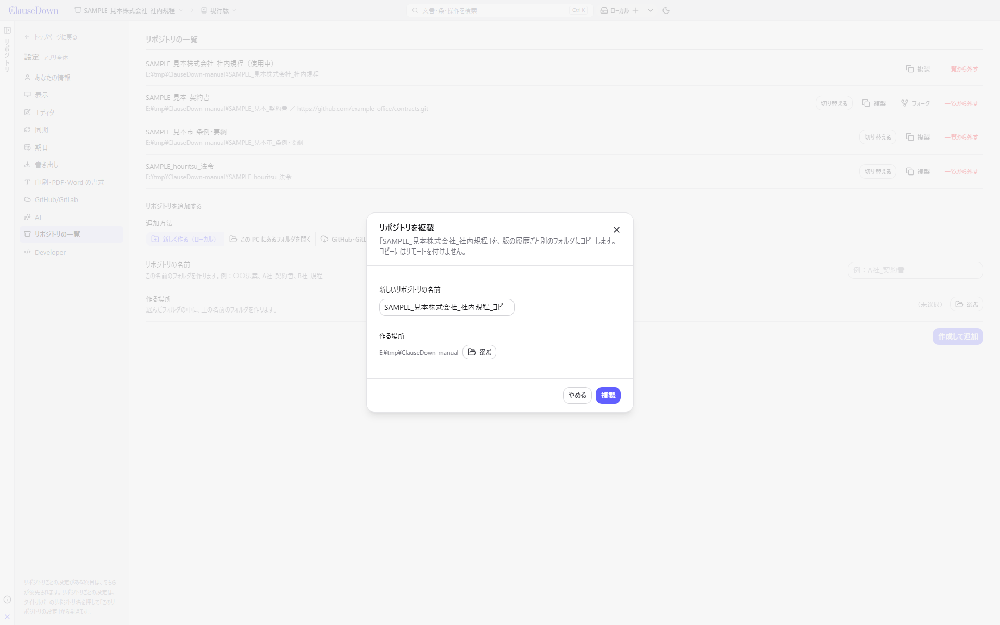

コピーにはリモートを付けません。元のリポジトリとは別のものになり、片方を変えてももう片方は変わりません。

### リポジトリをフォークする

リモートが GitHub か GitLab のリポジトリには「フォーク」のボタンが出ます。押すと、GitHub・GitLab のあなたのアカウントに、そのリポジトリのコピー（フォーク）を作ります。そして、ローカル のリポジトリの送信先をフォークに切り替えます。

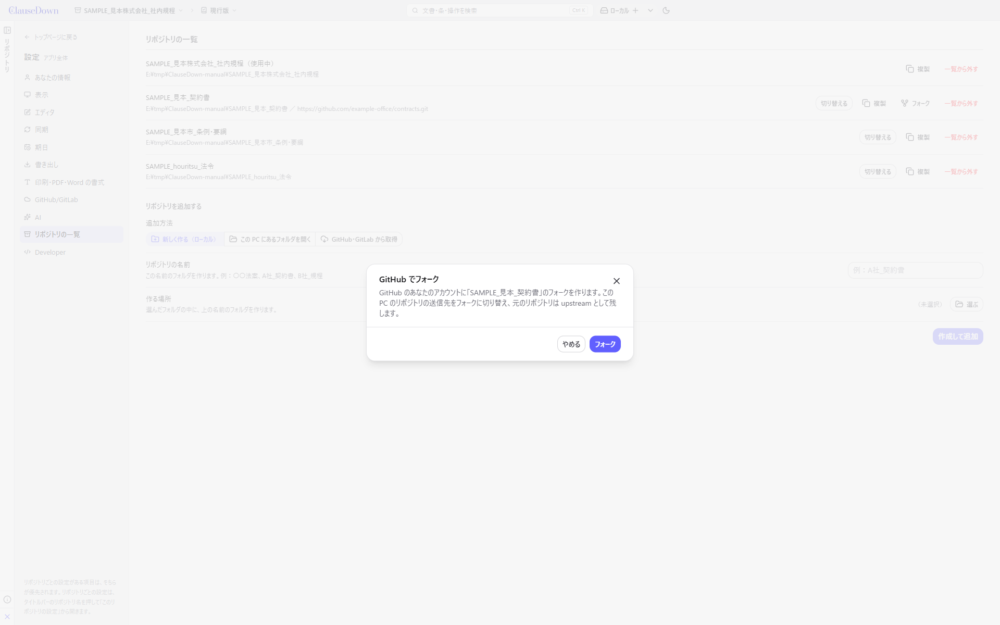

ほかの人が公開している雛形のリポジトリを取得したものの、元のリポジトリに送信する権限が無いときに使います。元のリポジトリは「upstream」という名前で残します。複製とは違い、フォークは GitHub・GitLab の上でも元のリポジトリとのつながりが記録されます。

### リポジトリを切り替える

タイトルバーのリポジトリ名を押すと、登録しているリポジトリの一覧が開きます。左のペインの名前を押しても切り替えられます。

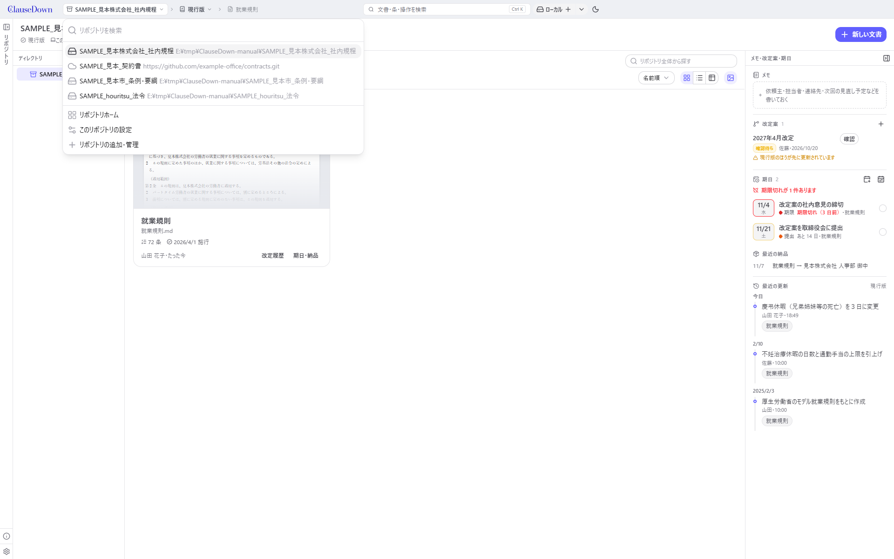

---

## 4. リポジトリホームで文書と改定案を見渡す

リポジトリを選ぶと、リポジトリホームが開きます。リポジトリの文書・改定案・期日・有効期間・納品をまとめて見る画面です。文書はディレクトリごとに、Windows のエクスプローラーと同じようにたどれます。

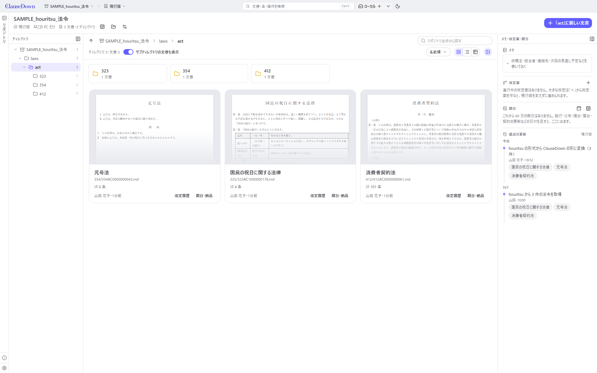

- **上の行**：リポジトリ名の下に、作業中の案、リモートの有無（「ローカル だけ」）、文書とディレクトリの数を出します。その右のボタンで、リポジトリのフォルダとリポジトリの設定を開きます。右上の「期日」「課題」で、期日の画面と課題の画面を開きます。「課題」のボタンには未完了の課題の数が付きます。右端の「新しい文書」は今開いているディレクトリに文書を作ります。
- **左のディレクトリ**：リポジトリのディレクトリを階層で出します。名前を押すとそのディレクトリを開き、左の矢印で下の階層を開閉します。右の数字はその下にある文書の数です。
- **中央**：今開いているディレクトリの中身です。
- **右のペイン**：上から順に、メモ（依頼主・担当者・次回の見直し予定などを書いておく欄）、改定案、期日、最近の更新を出します。改定案には確認の状態（確認待ち・承認済み・確認依頼なし）を付けます。

左右のペインは境目をドラッグして幅を変えられます。ペインの右上のボタンで畳むこともできます。

### ディレクトリをたどる

中央のいちばん上に、今いる場所を「SAMPLE_houritsu_法令 › laws › act」のように出します。名前を押すとその階層に戻り、左の上向きの矢印で 1 つ上の階層に戻ります。

中央には先にディレクトリを、そのあとに文書を並べます。ディレクトリを押すと、その中に入ります。「サブディレクトリの文書も表示」をオンにすると、下の階層にある文書もまとめて並べます。深い階層の文書を、1 つずつ開かずに見渡すときに使います。

右上の検索の欄に文字を入れると、今いるディレクトリにかかわらず、リポジトリ全体から名前とパスが合う文書とディレクトリを探します。

### 表示を切り替える

右上のボタンで、文書の並べ方を 3 つから選びます。

| 表示 | 中身 |
|---|---|
| カード | 文書ごとに、1 ページ目の縮小画像・条の数・施行中の版の施行日・最後に保存した人と日付を出します。画像のボタンで縮小画像を消せます |
| 一覧 | 文書名とファイル名だけを並べます。多くの文書を見渡すときに使います |
| 詳細 | 名前・条の数・施行中の版・次の施行日・最終更新・状態を表で出します。列の見出しを押すと、その列で並べ替えます。もう一度押すと逆の順になります |

カードと一覧では、右上の欄で並べ方（名前順・条の多い順・施行日が新しい順・次の施行日が近い順・更新が新しい順）を選びます。選んだ表示と並べ方は、次に開いたときも使います。

文書名を押すと編集画面を、カードの「改定履歴」「期日・有効期間・納品」を押すとその画面を開きます。

### 右クリックとドラッグで操作する

文書を右クリックすると、次の操作を選べます。

- 開く・改定履歴・期日・有効期間・納品
- コピー・別のディレクトリへ移動・他のリポジトリにコピー
- エクスプローラーで表示
- 削除

ディレクトリを右クリックすると「開く」「この中に新しい文書」を、何もない所を右クリックすると「新しい文書」を選べます。

文書をディレクトリ（中央のディレクトリ、左のディレクトリ、いちばん上の今いる場所の名前）にドラッグすると、そのディレクトリに移動します。移動する前に確認の画面を出します。移動したことは版として記録します。

---

## 5. 文書を作る

リポジトリホームかトップページの「新しい文書」を押します。

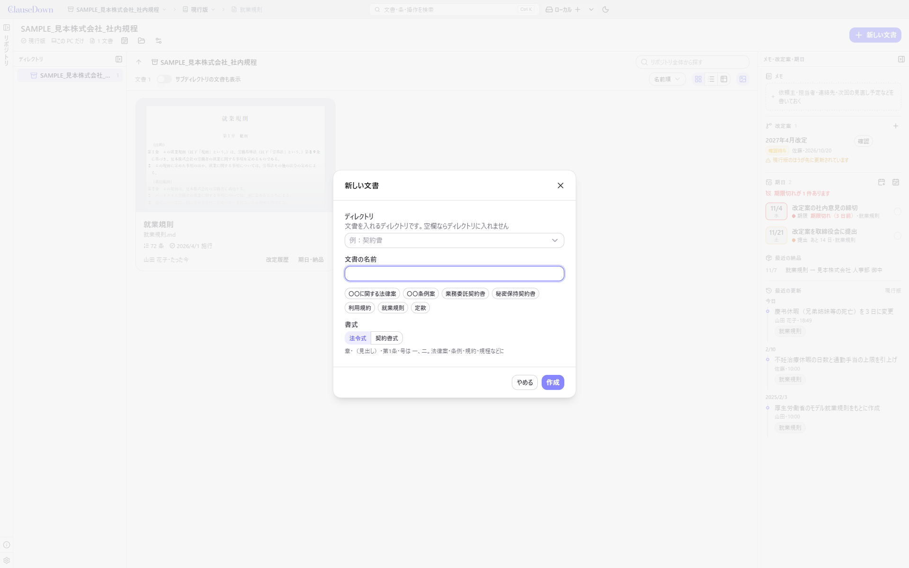

1. 「ディレクトリ」に、文書を入れるディレクトリの名前を入れます。空欄ならディレクトリに入れません。
2. 「文書の名前」を入れます。下の候補（「業務委託契約書」「就業規則」など）を押すと、その名前が入ります。
3. 「書式」を選びます。
   - **法令式**：章・（見出し）・第1条・号は「一、二」で並べます。法律案・条例・規約・規程に向きます。
   - **契約書式**：「第1条（目的）」のように条番号の右に見出しを置き、項番号を算用数字にします。
4. 「作成」を押すと、新しい文書が編集画面で開きます。

---

## 6. 条文を書く

文書名を押すと、編集画面が開きます。

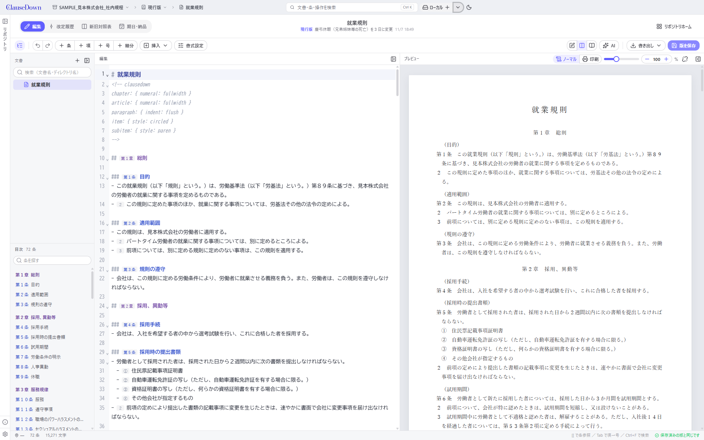

編集画面は左から順に次の 3 つの区画に分かれています。

- **文書と目次**：上はリポジトリの文書の一覧、下は開いている文書の目次（章と条）です。文書の一覧はリポジトリホームの左のディレクトリと同じ形で、ディレクトリを階層で開閉できます。ディレクトリの開閉はリポジトリホームと共通です。目次の条を押すと、その条に移ります。目次の上の欄に文字を入れると、条を見出しで絞り込めます。
- **編集**：条文を書く欄です。
- **プレビュー**：印刷したときの見た目です。見出しの右の切り替えで、「ノーマル」と「印刷」を選べます。
  - **ノーマル**：条文を 1 枚の長い紙に並べます。編集の欄でカーソルを動かすと、プレビューも同じ箇所に移ります。
  - **印刷**：PDF に書き出したときと同じ形で、ページに分けて表示します。改ページの位置、余白、ページ番号を確かめるときに使います。書くのをやめて 1 秒ほどたつと、表示を作り直します。

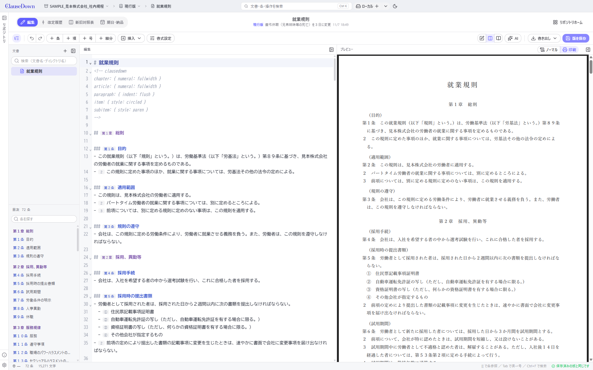

編集の欄の上で Ctrl＋ホイールを回すと、編集の欄の文字の大きさが変わります（設定の「エディタ」の文字サイズと同じもの）。プレビューの上で回すと、プレビューの倍率が 10% ずつ変わります。倍率はプレビューの見出しの右にあるスライダーと数値の欄でも変えられます。数値の欄には 50〜200 の値を 1% 単位で入れられます。その右の鎖のボタン（エディタと拡縮を同期する）をオンにすると、片方を拡大・縮小したときに、もう片方も同じ段数だけ拡大・縮小します。2 つの大きさをそろえるのではなく、それぞれの今の大きさから、編集の欄は 1px、プレビューは 10% を 1 段として動かします。どちらの大きさも次に起動したときまで残ります。

画面の上には「編集」「改定履歴」「新旧対照表」「期日・有効期間・納品」のタブがあり、その下に編集の道具が並びます。タブの行の右端の「リポジトリホーム」を押すと、リポジトリホームに移ります。確認を頼まれている改定案があれば、ボタンに「確認待ち」の件数が付きます。その左の「課題」を押すと、課題の画面に移ります（未完了の課題の数が付きます）。画面の幅が狭いときは、「挿入」「書式設定」「書き出し」「変更を取り消す」のボタンを文字なしのアイコンで表示します。アイコンにマウスを重ねると名前が出ます。

### 条・項・号の書き方

編集の欄では行の先頭の記号で条文の組み立てを表します。**自動採番のため番号は書きません**。アプリが番号を計算し、行の先頭に薄く表示します（例：第1条・2・一）。

| 書くもの | 書き方 | 表示される番号の例 |
|---|---|---|
| 文書の題名 | `# 就業規則` | — |
| 章 | `## 総則` | 第一章 |
| 条 | `### 目的` | 第1条（目的） |
| 項 | `- この規則は、…` | 2、3…（第1項には番号を付けません） |
| 号 | 項の下に 2 文字下げて `- 正社員` | 一、二… |
| 号の細分 | 号の下にさらに 2 文字下げて `- 有期` | イ、ロ… |

条を 1 つ足したり消したりすると、後ろの条の番号はアプリが振り直します。条文の中で別の条を指すときは、次の「条参照」を使うと、番号が変わっても参照先が番号を追いかけます。

番号を決まった値にしたいときは、条の見出しの後ろに `{n=10}` と書くと第10条に、`{n=10 b=2}` と書くと第10条の2になります。号は行の先頭に `{n=3}` や `{b=2}`（直前の号の枝番号。一の二など）と書きます。既存の法令を取り込んだときのように、番号が 1 から順に並ばない文書で使います。

### ボタンで条・項・号を足す

ツールバーの「＋条」「＋項」「＋号」「＋細分」を押すと、カーソルのある位置の後ろに、その単位の行を足します。Tab キーで項を号に、号を細分に下げ、Shift＋Tab で上げます。

「挿入」からは、このマニュアルに出てくる書き方をすべて入れられます。章、条（枝番号・削除・番号の指定）、項・号（細分・番号の指定・枝番号）、前文、附則、後文・署名欄、別表、表（セルの結合）、図（流れ図など）、数式、画像、条参照、改ページ、書式です。

画像は、画面のスクリーンショットなどをコピーして編集の欄に貼り付けるか、画像ファイルを編集の欄にドロップしても入れられます。画像は文書と同じディレクトリの `images/文書名/` に保存し、文書には `` の行が入ります。版を保存すると画像も一緒に記録され、PDF・Word にも入ります。使えるのは PNG・JPEG・GIF・WebP で、20MB までです。

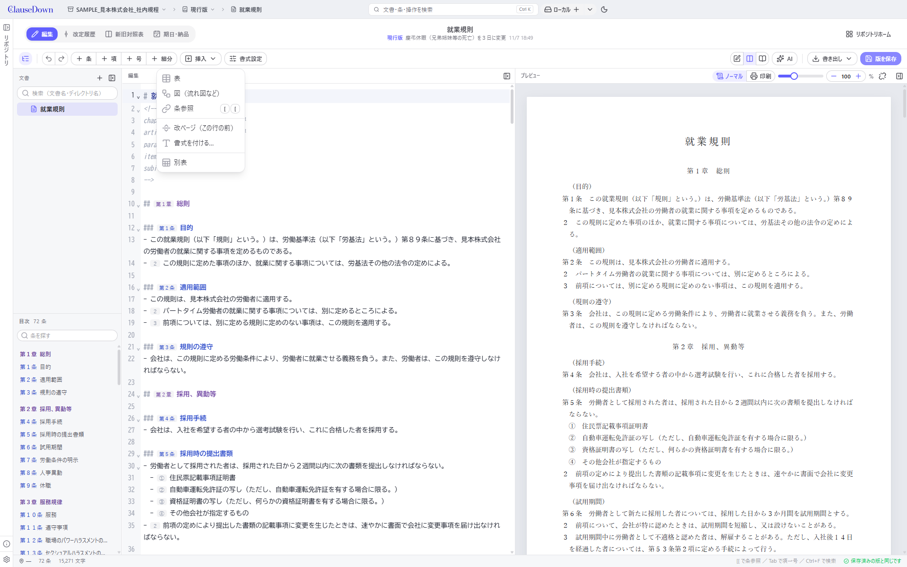

### 条参照：ほかの条を番号で指す

条文の中で `[[` と入力すると、条の候補が出ます。条を選ぶと `[[適用範囲]]` のような参照が入り、プレビューや印刷では「第2条」のように番号に置き換わります。条を足して番号がずれても、参照は正しい番号を指し続けます。

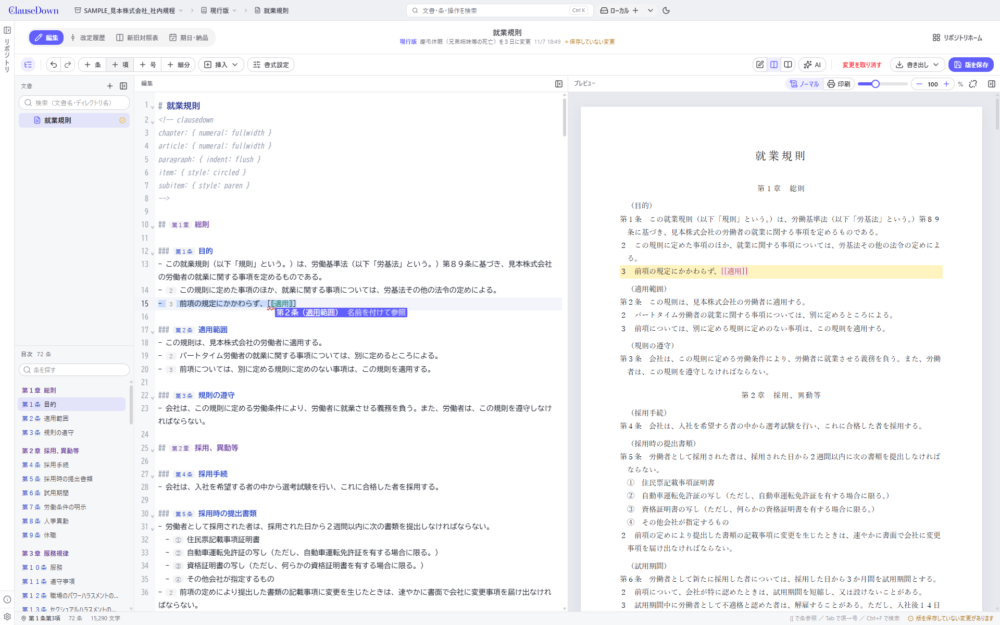

次の画像は第1条に「＋項」で第3項を足し、第2条への参照を書いたところです。プレビューでは参照が「第2条」になっています。タイトルの下に「＋保存していない変更」と出ているのは、まだ版を保存していないためです。

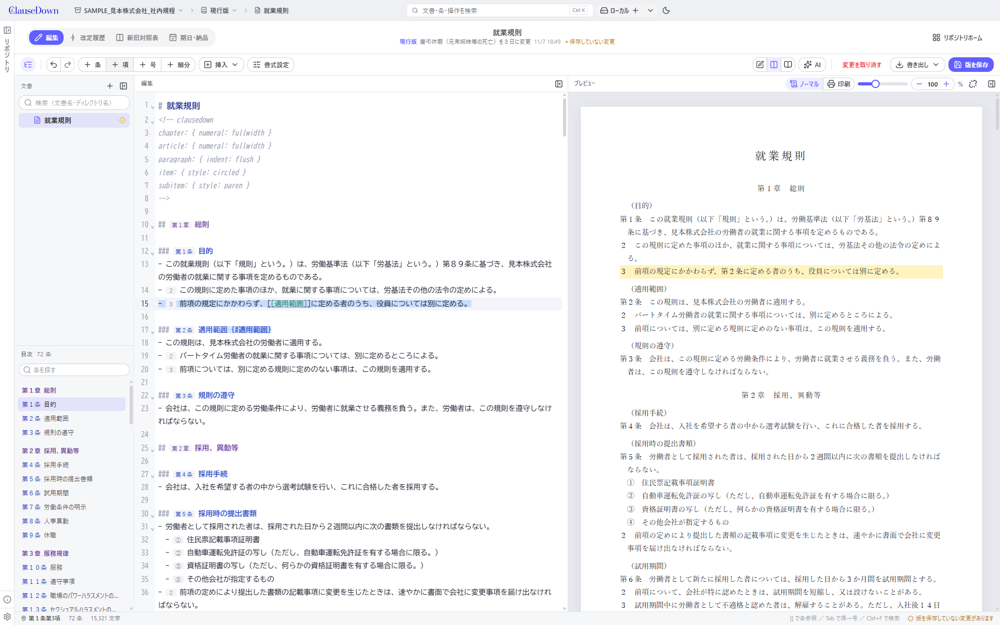

参照先の条が見つからないときや、同じ名前の条が 2 つあるときは、その箇所に下線を引きます。

条参照は条見出しでも動作します。たとえば `### [[目的]]の特例` と書くと、「（第1条の特例）」と表示されます。

### 定義語のチェック

「（以下「甲」という。）」「「消費者」とは、」のように定義した語について、次のときに赤い波線を引きます。波線にマウスを重ねると理由が出ます。

- 同じ語を 2 回定義している
- 「以下」で定義した語を、定義より前で使っている（「とは」で定義した語は文書全体に影響するので、前で使っても指摘しません）
- 定義したのに一度も使っていない

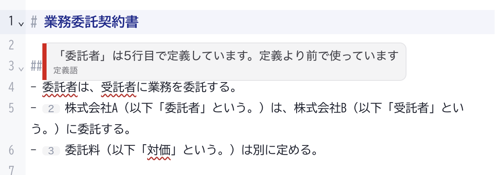

この例では、第1項の「委託者」「受託者」が第2項の定義より前にあり、第3項で定義した「対価」はどこでも使っていません。

「以下この項において」のように範囲を限った定義は、範囲を文字から判断できないので対象にしません。附則はそれぞれ別の範囲として扱います。「就業規則」の中の「規則」のように、ほかの語の一部になっているものは使ったとみなしません。題名と見出しの中の語は、定義より前にあっても指摘しません。

### 校閲

文章の書き方で気になる箇所に、黄色の波線を引きます。
波線にマウスを重ねると、理由と「校閲：用字」のような種類が出ます。

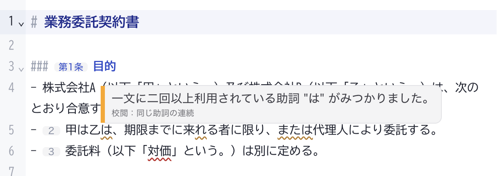

| 種類 | 例 |
|---|---|
| 同じ助詞の連続 | 「甲は乙は」のように「は」などが一文に重なっている。条文は一文が長いので、「に」「が」「の」などの重なりは指摘しません |
| ら抜き言葉 | 「来れる」「見れる」 |
| 二重否定 | 「しないことはない」 |
| 全角・半角の混在 | 同じ文書で英字の全角と半角が混ざっている |
| 用字 | 公用文・法令の書き方に合わない字。「または」→「又は」、「および」→「及び」、「但し」→「ただし」、「出来る」→「できる」など |
| 法令の用字 | 内閣法制局「法令における漢字使用等について」（平成22年）に従った言い換え。「捺印」→「押印」、「虞」→「おそれ」、「斡旋」「あっ旋」→「あっせん」、「繋留」→「係留」、「従って、」→「したがって、」など |
| 法令の送り仮名 | 同じ決定による送り仮名。「取り消しの」→「取消しの」、「支払いを」→「支払を」、「手続き」→「手続」など。名詞として使っているときだけ指摘し、「これを取り消し、」のような動詞は指摘しません |
| よくある誤用 | 「規定を適応する」（→適用）、「似て異なるもの」（→似て非なるもの）など |
| 半角カナ | 「ｶﾀｶﾅ」のような半角のカタカナ |
| 読点の多い文 | 一文に読点（、）が 7 つ以上ある。条文は一文が長いので、上限を多めにしています |
| 冗長な表現（初めは切ってあります） | 「請求を行う」（→請求する）、「することができる」など。条文では普通の言い回しも指摘するので、必要なときだけ入れます |

設定の「エディタ」の「校閲（黄色の波線）を表示する」で、校閲全体を表示しないようにできます。その下に規則ごとのスイッチがあり、使う規則だけを選べます。「同じ助詞の連続」では、重なっても指摘しない助詞を変えられます（初めは「に」「が」「と」「の」「を」などを許しています）。定義語の誤り（赤い波線）は、これらの設定に関係なく表示します。条参照・設定のコメント・`{…}` の指定・コードの囲みの中は校閲しません。

**指摘の件数と移動**：編集画面の下の帯に、赤い波線（誤り）と黄色の波線（注意）の件数が出ます。件数を押すと、カーソルの後ろにある次の指摘へ移り、帯の右に理由が出ます。押すたびに次へ進み、最後まで行くと先頭に戻ります。件数を右クリックするか Ctrl＋Shift＋M を押すと、編集の欄の下に指摘の一覧が開き、行を押すとそこへ移ります。F8・Shift＋F8 でも次・前の指摘へ移れます。

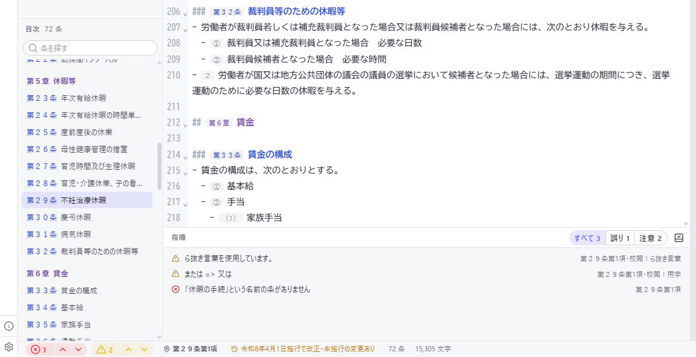

### 書式設定：章や項の番号の付け方を変える

「書式設定」を押すと、番号の付け方を選ぶ欄が開きます。章番号（第一章・第1章など）、条見出しの位置（前の行・条番号の右）、項番号の書き方、号と細分の記号などを選べます。「法令式」「契約書式」を押すと、まとめて切り替わります。ここで選んだ内容はその文書だけに適用されます。

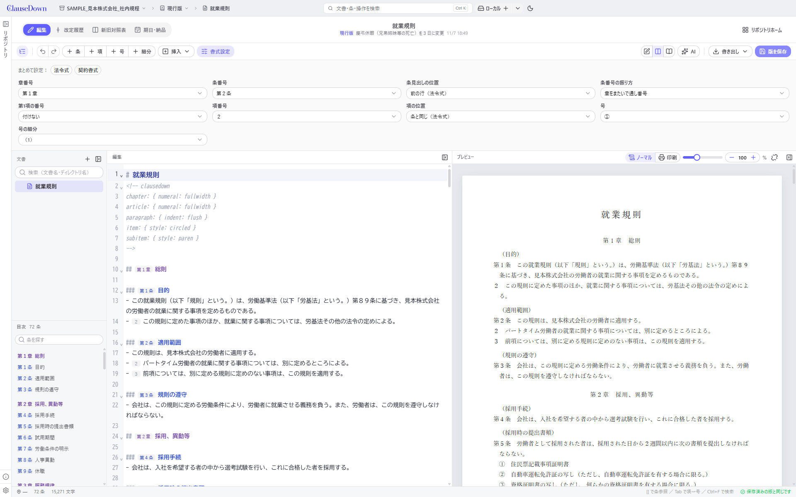

### 検索と置換

編集の欄で Ctrl＋F を押すと、検索の欄が開きます。見つかった語は編集の欄に色を付け、その語を含む条をプレビューでも色付きで示します。欄の左の「＞」を押すと、置換の欄が開きます。

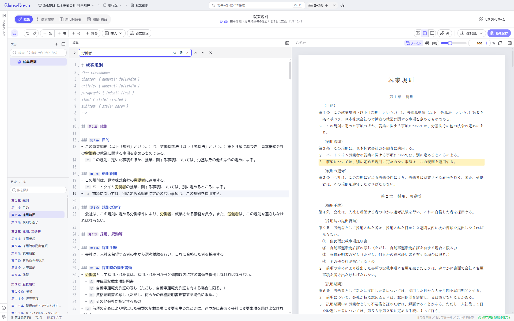

### 改ページ・文字の大きさ・寄せを指定する

Markdown の書き方では表せない指定は、波かっこ `{…}` で書きます。Pandoc と同じ書き方です。手で書くほか、画面から入れることもできます。

- 編集の欄で文字や行を選んで右クリックし、「選んだ範囲に書式を付ける…」を押します。文字の大きさ・フォント・寄せ・行の高さ・表の列の幅・改ページを選ぶ画面が開き、見本で見た目を確かめてから「囲む」を押します。
  - 1 行の一部を選んだときは、「選んだ文字だけ」か「行ごと」かを選べます。行ごとにすると、条・項・表などの単位で効果範囲を
  - 何も選ばずに開くと、カーソルのある行に付けます。
- 「挿入」の「書式を付ける…」でも同じ画面が開きます。「改ページ（この行の前）」はカーソルのある行の前に改ページを入れます。
- 右クリックのメニューには切り取り・コピー・貼り付け・条参照もあります。

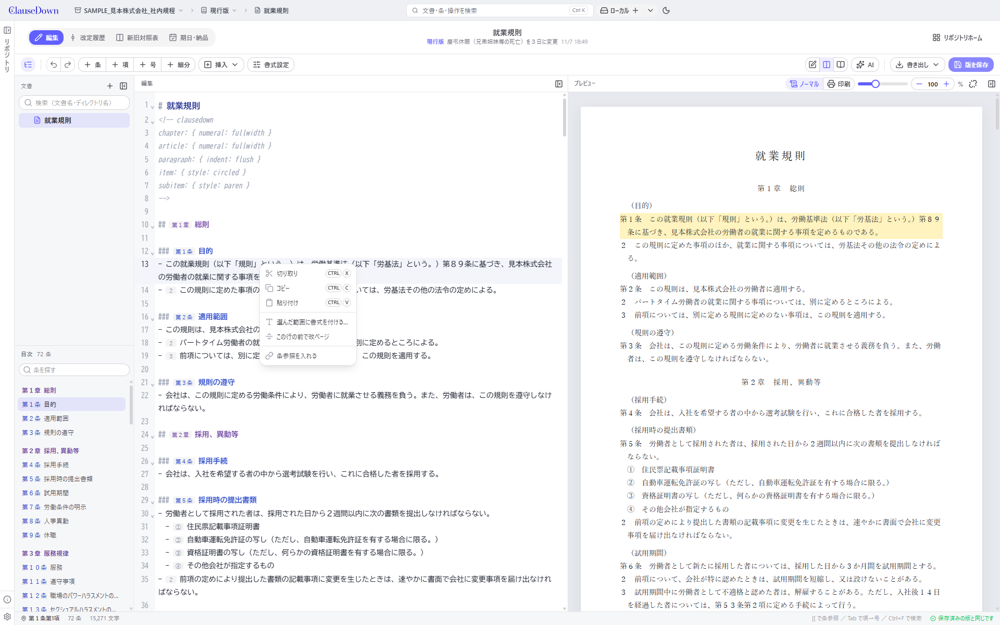

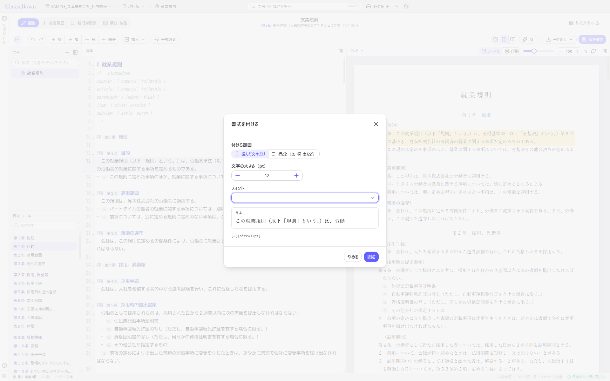

| 書き方 | 効果範囲 |
|---|---|
| 文の中の `[選択文書]{size=12pt}` | かっこで囲んだ文字に効果 |
| `::: {size=9pt}` の行から `:::` の行まで | 囲んだ条・項・号・表・後文の行に効果 |
| `{right}` だけの行 | 次の行の要素（条・項・号・表など）に効果 |
| `{break}` だけの行 | 次の行の要素の前で改ページします |

指定できる項目は次のとおりです。いくつか並べるときは、空白で区切ります（例：`{size=9pt right}`）。

| 項目 | 例 | 意味 |
|---|---|---|
| `size` | `size=9pt` | 文字の大きさ。pt・mm・% などで書きます。数字だけなら pt です |
| `font` | `font="BIZ UDゴシック"` | フォント。名前に空白があるときは `"` で囲みます |
| `left`・`center`・`right` | `right` | 寄せ |
| `line` | `line=1.4` | 行の高さ（文字の大きさの何倍か） |
| `cols` | `cols=25,75` | 表の列の幅。数字だけなら % です |
| `break` | `break` | その前で改ページします |

`font-size`・`font-family`・`text-align`・`line-height` のような CSS の名前でも書けます。

次の例では表の文字を本文より小さくし、列の幅を 1 対 3 にしています。

```md
- 委託料は、次の表のとおりとする。
  ::: {size=8.5pt cols=25,75}
  | 区分 | 内容 |
  |---|---|
  | 基本料 | 月額300,000円（消費税別） |
  :::
```
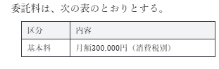

指定はプレビュー・PDF・Word のどれにも反映されます。
新旧対照表では指定を除いて比べるので、指定だけを変えた版は新旧対照表には変更として出ません。

### 表のセルを結合する

表のセルに `>` だけを書くと右隣のセルと、`^` だけを書くと上のセルと結合します。VS Code の拡張機能 Markdown Preview Enhanced の拡張テーブル記法と同じ書き方です。

```md
| 区分 | > | 内容 |
|---|---|---|
| 正社員 | 月給 | 期間の定めなし |
| ^ | 時給 | 試用期間中 |
```
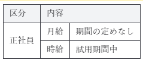
この例では、見出しの「内容」が 2 列分に広がり、「正社員」が 2 行分に広がります。

- 文字を残すのは、結合したまとまりの右上のセルです。
- 見出しの行と本文の行をまたいで結合はできません。
- 結合はプレビュー・PDF・Word のどれにも反映されます。新旧対照表では結合した分のセルを除いて比べます。
- houritsu の法令を取り込むときは、結合したセルをこの書き方で残します。

### 数式を書く

補助金の額の算定式や按分の式などは、LaTeX 記法で表現可能です、プレビュー・印刷・PDF で数式として表示されます。「挿入」の「数式」からも挿入可能です。

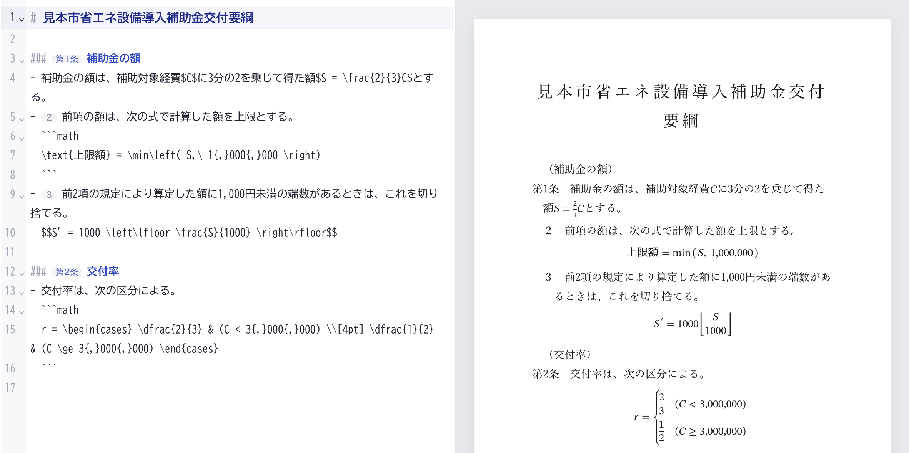

| 書き方 | 表示 |
|---|---|
| 文の中の `$S = \frac{2}{3}C$` | 文の中に数式を入れる |
| 1 行だけの `$$S = \frac{2}{3}C$$` | その行を独立した数式にして、中央に置く |
| ` ```math ` の囲み | 独立した数式。長い式や場合分け（`\begin{cases} … \end{cases}`）に |

- 数式の中の日本語は `\text{上限額}` のように `\text{}` で囲みます。
- 「US$1,000」のような金額の `$` は、数式とはみなしません。`$` と `$` の間に日本語があるときや、閉じる `$` の後ろに数字が続くときは、ふつうの文字のままです。`$` を文字として書きたいときは `\$` と書きます。
- 書き方に誤りがあると、編集の欄に黄色の波線が出て、プレビューには理由を表示します。
- Word に書き出すと、独立した数式は画像として入ります。文の中の数式は、数式の書き方の文字（`S = \frac{2}{3}C`）のまま挿入します。
- 数式は [Temml](https://temml.org/) で変換し、表示には OS の数式フォント（macOS は STIX Two Math、Windows は Cambria Math）を使用しあす。

### PDF・Word・Markdown に書き出す

「書き出し」から書き出す形式を選ぶと、保存先を選ぶ画面が開きます。

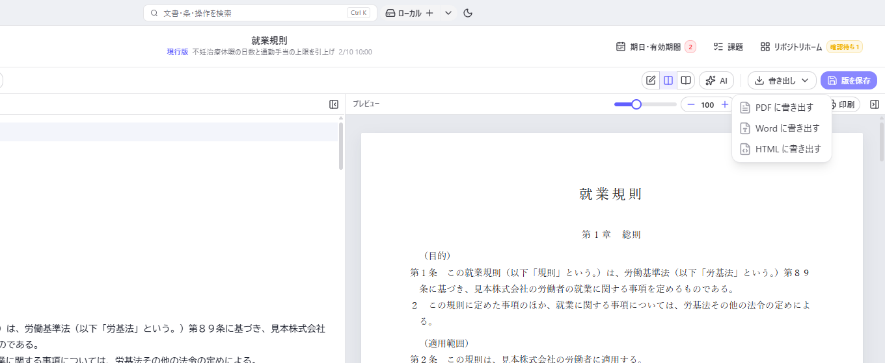

- **PDF に書き出す・Word に書き出す**：印刷したときの見た目で書き出します。フォント・文字の大きさ・余白などは、設定の「印刷・PDF・Word の書式」で決めます（[17 章](#17-設定)）。
- **Markdown（法令の形・houritsu）に書き出す**：条番号・項番号を本文に書き込んだ Markdown にします（[15 章](#15-houritsu-の法令を取り込む書き出す)）。

### 書いた内容の保存

編集の欄に書いた内容は、入力をやめて 0.5 秒ほどたつと、PC のファイルに自動で書き込まれます。ただし「版」としては記録されていません。後から見返せる記録を残すには、次の章の「版を保存」を押します。保存前の変更を捨てるには「変更を取り消す」を押します。

---

## 7. 版を保存する

区切りのよいところで、右上の「版を保存」を押すか、編集の欄で Ctrl＋S を押します。前の版から変わっていないときは、ボタンは押せず、Ctrl＋S では変わっていないことを知らせます。

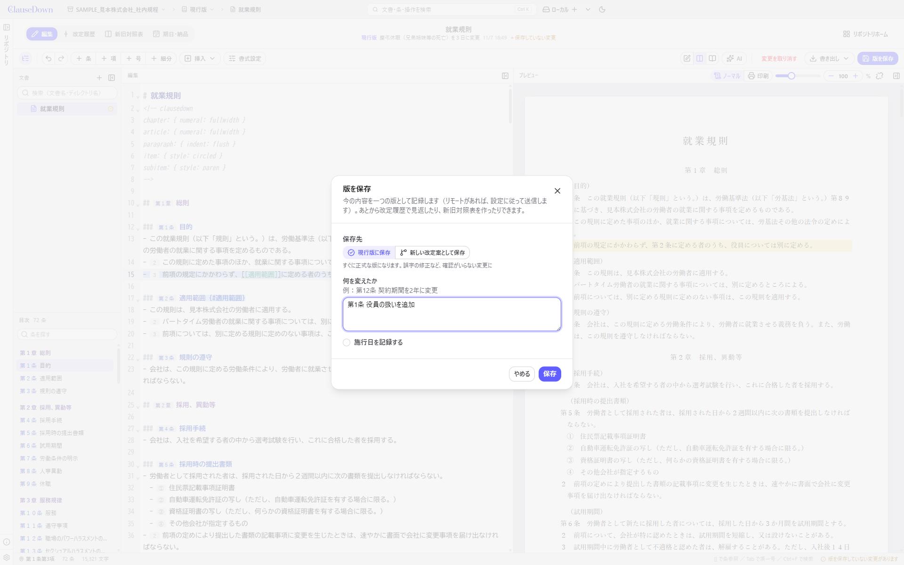

1. 「保存先」を選びます。
   - **現行版に保存**：すぐに正式な版になります。誤字の修正など、確認がいらない変更に使います。
   - **新しい改定案として保存**：今の変更を改定案に移して保存します。現行版は変わりません。ほかの人の確認を受けたい変更に使います（[10 章](#10-改定案で書き直し確認を受けて現行版に反映する)）。
2. 「何を変えたか」に、変更の内容を 1 行で書きます。例：「第12条 契約期間を2年に変更」。改定履歴の一覧にこの文が出るので、後で探しやすい書き方にします。
   - AI を設定していれば（[16 章](#16-ai-に確認や書き直しを頼む)）、欄の上に「AI で下書き」のボタンが出ます。押すと、前の版からの変更を AI が読んで、説明の文を欄に入れます。そのまま使わず、内容を確かめてから保存します。
3. その版から施行することが決まっていれば、「施行日を記録する」をオンにして日付を入れます。
4. 「保存」を押します。

リモートがあり、設定の「同期」で「版を保存したら送信する」をオンにしていれば、保存した版はそのままリモートに送信されます。

**現行版にまだない文書**（新しく作った文書や、リポジトリで最初に保存する文書）を保存するときは、「改定案として保存」が選ばれた状態で開き、改定案の名前には「（文書名）の作成」が入っています。書きかけの文書を区切りごとに保存し、完成して確認が済んだら「現行版に反映」します（[10 章](#10-改定案で書き直し確認を受けて現行版に反映する)）。そのあいだ現行版には入りません。すでに完成している内容なら、「現行版に保存」を選ぶと、そのまま正式な版になります。

---

## 8. 改定履歴で過去の版を見る

「改定履歴」のタブを押すと、文書の版の一覧が開きます。

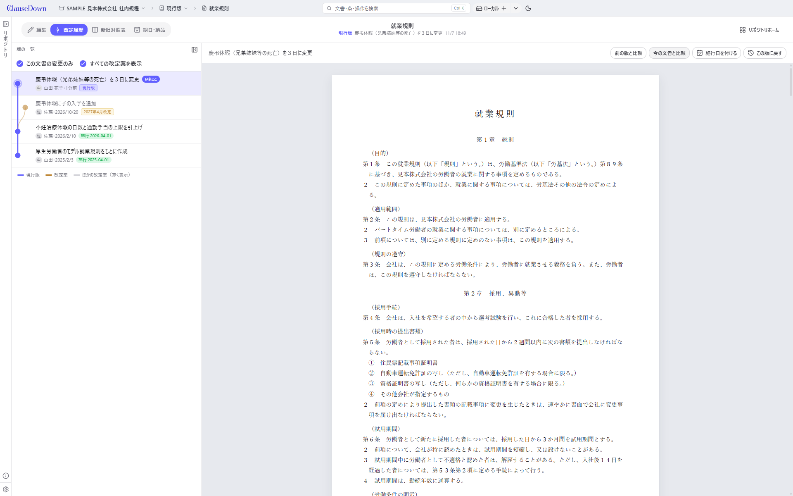

- 左の一覧は新しい版が上です。線の色で、現行版の版（青）と改定案の版（茶）を分けます。施行日を記録した版には「施行 2026-04-01」のような印が付きます。
- 「この文書の変更のみ」をオンにすると、この文書を変えた版だけを出します。「すべての改定案を表示」をオフにすると、改定案の版を隠します。
- 版を押すと、右にその版の条文を出します。右上のボタンで次の操作ができます。
  - **前の版と比較**・**今の文書と比較**：新旧対照表の画面で比べます。
  - **施行日を付ける**：その版を施行版にします（[11 章](#11-施行日を記録し納品する)）。
  - **この版に戻す**：文書の内容をその版のものに戻します。戻した内容は版を保存するまで「保存していない変更」として扱います。

---

## 9. 新旧対照表を作る

「新旧対照表」のタブを押すと、2 つの版を条ごとに並べた表を作ります。

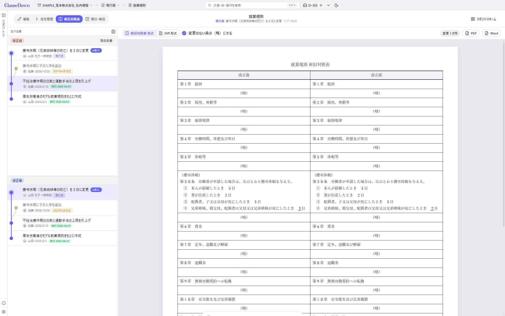

左の「比べる版」のペインは上下に分かれていて、上で改正前、下で改正後の版を選びます。どちらも改定履歴と同じこの文書の版の一覧で、版の説明・保存した人・日付・施行日の印を見ながら選べます。

1. 上の「改正前」の一覧で、比べる元の版を押します。何もない状態と比べるときは、見出しの右の「空の文書」を押します。
2. 下の「改正後」の一覧で、比べる先の版を押します。保存していない変更があるときは、一覧のいちばん上の「保存していない変更」を選ぶと、その変更も表に入ります。
3. 変わった文字には下線を引きます。「変更のない条は（略）にする」をオンにすると、変わっていない条を「（略）」にまとめます。
4. 右上に変更の箇所の数を出します。「PDF」「Word」を押すと、表示している形式のままそのファイルに書き出します。

画面を開いたときは、改正前に最新の施行版（改定案で作業中なら現行版、施行版がなければ一つ前の版）、改正後に今の文書を選んであります。改定履歴の「前の版と比較」「今の文書と比較」から開いたときは、その 2 つの版を選んであります。

ツールバーの切り替えで、表示の形式を選べます。

- **新旧対照表 形式**：改正後と改正前を左右に並べた表です。PDF・Word は横向きで書き出します。
- **Diff 形式**：文書の順に条文を並べ、削除した文字を赤の取り消し線、追加した文字を青の下線で示します。どこがどう変わったかを 1 つの文で追えます。PDF・Word は縦向きで、題名は「（文書名） 変更箇所」になります。

選んだ形式は次に開いたときも使います。

条を消して別の条を足したときは、内容に共通点が少なければ、1 つの条の変更ではなく「削除」と「新設」の 2 行に分けて出します。

---

## 10. 改定案で書き直し、確認を受けて現行版に反映する

複数の条をまとめて見直すときや、ほかの人の確認を受けてから正式にしたいときは、改定案で作業します。改定案で書いた内容は、現行版に反映するまで現行版を変えません。

### 改定案を作る

タイトルバーの作業中の案（「現行版 ▾」）を押すと、改定案の一覧が開きます。一覧にはまだ現行版に反映していない版の数・最後に保存した人・確認の状態を出します。

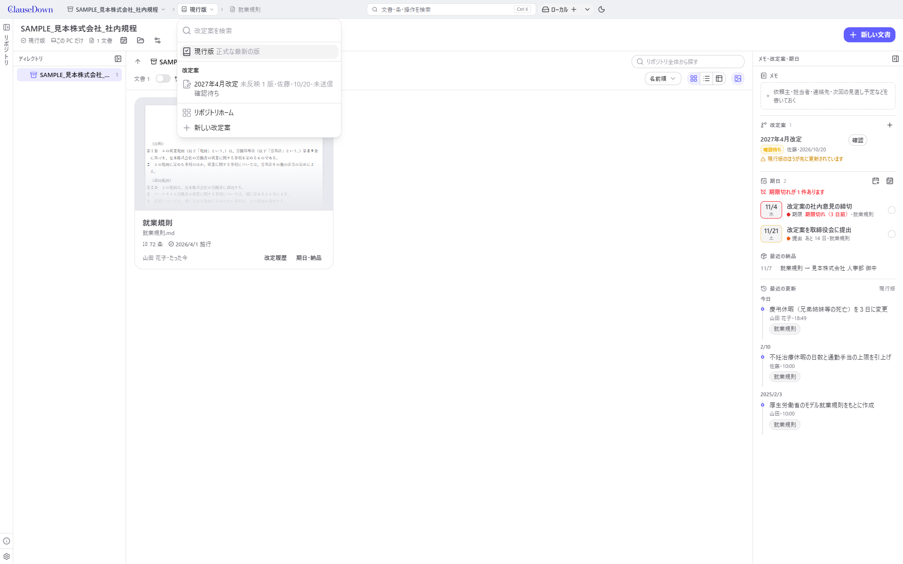

「新しい改定案」を押し、改定案の名前（例：「2027年4月改定」「第3条の見直し」）と、元にする版を選んで「作成して切り替え」を押します。版を保存するときに「新しい改定案として保存」を選んでも作れます。

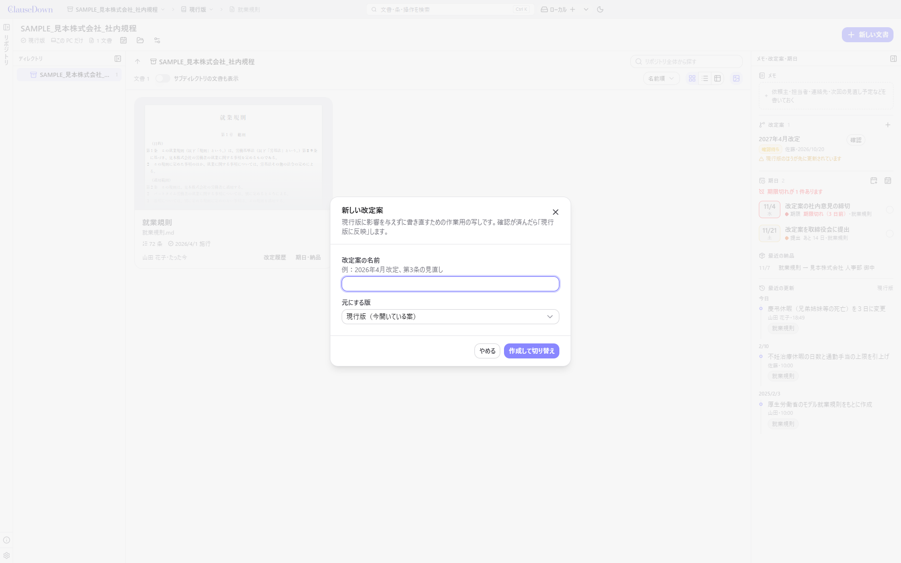

### 改定案で作業する

改定案に切り替えると、タイトルバーの案の名前が茶色になります。画面の上には「改定案『…』で作業中です。ここでの変更は現行版に影響しません。」と出ます。この状態で書いた内容と保存した版は、改定案の中だけに記録されます。

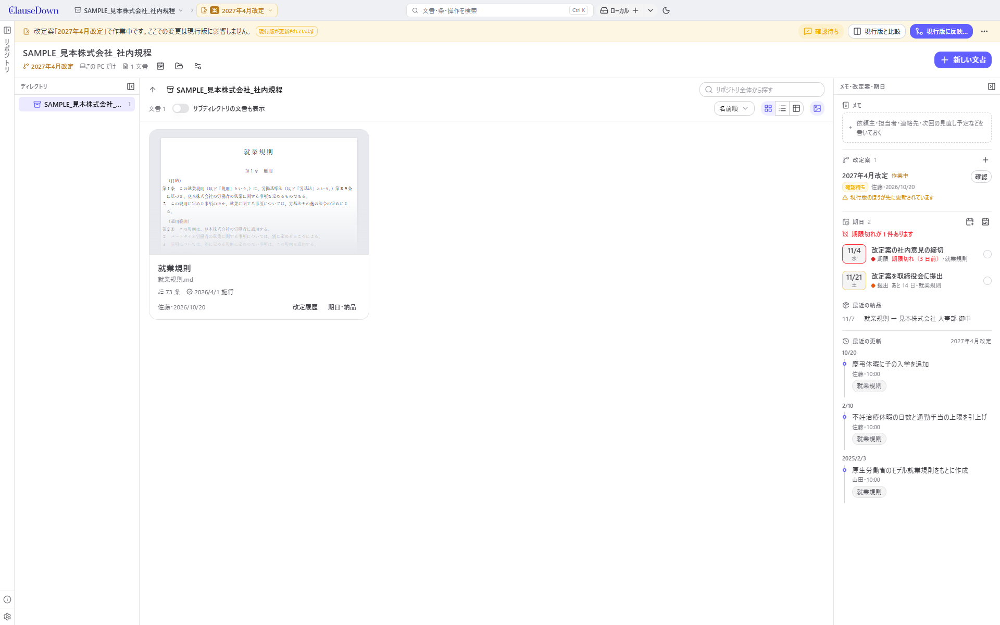

改定案を作った後に現行版が先に更新されると、「現行版が更新されています」と出ます。帯の「…」の「現行版の最新を取り込む」で、現行版の変更を改定案に取り込めます。

帯のボタンで次の操作をします。

- **確認依頼**（確認の状態によって「確認待ち」などと表示）：確認依頼の画面を開きます。
- **現行版と比較**：現行版との新旧対照表を開きます。
- **現行版に反映**：改定案の内容を現行版に入れます。

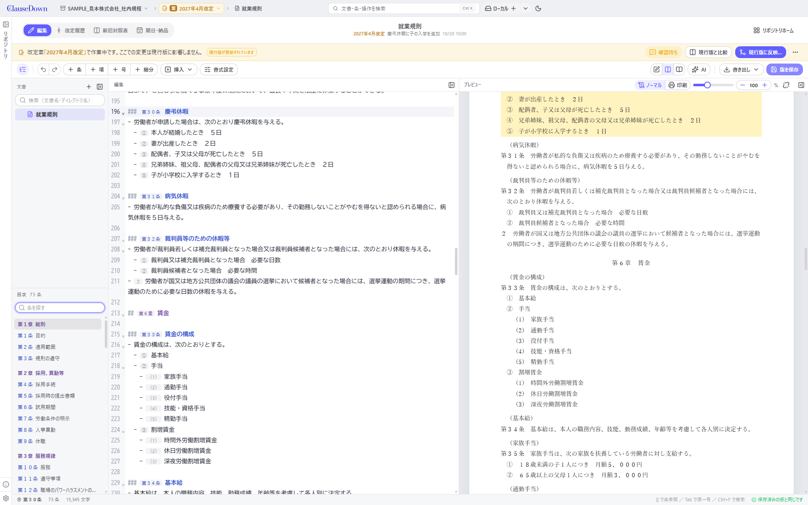

### 確認を依頼する・確認する

確認依頼の画面では左に依頼とやり取りの記録、右に現行版との新旧対照表を出します。

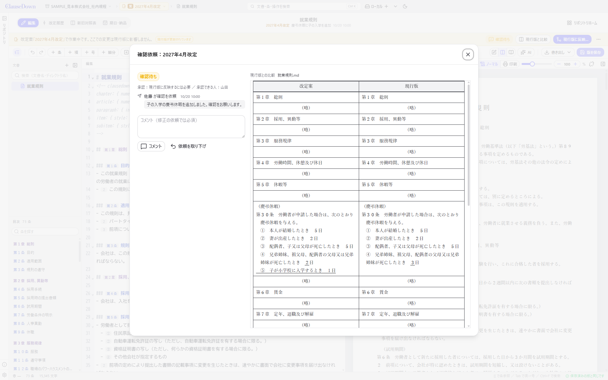

- 改定案を書いた人は「確認を依頼」を押して、確認を頼みます。
- 確認する人は内容を見て「承認」「修正を依頼」「コメント」のどれかを押します。「修正を依頼」にはコメントが必要です。
- 依頼した人は「依頼を取り下げ」で依頼をやめられます。

承認した後に改定案を変えると、承認はやり直しになります。リポジトリの設定で「承認できる人」を決めていないときは、依頼した人以外の誰でも承認でき、依頼した本人は承認できません。確認を頼まれた改定案は、トップページの「あなたの確認待ち」にも出ます。

### 現行版に反映する

「現行版に反映」を押すと、反映の画面が開きます。リポジトリの設定で承認を必須にしていて、まだ承認されていないときは、ここで止まり「確認依頼を開く」を案内します。

改定案を作った後に、現行版でも同じ文書が変わっていることがあります。この場合、別々の箇所の変更は両方を自動で残します。同じ箇所を両方が変えたところ（重なった箇所）だけを、1 か所ずつ選びます。次の画像では現行版で第30条の日数を変え、改定案で同じ条に号を足したため、1 か所が重なっています。

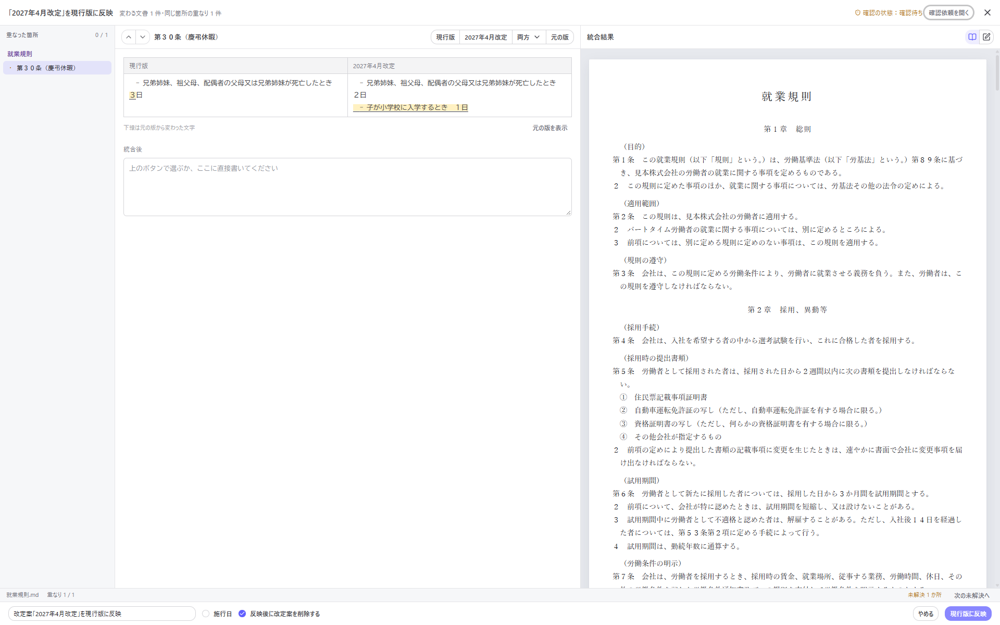

1. 左に重なった箇所の一覧を出します。中央の表で、現行版と改定案の文を見比べます。
2. 上のボタンで、使う方（「現行版」、改定案の名前、「両方」「元の版」）を選びます。「統合後」の欄に直接書いてもかまいません。右に統合後の文書を出します。
3. すべての箇所を選び終えたら、下の欄で版の説明・施行日・「反映後に改定案を削除する」を確かめ、「現行版に反映」を押します。

選んでいない箇所が残っているうちは反映できません。途中でやめても、文書は反映の前の状態のままです。

---

## 11. 施行日を記録し、納品する

### 施行日を付ける

施行日は版を保存するときに「施行日を記録する」で付けるほか、改定履歴で版を選んで「施行日を付ける」からも付けられます。同じ日付の施行日がすでにあれば、新しく選んだ版に置き換えます。

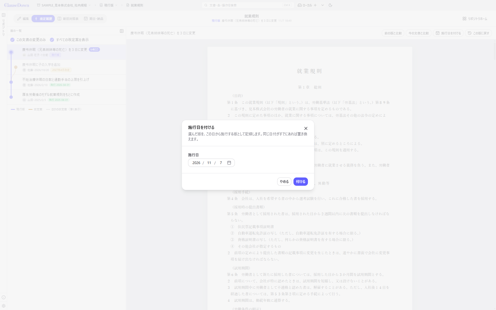

### 期日・有効期間・納品のタブ

文書の「期日・有効期間・納品」のタブでは、その文書の期日・施行版・納品の記録をまとめて見ます。

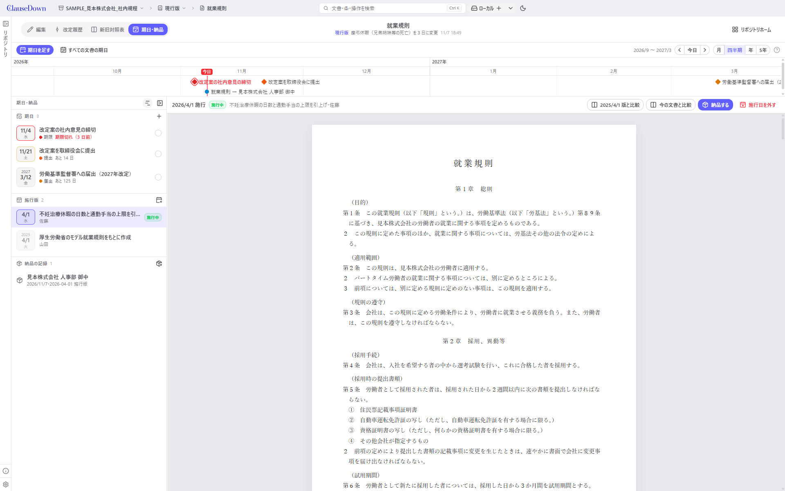

- 上はその文書だけのタイムラインです。「期日の追加」でこの文書の期日を記録します。施行版ごとの有効期間を、行の下の帯で表します。
- 左の一覧は期日・施行版・納品の記録の 3 つに分かれます。今日の時点で施行されている版には「施行中」と付けます。次の版がある施行版には、効力のある最後の日（「〇年〇月〇日 まで」）を出します。
- 施行版を選ぶと、右にその版の条文を出します。前の施行版や今の文書との新旧対照表を開くボタン、「納品する」「施行日を外す」のボタンがあります。「施行日を外す」は施行日の記録だけを外し、版そのものは消しません。

### 納品する

施行版を選んで「納品する」を押します。

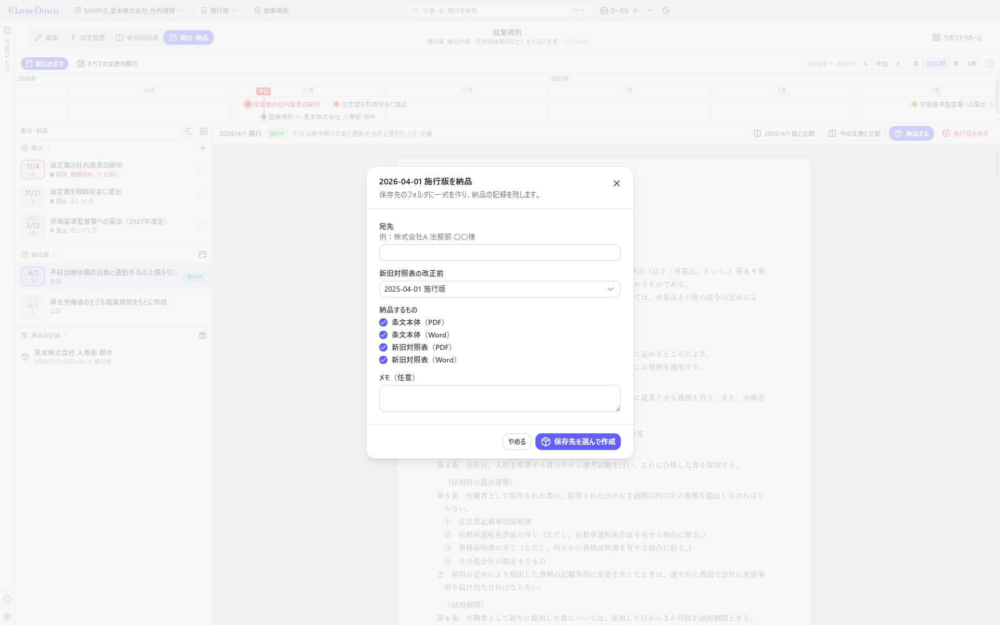

1. 「宛先」に、渡す相手を入れます。例：「見本株式会社 人事部 御中」。
2. 「新旧対照表の改正前」で、比べる元の施行版を選びます。
3. 「納品するもの」で、条文本体と新旧対照表を PDF と Word のどちらで入れるかを選びます。
4. 「保存先を選んで作成」を押し、保存先のフォルダを選びます。選んだフォルダの中に、日付・ディレクトリ名・文書の題名を付けたフォルダ（例：「20261107_就業規則_納品」）を作り、選んだファイルを入れます。

納品の記録は「納品の記録」の一覧に残ります。リモートが GitHub か GitLab なら、リモートのリリースにも納品物を載せられます。

---

## 12. 課題を管理する

「第12条の休日を見直す」のような、これからやることを課題として記録できます。課題には番号（#1、#2 …）が付き、版や改定案と結び付けて、どの版で解決したかを後から追えます。GitHub や GitLab の Issue と同じ仕組みで、リポジトリをリモートに接続していなくても使えます。

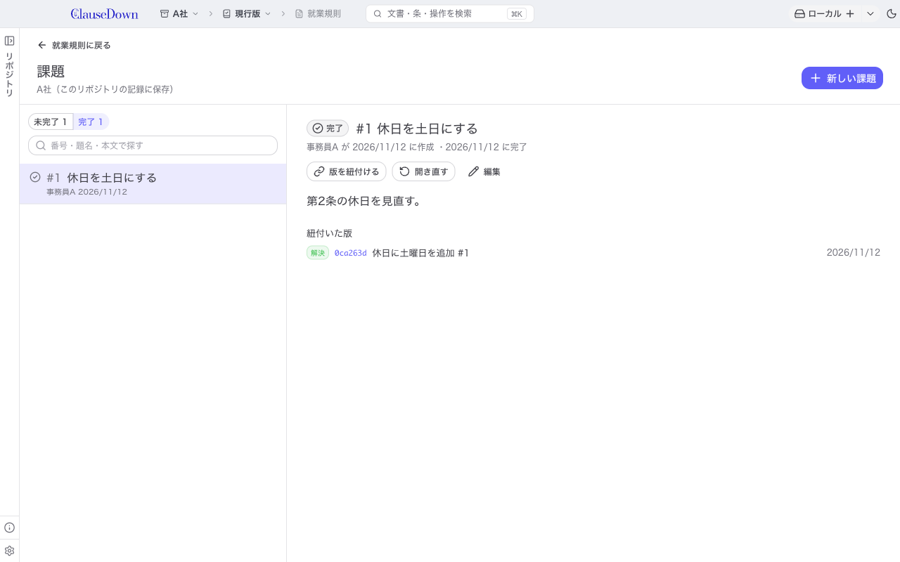

課題の画面は、リポジトリホームの右上の「課題」、文書を開いているときの右上の「課題」、改定案のメニューの「課題」、検索の欄（Ctrl＋K）の「課題」から開きます。ボタンには未完了の課題の数が付きます。左上の「← 〇〇に戻る」を押すと、開く前の画面（文書やリポジトリホーム）に戻ります。

左が課題の一覧で、「未完了」と「完了」を切り替えられます。課題を押すと、右に本文と紐付いた版が出ます。

### 課題を作る

1. 右上の「新しい課題」を押します。
2. 題名と本文を書きます。本文は Markdown で書けます。
3. 「作る」を押します。

編集の欄で右クリックして「この条について課題を作る」を選ぶと、本文に「就業規則 第2条（休日）」のように文書名と条が入った状態で作成画面が開きます。

### 版と課題を結び付ける

**版を保存するときに選ぶ**

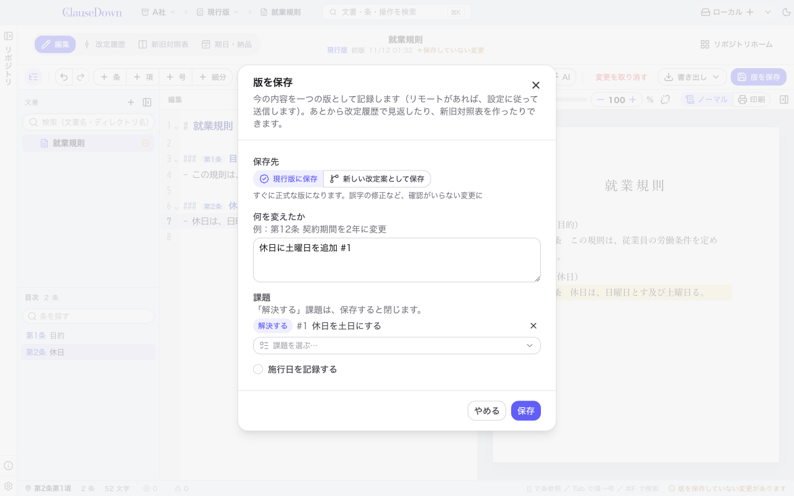

版を保存の画面の「課題」で、未完了の課題を選びます。選んだ課題の左のボタンを押すと、次の 2 つを切り替えられます。

- **解決する**：この版で課題が片付いたことを表します。メッセージの最後に `Closes #1` の行が入り、課題が閉じます（閉じるタイミングは次の節）。
- **関連する**：課題に関係する版として残します。メッセージに `Refs #1` の行が入り、課題は閉じません。

**メッセージに番号を書く**

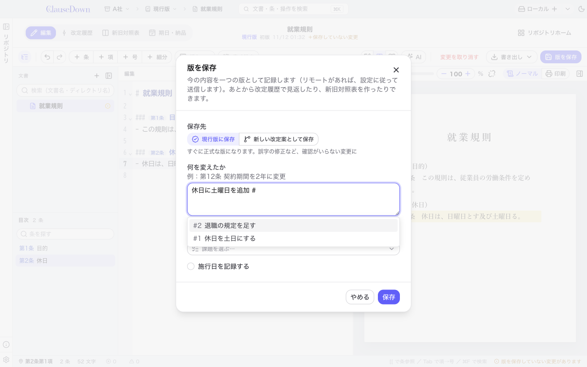

「何を変えたか」の欄で `#` を打つと、未完了の課題の候補が出ます。↑↓ で選んで Enter を押すと番号が入ります。メッセージに `#1` と書いた版は課題 #1 に紐付き、`Closes #1`・`Fixes #1`・`Resolves #1` と書いた版は課題 #1 を解決します（英語の書き方です。GitHub と GitLab が同じ書き方を使うためです）。

改定履歴やトップページなどに出るメッセージの `#1` は、押すとその課題を開きます。

**保存したあとの版を紐付ける**

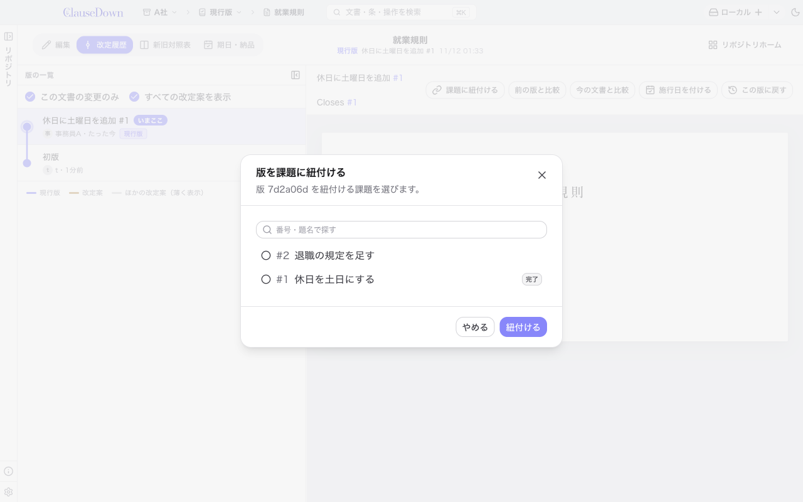

改定履歴で版を選び、右上の「課題に紐付ける」を押して課題を選びます。課題の画面の「版を紐付ける」からも同じことができます。

**改定案ごと紐付ける**

改定案で作業しているときは、改定案のメニューの「この改定案で解決する課題…」で課題を選べます。選んだ課題は、その改定案を現行版に反映したときに閉じます。

### 課題を閉じる

課題が閉じるのは、解決する版が**現行版に入ったとき**です。

- 現行版に `Closes #1` の版を保存したとき：すぐに閉じます。
- 改定案に `Closes #1` の版を保存したとき：まだ閉じません。改定案を現行版に反映したときに閉じます。
- 改定案のメニューで紐付けた課題：改定案を現行版に反映したときに閉じます。

手で閉じるときは、課題の画面の「閉じる」を押します。解決した版を選ぶこともできます（選ばなくても閉じられます）。閉じた課題は「開き直す」で未完了に戻せます。

### コメントで話し合う

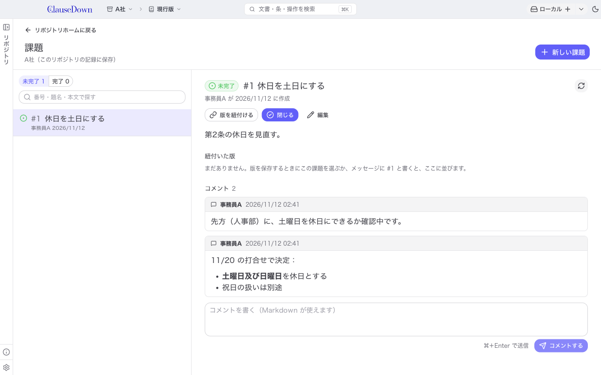

課題の下の欄にコメントを書いて「コメントする」を押すと、課題にコメントが付きます。Ctrl＋Enter（Mac は ⌘＋Enter）でも送れます。「先方に確認中」「11/20 の打合せで決定」のような経過を残しておくと、なぜその条文にしたかを後から追えます。

- コメントは Markdown で書けます（箇条書き・太字・リンクなど）。リンクはブラウザーで開きます。
- コメントは古い順に並び、書いた人と日時が付きます。
- 書いたコメントは、今のところアプリでは直したり消したりできません。

リモートに接続していないリポジトリでも使えます。コメントはリポジトリの記録に保存し、同期すればほかの PC でも見られます。2 台の PC で同時に書いても、どちらのコメントも残ります。

### GitHub・GitLab に接続しているとき

リモートが GitHub か GitLab のときは、課題はそのサイトの Issue そのものです。アプリで作った課題はサイトにも出て、サイトで作った課題はアプリにも出ます。「GitHub で開く」（GitLab では「GitLab で開く」）を押すと、ブラウザーで開きます。

- コメントは Issue のコメントそのものです。サイトで書かれたコメントも、課題を開いたときに出ます。課題を開いたまま新しいコメントを見るときは、右上の再読み込みのボタンを押します。コメントを直したり消したりするときは、サイトで行います。
- 版の紐付けは、Issue のコメント（「版 … を紐付けました（ClauseDown）」）としてサイトに残ります。アプリのコメントの一覧では、話し合いのコメントと分けて 1 行の記録として出します。
- `Closes #1` の版が現行版に入ると、サイトが Issue を閉じます。
- 改定案で紐付けた課題は、確認依頼（プルリクエスト・マージリクエスト）の説明に `Closes #1` として入ります。

**ローカルで作った課題を移す**：リモートに接続する前に作った課題は、接続したあと課題の画面に出る案内から、サイトに移せます。コメントも一緒に移ります。サイト上の投稿者は接続した人のアカウントになるため、コメントの先頭に「（事務員A・2026/11/12 14:03 のコメント）」のように、元の書き手と日時を書き残します。新しく作った空のリポジトリなら、番号はそのまま（#1 は #1）です。サイトにすでに Issue やプルリクエストがあって番号がずれるときは、移した課題の本文に元の番号を書き残します。過去の版のメッセージにある `#番号` は、サイトでは別の課題を指すことがあります。

GitHub では、ClauseDown の GitHub App に Issues の権限が必要です。権限が足りないと、課題を開いたときにその旨が出ます。

---

## 13. 期日・有効期間を管理する

施行・公布・提出・届出・申請・開始・終了・更新・期限などの日付を、文書ごと（またはリポジトリ全体）に記録します。記録した期日はリポジトリを使う全員に共有されます。版を保存しなくても記録されます。

### 期日・有効期間の画面

リポジトリホームの右上の「期日・有効期間」か、右のペインの「期日・有効期間」から、期日・有効期間の画面を開きます。

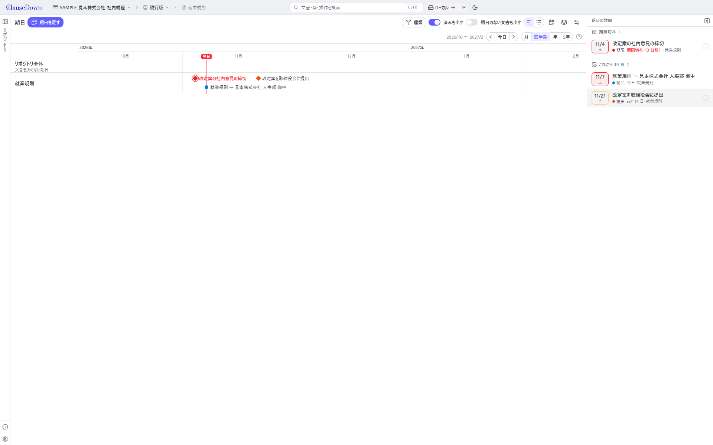

- 縦に文書を並べ、横を日付にしたタイムラインです。いちばん上の「リポジトリ全体」は、文書を決めない期日の行です。
- 1 日だけの期日は ◆、期間（開始日と終了日がある期日）は帯で表します。色は期日の種類ごとに変わります。
- 赤い縦線が今日です。期限を過ぎて済みにしていない期日は赤い枠で囲みます。
- 右の「期日の詳細」には、期限切れ・これから 30 日・最近済みにしたものを出します。

タイムラインの操作は次のとおりです。

| 操作 | 結果 |
|---|---|
| 「月」「四半期」「年」「5年」を押す | 目盛りを切り替える |
| Ctrl＋ホイール | 拡大・縮小する |
| 背景をドラッグ、または Shift＋ホイール | 前後の日付に動かす |
| 「今日」を押す | 今日を中心に戻す |
| 空いた所をダブルクリック | その日付で期日を追加する |
| 上の目盛りを押す | その日を「指定した日」にする |
| 有効期間の帯を押す | その施行版を選ぶ |
| 期日をドラッグ | 日付を動かす（繰り返す期日と、施行版・納品の記録は動かせません） |
| 期日を押す | 右に詳細を出す |

期日を押すと、右に詳細が出ます。「済みにする」「直す」「消す」のボタンがあります。次の画像は「改定案を取締役会に提出」を選んだところです。

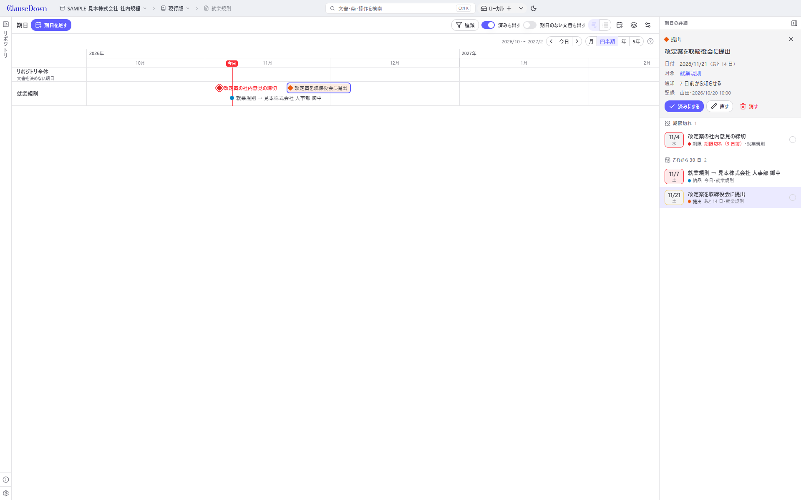

ツールバーの「種類」で表示する種類を絞り、「済みも出す」で済みにした期日を出すかどうかを切り替えます。右のボタンで、タイムラインと一覧を切り替えます。

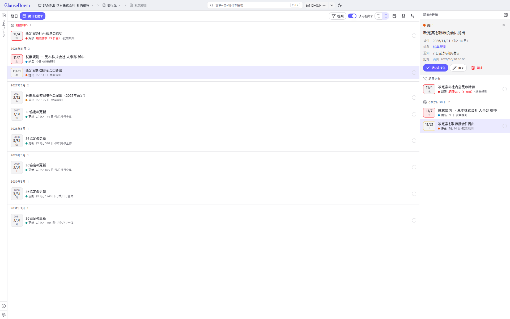

### 有効期間と指定した日の版

施行日を付けた版は、その施行日から次の版の施行日の前日まで効力があります。この期間を有効期間と呼び、タイムラインの文書の行の下に帯で表します。最後の施行版の帯は、終わりを決めずに右へ伸びます。

ツールバーの日付の欄に日付を入れるか、上の目盛りを押すと、その日に効力のあった版を調べられます。

- タイムラインに青い点線を引き、その日を含む帯を濃く表します。
- 右の欄の先頭に「〇年〇月〇日 の版」を出します。文書ごとに、その日に効力のあった施行版の有効期間を並べます。その日より後に初めて施行された文書は「施行前」と出します。
- 文書を押すと、その文書の「期日・有効期間・納品」のタブを開き、その施行版を選んだ状態で条文を出します。
- 日付の欄の × を押すと、指定をやめます。

有効期間の帯を押すと、その施行版の施行日を選び、右の詳細に有効期間を出します。「期日・有効期間・納品を開く」を押すと、その施行版を選んだ状態でタブを開きます。

「リポジトリ全体」に付けた施行日（文書を決めずに付けた施行日）は「リポジトリ全体」の行の帯にし、各文書の有効期間には含めません。

### 期日の追加

「期日の追加」を押します。

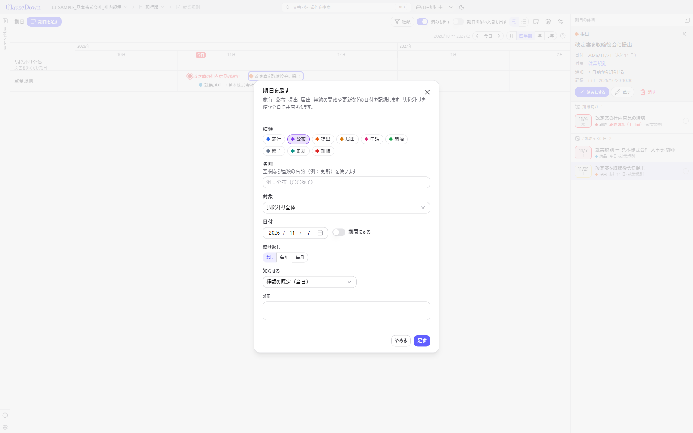

1. 「種類」を選びます。
2. 「名前」を入れます。空欄なら種類の名前（例：「更新」）を使います。
3. 「対象」で文書を選びます。「リポジトリ全体」は文書を決めない期日です。
4. 「日付」を入れます。年・月・日の欄に数字を入れるか、右のカレンダーのボタンを押して日付を選びます。存在しない日付（2 月 30 日など）は入れられません。「期間にする」をオンにすると、終了日も入れられます。
5. 「繰り返し」で「毎年」「毎月」を選ぶと、同じ日付で繰り返します。終わりの日も決められます。毎月 31 日のように、その月に無い日付は月末にします。
6. 「知らせる」で、何日前から知らせるかを選びます。「種類の既定」を選ぶと、種類ごとに決めた日数を使います。
7. 「足す」を押します。

### 済みと期限切れ

既定の種類のうち、提出・届出・申請・更新・期限は「済みにする」種類です。済みにするまで一覧に残り、日付を過ぎると「期限切れ」と表示します。施行・公布・開始・終了は、日付が来れば済む種類として、済みにする操作を出しません。どの種類を「済みにする」種類にするかは、期日の種類の設定で変えられます。

繰り返す期日は、回ごとに済みにします。毎月の期日なら 90 日、毎年の期日なら 400 日より前の回は、済みにしていなくても期限切れに数えません。

### 期日の種類を変える

種類の名前・色・済みにするか・既定で何日前に知らせるかは、リポジトリの設定の「期日の種類」で変えます。期日の画面のツールバーの右端のボタンからも開きます。種類はリポジトリごとに決め、そのリポジトリを使う全員に共有されます。

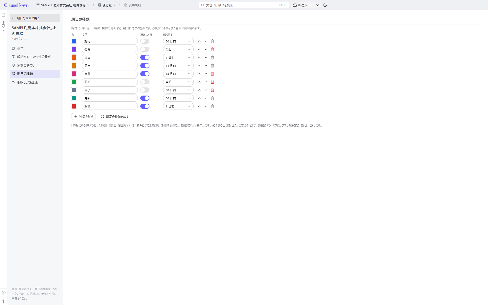

「種類を足す」で独自の種類（例：「検査」「株主総会」）を足せます。期日に使っている種類は消せません。

### デスクトップへの通知

設定の「期日・有効期間」で「期日をデスクトップに通知する」をオンにすると、アプリの起動中に 1 時間ごとに期日を確かめ、知らせる日になった期日と期限を過ぎた期日を Windows の通知で知らせます。同じ期日を知らせるのは 1 回だけです。アプリを閉じている間は通知しません。

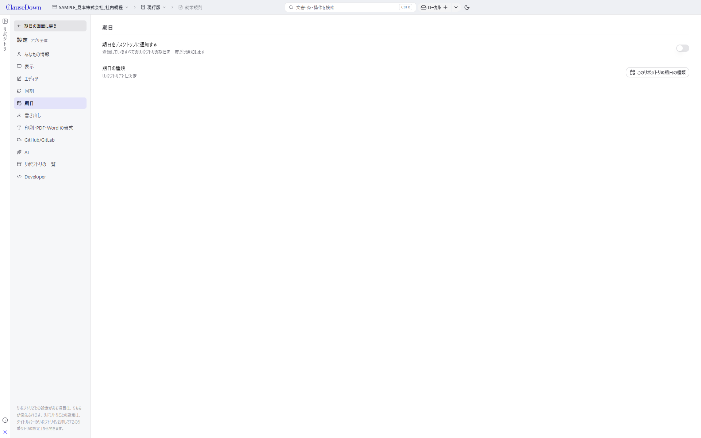

### カレンダーのアプリに書き出す

期日・有効期間の画面のツールバーにある、カレンダーに下向きの矢印のボタンを押すと、期日を iCalendar 形式（.ics）のファイルに書き出します。Outlook・Google カレンダーなど、iCalendar を取り込めるカレンダーのアプリに取り込めます。

- 書き出すのは、今日の 1 年前から 5 年先までの、済みにしていない期日と施行日です。
- 繰り返す期日は、回ごとに 1 件の予定になります。
- 知らせる日の 9 時に鳴るアラームを付けます。
- 書き出したファイルは、その時点の期日の写しです。後でアプリで期日を変えても、カレンダーには反映されません。もう一度書き出して取り込み直します。取り込み直したときに前の予定を置き換えるか、重ねて入れるかは、カレンダーのアプリによって違います。

トップページの「すべてのリポジトリの期日・有効期間」で同じボタンを押すと、すべてのリポジトリの期日をまとめて書き出します。

---

## 14. ほかの PC・ほかの人と共有する

リモート（GitHub・GitLab）を使うと、組織の複数の PC や、ほかの人と同じリポジトリを使えます。リモートが無いリポジトリは、ローカル の中だけで管理します。

### GitHub.com に接続する

GitHub では ClauseDown の GitHub App を使うリポジトリにインストールしてから、アプリでログインします。インストールはアカウント（または組織）ごとに一度だけです。

**リポジトリにインストールする**

1. 設定の「GitHub/GitLab」で、GitHub の「インストールする」を押します。ブラウザーで ClauseDown の GitHub App のページが開きます。

2. 「Install」を押します。すでにインストールしているときは、ボタンが「Configure」になっていて、押すとインストール先の設定を変えられます。

3. インストールするアカウントか組織を選び、「Continue」を押します。

4. 「Repository access」で「Only select repositories」を選び、「Select repositories」から ClauseDown で使うリポジトリだけを選びます。選び終えたら「Install」（設定を変えるときは「Save」）を押します。

   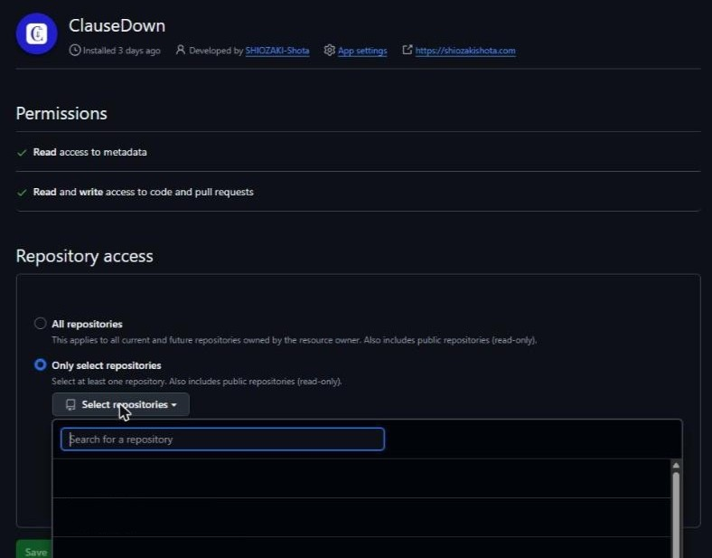

あとから使うリポジトリを増やすときも、同じ「インストールする」のボタンから選び直します。

**アプリでログインする**

1. 設定の「GitHub/GitLab」で、GitHub の「ログイン」を押します。アプリにコードが出て、ブラウザーで GitHub のページが開きます。

   

2. アプリの「コピー」を押して、コードをコピーします。

3. ブラウザーでアカウントを選んで「Continue」を押し、コードを貼り付けて「Continue」を押します。

4. 「Authorize ClauseDown」を押します。

5. アプリに戻ると、GitHub の欄にログインしたアカウントの名前が出ます。

コードは 15 分で切れます。切れたときは、もう一度「ログイン」を押します。

### GitLab.com に接続する

1. 設定の「GitHub/GitLab」で、GitLab.com の「ログイン」を押します。アプリにコードが出て、ブラウザーで GitLab のページが開きます。

2. アプリの「コピー」を押してコードをコピーし、ブラウザーの「Device code」に貼り付けて「Authorize」を押します。

   

3. 許可の画面で、もう一度「Authorize」を押します。

4. アプリに戻ると、GitLab.com の欄にログインしたアカウントの名前が出ます。

GitLab には、GitHub のように使うリポジトリだけを選ぶ仕組みがありません。ログインしたアカウントが使えるすべてのプロジェクトに、ClauseDown からつなげます。

### 社内の GitLab に接続する

GitLab をセルフホストしている場合、設定の「GitHub/GitLab」の「社内の GitLab」に、その GitLab の URL を入れて追加します。ログインのしかたは、社内 GitLab の管理者にお聞きください。


### リポジトリをリモートに送る

タイトルバー右の同期のボタンは、リモートが無いリポジトリでは「ローカル」と表示します。「＋」か右の「▾」から「リモートを追加…」を選びます。


開いた画面の順に進めます。

1. リモートを置く場所（GitHub.com・GitLab.com・追加した社内の GitLab）を選びます。
2. まだログインしていなければ、「ログインの設定を開く」からログインします。
3. 「GitHub で作る」（GitLab なら「GitLab で作る」）を押し、ブラウザーで空のリポジトリを作ります。
   - GitHub では「Private」を選び、「Add README」「Add .gitignore」「Add license」は付けずに「Create repository」を押します。

     

   - GitLab では「Private」を選び、「Initialize repository with a README」を外して「Create project」を押します。

     

4. GitHub なら、「App の設定を開く」から、作ったリポジトリを ClauseDown の GitHub App のインストール先に加えます。
5. 作ったリポジトリの URL をコピーして貼り付け、「リモートに送信する」を押します。
   - GitHub では、作った直後の画面の「Quick setup」にある HTTPS の URL をコピーします。

     

   - GitLab では、「Code」を押して「Clone with HTTPS」の URL をコピーします。

     


現行版・改定案・記録をすべて送信し、以後はそのリモートと同期します。

### 同期する

リモートがあるリポジトリでは、同期のボタンに今の状態を出します。まだ送信していない版があれば「送信待ち 2」のように件数を、保存していない変更があってリモートの版を取得できないときは「取得できません」を出します。ボタンを押すと、リモートの版を取得し、ローカル の版を送信します。同期の途中に押しても、2 回目の同期は始めず、実行中の同期が終わるのを待ちます。設定の「同期」で、起動時に同期するか、版を保存したら送信するかを選びます。 (git: staging)

2 台の PC で同じ箇所を変えていたときは、同期のボタンに「重なりあり」と出ます。押すと、現行版への反映と同じ画面で、重なった箇所を 1 か所ずつ選びます（[10 章](#現行版に反映する)）。期日・確認依頼・納品の記録は、2 台で同時に足しても両方が残ります。

---

## 15. houritsu の法令を取り込む・書き出す

[houritsu](https://github.com/Kohei-Wada/houritsu) は e-Gov 法令検索の法令を Markdown にし、改正の履歴を Git の版として持つリポジトリです。ClauseDown はこの形式の法令を ClauseDown の文書に変換して取り込めます。逆に、ClauseDown の文書を同じ形式で書き出すこともできます。

### 取り込む

houritsu の形式の .md を入れたフォルダをリポジトリとして追加すると、変換するかを聞く画面が出ます。houritsu の形式かどうかは、文書の先頭の情報（法令番号などを書いた欄）で見分けます。


「変えて版を保存」を押すと、すべての文書を ClauseDown の形に変え、1 つの版として保存します。

- 条・項・号の番号と本文は、元のとおりに残ります。番号が 1 から順に並ばない箇所（附則の条、「第三条の二」のような枝番号、削除された条）は、番号を指定する書き方（[6 章](#条項号の書き方)）で残します。
- 章の見出しは残します。編・節・款・目の見出しは消えます。
- HTML の表は、ClauseDown の表に変えます。結合したセルは、`>`・`^` の書き方で残します（[表のセルを結合する](#表のセルを結合する)）。
- 保存していない変更がある文書は変換しません。
- 元の形は、版の履歴に残ります。

変換が終わると、確かめてほしい点のある文書を一覧で出します。たとえば、項の番号が書かれていない古い附則に番号を付けたときや、条の番号が元と合わないときです。


変換した文書は、ほかの文書と同じように編集・版の保存・新旧対照表に使えます。


### 書き出す

編集画面の「書き出し」→「Markdown（法令の形・houritsu）に書き出す」で、条番号・項番号・号の番号を本文に書き込んだ Markdown にします。取り込んだ文書なら、先頭の情報（法令番号など）を元のとおりに戻します。続けて削除された条は「第三条から第五条まで　削除」のようにまとめます。

---

## 16. AI に確認や書き直しを頼む

編集画面の「AI」を押すと、右に AI のパネルが開きます。条文のリーガルチェック、文言を整える、条参照を直す、改定内容の説明などを頼めます。

AI ができるのは「文書を読む」「機械的なチェックをする」「ローカル の文書を書き換える」までです。版の保存・現行版への反映・施行日・納品・確認依頼は、人が画面で行います。AI が書き換えた内容は、すぐ編集の欄に反映されます。Ctrl＋Z、「依頼の前に戻す」、「変更を取り消す」で元に戻せます。AI が書き換えている間に編集の欄で書いた内容は、別々の箇所なら両方を残します。同じ箇所なら、編集の欄の内容を残します。


画面の幅が足りず、編集・プレビュー・AI のパネルを並べるとプレビューが読めない幅になるときは、プレビューを右端の細い帯に畳みます。帯を押すと AI のパネルを畳み、編集とプレビューを並べて表示します。

使う前に、設定の「AI」で接続先を選びます。


- 「使う AI」で、Claude（Anthropic）、OpenAI 互換のサービス、Ollama（ローカル の中で動かす AI）、OpenRouter、GitHub Models から選びます。
- 選んだ接続先に必要な API キーを入れるか、ログインします。「接続を試す」で、使えるかを確かめます。
- 文書の内容は、選んだ AI の会社に送られます。PC の外に文書を出したくないときは、Ollama を選びます。

### Claude Desktop・Claude Code から使う

ClaudeDesktop から、ClauseDown の文書を読む・チェックする・書き換えることもできます（MCP）。

1. 設定の「AI」で「外部の AI からつなぐ（MCP）」をオンにします。
2. **Claude Desktop**：「Claude Desktop への登録」の「登録する」を押し、Claude Desktop を再起動します。チャットで「ネットから厚労省のモデル就業規則を参照して月変形の規則を作って」のように頼むと、ClauseDown の文書を使って答え、編集します。
3. **Claude Code**：「Claude Code への登録」のコマンドをコピーして、ターミナルで実行します。

- 使えるのは ClauseDown を起動している間だけです。ClauseDown を閉じていると、Claude は「ClauseDown が起動していない」と答えます。
- できることは、編集画面の AI のパネルと同じです。版の保存・現行版への反映・納品はできません。Claude が書き換えた内容はすぐ編集の欄に反映され、Ctrl＋Z や「変更を取り消す」で戻せます。
- ClauseDown を別の場所に移したときは、「登録し直す」を押します。使わなくなったら「登録を外す」を押します。

---

## 17. 設定

設定には、ローカル 全体の設定と、リポジトリごとの設定の 2 つがあります。

設定を開くと、左のペインの「設定」が「設定を閉じる」に変わります。押すと、設定を開く前の画面（編集中の文書など）に戻ります。設定の画面の左上の「（文書名）に戻る」のボタンでも戻れます。リポジトリの設定と「このソフトについて」にも、同じ戻るボタンがあります。

### アプリ全体の設定

左のペインのいちばん下の「設定」で開きます。ローカル だけに保存され、ほかの人には影響しません。

| 区分 | 主な項目 |
|---|---|
| あなたの情報 | 版や確認依頼に残す名前の決め方と、名前・メールアドレス (git: user./name, user.email) |
| 表示 | ライトモード・ダークモード、画面の拡大率、起動時に前回の文書を開くか |
| エディタ | 編集の欄のフォント・文字の大きさ・行番号・折り返し・番号の表示 |
| 同期 | 起動時に同期する、版を保存したら送信する |
| 期日・有効期間 | デスクトップへの通知 |
| 書き出し | 書き出したファイルの既定の保存先、ファイル名に日付を付けるか |
| 印刷・PDF・Word の書式 | 本文のフォント・文字の大きさ・行間・余白・ページ番号の既定 |
| GitHub/GitLab | リモートへのログイン（[14 章](#14-ほかの-pcほかの人と共有する)） |
| AI | AI の接続先（[16 章](#16-ai-に確認や書き直しを頼む)） |
| リポジトリの一覧 | リポジトリの追加・切り替え・複製・フォーク・一覧から外す（[3 章](#3-リポジトリを用意する)） |
| Developer | サンプルリポジトリの追加、版組 CSS、設定のリセット |

### あなたの情報

「名前の決め方」で、版を保存した人として記録する名前の出どころを選びます。


- **GitHub・GitLab のアカウント**：ログインしたアカウントの名前とメールアドレスを使います。リモートが GitHub・GitLab のリポジトリでは、そのアカウントの名前を使うので、リモートの履歴と名前がそろいます。アカウントを 2 つ以上ログインしているときは、リモートの無いリポジトリで使うアカウントを選べます。
- **自分で入力する**：入力した名前とメールアドレスを、すべてのリポジトリで使います。名前を空にしたときは、ログインしているアカウントの名前を使います。

名前が決まるまで、版は保存できません。

### Developer


- **試験中の機能**：まだ形が決まっていない機能を、ここで有効にして試せます。今後、名前や使い方が変わったり、なくなったりすることがあります。
  - **条項ライブラリ**：よく使う条（秘密保持・反社会的勢力の排除など）を、ライブラリ用のリポジトリにまとめておき、編集画面の「挿入」→「条項ライブラリから…」で文書に入れます。オンにしたら「ライブラリに使うリポジトリ」で、条を書いておくリポジトリを選びます。ライブラリの文書は、ふつうの文書と同じように書き、版を保存し、同期します。条を選ぶと、カーソルのある条の後に入ります。条の中にほかの条への参照（`[[purpose]]` など）があるときは、入れる先の文書のどの条を指すかを選ぶ画面が出ます。見出しが同じ条があれば、初めから選ばれています。対応する条がなければ、参照を外して見出しの文字で残すか、そのまま残すかを選べます。
- **サンプルリポジトリを追加**：[3 章](#サンプルリポジトリで試す)のサンプルを、選んだフォルダに作ります。同じ名前のフォルダがあるときは、名前の後ろに（2）などを付けて作ります。
- **版組 CSS**：条文のプレビューと PDF（新旧対照表の PDF を含む）の見た目を決める CSS です。欄には最初から既定の CSS が入っており、それを書き換えます。書き換えるとすぐプレビューに反映します。条（`.cd-article`）・条見出し（`.cd-art-title`）・項（`.cd-para`）・号（`.cd-item`）などのクラス名は、欄の中の既定の CSS で確かめられます。「既定に戻す」で既定の CSS に戻します。Word の書き出しには使いません。
- **表示・エディタなどの設定を初期値に戻す**：配色・拡大率・エディタ・同期・期日の通知・書き出し・印刷の書式・版組 CSS を、最初の状態に戻します。あなたの情報・ログイン・AI・リポジトリの一覧は変わりません。
- **すべてを初期状態に戻す**：ローカル に保存した設定・ログイン・AI の API キー・リポジトリの一覧をすべて消して、アプリを起動し直します。リポジトリのフォルダと文書は消えません。GitHub・GitLab 側の連携の許可は残るので、完全に外すときはそれぞれのサイトで取り消します。

### リポジトリの設定

タイトルバーのリポジトリ名から「このリポジトリの設定」を選ぶか、リポジトリホームの設定のボタンで開きます。表示名を除き、リポジトリの中に記録され、そのリポジトリを使う全員に共有されます。

**印刷・PDF・Word の書式**：リポジトリ全体、またはディレクトリごとに、フォント・文字の大きさなどをアプリ全体の設定から変えます。変えていない項目は、上の設定（ディレクトリならリポジトリ全体、リポジトリ全体ならローカル の設定）を使います。下に、選んだ書式で印刷したときの見本を出します。


**承認の決まり**：「現行版に反映する前に承認を必須にする」をオンにすると、承認を受けていない改定案は現行版に反映できなくなります。「承認できる人」に名前を入れると、その人の承認だけを数えます。名前は、各自の「あなたの情報」の名前か、GitHub・GitLab のユーザー名です。


**期日の種類**：[13 章](#期日の種類を変える)を参照してください。

### ダークモード

タイトルバーの右端のボタンで、ライトモードとダークモードを切り替えます。


### アプリを更新する

左のペイン下部の「このソフトについて」を開き、「更新を確認」を押します。

1. 新しいバージョンがあると、バージョンと変更点を出します。「ダウンロード」を押します。
2. ダウンロードが終わると、ボタンが「再起動して更新」に変わります。押すと、アプリを閉じて新しいバージョンを入れ、起動し直します。書いている途中の文書は、閉じる前に PC に書き込みます。

アプリが勝手に新しいバージョンを入れることはありません。「再起動して更新」を押さずに閉じたときも、今のバージョンのまま使えます。

---

## 18. ショートカットキー

| キー | 操作 |
|---|---|
| Ctrl＋K | 文書・条・改定案・操作を名前で探す |
| Ctrl＋S | 版を保存する（編集の欄） |
| Ctrl＋F | 編集の欄で検索・置換する |
| F8 / Shift＋F8 | 次・前の指摘（波線）へ移る |
| Ctrl＋Shift＋M | 指摘の一覧を開く |
| Ctrl＋Alt＋A | 条を足す |
| Ctrl＋Alt＋P | 項を足す |
| Ctrl＋Alt＋I | 号を足す |
| Tab / Shift＋Tab | 項を号に下げる・号を項に上げる（号と細分も同じ） |
| Enter | 項・号の行の続きに、同じ単位の行を足す |
| `[[` | 条参照の候補を出す |
| Ctrl＋Z / Ctrl＋Y | 元に戻す / やり直す |
| Ctrl＋ホイール（編集の欄） | 編集の欄の文字を大きく・小さくする |
| Ctrl＋ホイール（プレビュー） | プレビューを拡大・縮小する |
| Ctrl＋ホイール（期日・有効期間の画面） | タイムラインを拡大・縮小する |
| Shift＋ホイール（期日・有効期間の画面） | タイムラインを前後に動かす |
| 任意のキー・クリック（起動時） | ロゴのアニメーションを飛ばす |

macOS では、Ctrl の代わりに ⌘（command）、Alt の代わりに ⌥（option）を使います。undoは ⇧＋⌘＋Z です。
