# ClauseDown User Manual

ClauseDown is a Windows and macOS app for writing documents that are made of numbered articles, such as bills, ordinances, contracts and internal rules. It records each version of a document and helps you manage everything from reviewing a revision to its effective date and delivery.
This manual is for the people who write and revise those documents (administrative staff, in-house legal teams and legal professionals). It explains what to do on each screen.

You can switch the app's display language under **Settings → Appearance → Language** (**Match the OS**, **日本語** or **English**). The display language is separate from the language of your documents.

This manual is also available in Japanese: [日本語版](../README.md)

## Contents

- [ClauseDown User Manual](#clausedown-user-manual)
  - [Contents](#contents)
  - [1. Terms used in this manual](#1-terms-used-in-this-manual)
  - [2. Starting the app and the screen layout](#2-starting-the-app-and-the-screen-layout)
    - [Installing](#installing)
    - [The first time you start the app](#the-first-time-you-start-the-app)
    - [Home](#home)
    - [Finding documents, articles, drafts and actions by name](#finding-documents-articles-drafts-and-actions-by-name)
  - [3. Setting up a repository](#3-setting-up-a-repository)
    - [Trying the sample repositories](#trying-the-sample-repositories)
    - [Duplicating a repository](#duplicating-a-repository)
    - [Forking a repository](#forking-a-repository)
    - [Switching repositories](#switching-repositories)
    - [Grouping repositories](#grouping-repositories)
  - [4. Repository home: documents and drafts at a glance](#4-repository-home-documents-and-drafts-at-a-glance)
    - [Browsing folders](#browsing-folders)
    - [Changing the view](#changing-the-view)
    - [Right-click and drag actions](#right-click-and-drag-actions)
  - [5. Creating a document](#5-creating-a-document)
  - [6. Writing articles](#6-writing-articles)
    - [Writing articles, paragraphs and items](#writing-articles-paragraphs-and-items)
    - [Adding articles, paragraphs and items with buttons](#adding-articles-paragraphs-and-items-with-buttons)
    - [Cross-references: referring to other articles](#cross-references-referring-to-other-articles)
    - [Amendment history of an article](#amendment-history-of-an-article)
    - [Defined-term checks](#defined-term-checks)
    - [Proofreading](#proofreading)
    - [Formatting: changing how chapters and paragraphs are numbered](#formatting-changing-how-chapters-and-paragraphs-are-numbered)
      - [Overseas formats](#overseas-formats)
    - [Search and replace](#search-and-replace)
    - [Page breaks, font size and alignment](#page-breaks-font-size-and-alignment)
    - [Merging table cells](#merging-table-cells)
    - [Writing math](#writing-math)
    - [Exporting to PDF, Word and HTML](#exporting-to-pdf-word-and-html)
    - [How your writing is saved](#how-your-writing-is-saved)
  - [7. Saving a version](#7-saving-a-version)
  - [8. Viewing past versions in the revision history](#8-viewing-past-versions-in-the-revision-history)
  - [9. Creating a comparison table](#9-creating-a-comparison-table)
  - [10. Revising in a draft, getting it reviewed, and merging it into the current version](#10-revising-in-a-draft-getting-it-reviewed-and-merging-it-into-the-current-version)
    - [Creating a draft](#creating-a-draft)
    - [Working in a draft](#working-in-a-draft)
    - [Requesting and giving a review](#requesting-and-giving-a-review)
    - [Merging into the current version](#merging-into-the-current-version)
  - [11. Recording effective dates and delivering](#11-recording-effective-dates-and-delivering)
    - [Setting an effective date](#setting-an-effective-date)
    - [The due dates and delivery tab](#the-due-dates-and-delivery-tab)
    - [Delivering](#delivering)
  - [12. Managing issues](#12-managing-issues)
    - [Creating an issue](#creating-an-issue)
    - [Linking versions and issues](#linking-versions-and-issues)
    - [Closing an issue](#closing-an-issue)
    - [Discussing in comments](#discussing-in-comments)
    - [When connected to GitHub or GitLab](#when-connected-to-github-or-gitlab)
  - [13. Managing due dates and validity periods](#13-managing-due-dates-and-validity-periods)
    - [The due dates screen](#the-due-dates-screen)
    - [Validity periods and versions on a given date](#validity-periods-and-versions-on-a-given-date)
    - [Adding a due date](#adding-a-due-date)
    - [Done and overdue](#done-and-overdue)
    - [Changing due date types](#changing-due-date-types)
    - [Desktop notifications](#desktop-notifications)
    - [Exporting to a calendar app](#exporting-to-a-calendar-app)
  - [14. Sharing with other computers and other people](#14-sharing-with-other-computers-and-other-people)
    - [Connecting to GitHub.com](#connecting-to-githubcom)
    - [Connecting to GitLab.com](#connecting-to-gitlabcom)
    - [Connecting to your company's GitLab](#connecting-to-your-companys-gitlab)
    - [Pushing a repository to a remote](#pushing-a-repository-to-a-remote)
    - [Syncing](#syncing)
  - [15. Importing and exporting houritsu statutes](#15-importing-and-exporting-houritsu-statutes)
    - [Importing](#importing)
    - [Exporting](#exporting)
  - [16. Asking AI to check or rewrite](#16-asking-ai-to-check-or-rewrite)
    - [Using Claude Desktop or Claude Code](#using-claude-desktop-or-claude-code)
  - [17. Settings](#17-settings)
    - [App-wide settings](#app-wide-settings)
    - [Profile](#profile)
    - [Developer](#developer)
    - [Repository settings](#repository-settings)
    - [Dark mode](#dark-mode)
    - [Updating the app](#updating-the-app)
  - [18. Keyboard shortcuts](#18-keyboard-shortcuts)
  - [19. Digital signatures](#19-digital-signatures)
    - [Signing versions](#signing-versions)
    - [Signing approvals](#signing-approvals)
    - [Signing the rules](#signing-the-rules)
    - [Adding a digital signature to PDFs](#adding-a-digital-signature-to-pdfs)
    - [Saving a returned signed PDF](#saving-a-returned-signed-pdf)
    - [Signing with a My Number Card](#signing-with-a-my-number-card)
    - [Inserting seals and signature images](#inserting-seals-and-signature-images)

---

## 1. Terms used in this manual

ClauseDown uses a version control system called Git internally. The screens avoid Git terminology and use the following terms instead.

| Term | Meaning |
|---|---|
| Repository | The unit in which you manage a set of documents. It corresponds to one folder on your computer. It is easiest to create one per client and document type, such as "Company A internal rules" or "Company B contracts" (git: repository) |
| Document | A single document made of articles, such as work rules or a contract. It is stored as one file in a repository |
| Folder | A folder inside a repository used to organize documents (shown as "directory" in the Japanese UI) |
| Version | A record of a document's contents at a point in time. Each click of **Save version** adds one. You can look back at saved versions later and compare them (git: commit) |
| Current version | The official line of latest versions. Only reviewed content goes here (git: main (master) branch) |
| Draft | A working copy for revising a document without changing the current version. After it is reviewed and approved, you merge it into the current version (git: feature branch) |
| Review request / approval | The process of having someone else check a draft. In the repository settings you can require approval before a draft can be merged into the current version (git: pull request) |
| Effective version | A version with a recorded effective date. It ties a date to a version, as in "the version that takes effect on April 1, 2026" (git: tag, release) |
| Delivery | Saving the text of an effective version and its comparison table as PDF or Word files, and keeping a record that you handed them over |
| Due date | A date related to a document, such as the effective date, promulgation, submission, filing, application, or the start or renewal of a contract |
| Validity period | The period during which an effective version is in force: from its effective date to the day before the next effective version's effective date |
| Remote | A place on the internet, such as GitHub or GitLab, where versions are stored and shared. You can use the app without a remote, entirely on your own computer |
| Sync | Fetching versions from the remote to your computer and sending your local versions to the remote |

---

## 2. Starting the app and the screen layout

When you start the app, a logo animation plays and then Home opens. Click anywhere or press any key to skip the animation. It does not play if animation effects are turned off in your OS settings.

### Installing

Download the app from the [official website](https://clausedown.app/#get), or install it with one of these commands.

| OS | Method | Command |
|---|---|---|
| Windows | PowerShell | `irm https://clausedown.app/install.ps1 \| iex` |
| Windows | winget | `winget install ShiozakiShota.ClauseDown` |
| macOS (Apple silicon) | Terminal | `curl -fsSL https://clausedown.app/install.sh \| sh` |
| macOS (Apple silicon) | Homebrew | `brew install --cask shiozaki-shota/tap/clausedown` |

- On Windows, you can also use the same curl command as macOS in Git Bash.
- If you install from a downloaded file, the OS shows a warning the first time because the app is not signed. On Windows, click "More info" and then "Run anyway". On macOS, open "System Settings" → "Privacy & Security" and click "Open Anyway". No warning appears when you install with a command.

### The first time you start the app

If you have not added a repository yet, Home shows two steps under **Getting started**. Click **Set up** to go to the settings screen for that step.

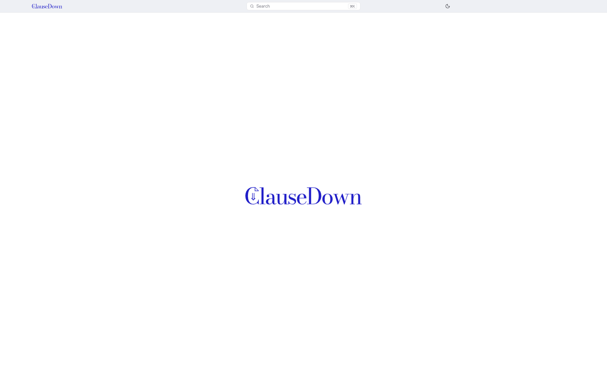

1. **Sign in to GitHub/GitLab (or enter your name)**: Choose the name that is recorded as the person who saved each version ([chapter 17](#profile)).
2. **Add a repository**: Create or add a repository for your documents ([chapter 3](#3-setting-up-a-repository)). To try the app first, go to **Developer** in Settings and click **Add sample repositories**.

### Home

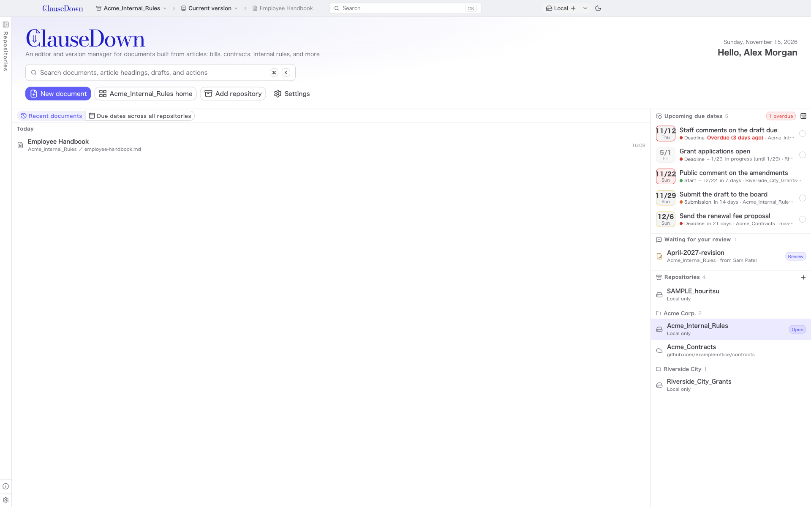

The screen has three parts.

- **Title bar (the strip at the top)**: From left to right: the logo (click it to return to Home), the current repository, what you are working on (the current version or a draft), the open document, the search box, the sync status, and the light/dark mode switch.
- **Left pane**: The list of repositories you have added. When the app starts, it is collapsed into a thin strip on the left edge; click the strip to open it. Click a name to switch to that repository. **About ClauseDown** and **Settings** are at the bottom.
- **The large area on the right**: The contents of the screen you have chosen.

The repository, working draft and document in the title bar show where you are.

- Click the repository name or the working draft, then choose **Repository home** from the menu to go to the repository home.
- While the repository home or Settings is open, the title bar keeps showing the last document you had open, dimmed. Click it to reopen that document on the same tab as before (Edit, Revision history and so on).

The lower half of Home shows **Recent documents** on the left and **Upcoming due dates** and **Repositories** on the right. If someone has asked you to review a draft, **Waiting for your review** also appears. **Upcoming due dates** lists overdue items and items within the next 90 days from all your repositories, with overdue items first. Click the circle on the right to mark a due date as done.

Switch the toggle at the top left to **Due dates across all repositories** to turn the lower half into a timeline that combines all repositories.

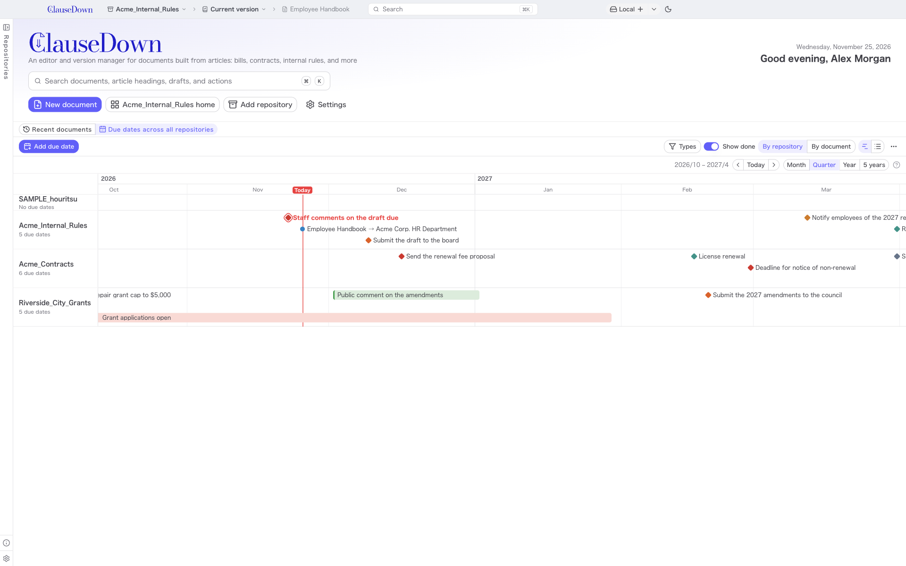

### Finding documents, articles, drafts and actions by name

Click the search box in the title bar or press Ctrl+K to open the search window. It also opens while you are typing in the editor. As you type, it shows documents, articles, drafts and actions (such as **New document** or **Settings**) whose names match. Select one and press Enter to open that document or draft.

Articles are searched by heading and number across all documents in the repository. For example, type a heading word or an article number such as "第10条". Full-width and half-width digits both work. When you select an article, the document opens at that article.

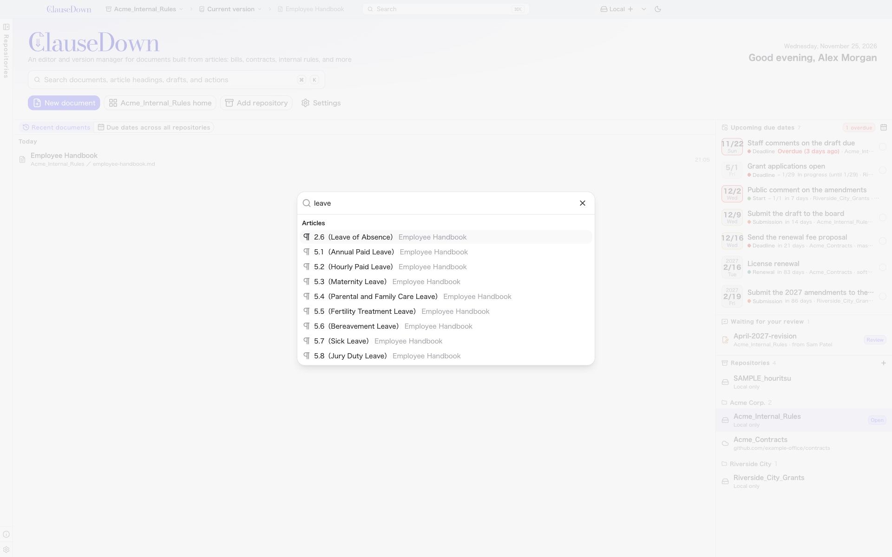

---

## 3. Setting up a repository

Before you create documents, set up a repository to hold them. Click **Add repository** on Home, or **+** in the left pane, to open **Repositories** in Settings.

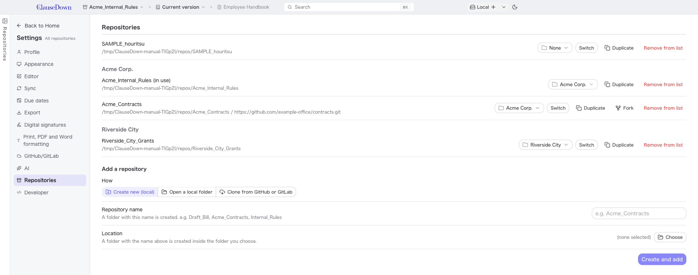

Under **How**, choose one of three options.

- **Create new (local)**: Creates a new folder on your computer as an empty repository. Give it a name that shows the client and document type, such as "Acme_Contracts" or "CompanyB_Rules".
- **Open a local folder**: Adds a repository copied from another computer or one you created earlier. Hold Ctrl or Shift while selecting to add several at once.
- **Clone from GitHub or GitLab**: Copies a repository from a remote to your computer and adds it. Sign in under **GitHub/GitLab** in Settings first ([chapter 14](#14-sharing-with-other-computers-and-other-people)).

**Remove from list** only removes the repository from the app's list. The folder and its versions are not deleted.

### Trying the sample repositories

In Settings, go to **Developer**, click **Add sample repositories** and choose a folder. The app creates the following four repositories and adds them to the list. Each has a version history, drafts, effective dates and due dates. The samples are Japanese documents, so their names are in Japanese.

| Repository | Contents |
|---|---|
| SAMPLE_見本株式会社_社内規程 | Work rules of a fictional company. Includes a draft with an open review request |
| SAMPLE_見本_契約書 | A services agreement and a copyright assignment agreement (contract style) |
| SAMPLE_見本市_条例・要綱 | A municipal ordinance on vacant houses and the guidelines for a subsidy |
| SAMPLE_houritsu_法令 | Three Japanese statutes in houritsu format. When you add it, you are asked whether to convert them ([chapter 15](#15-importing-and-exporting-houritsu-statutes)) |

### Duplicating a repository

Click **Duplicate** in the list to copy the repository, including its version history, to another folder and add it to the list. Use this when you want to start a repository for another client based on last year's set of rules.

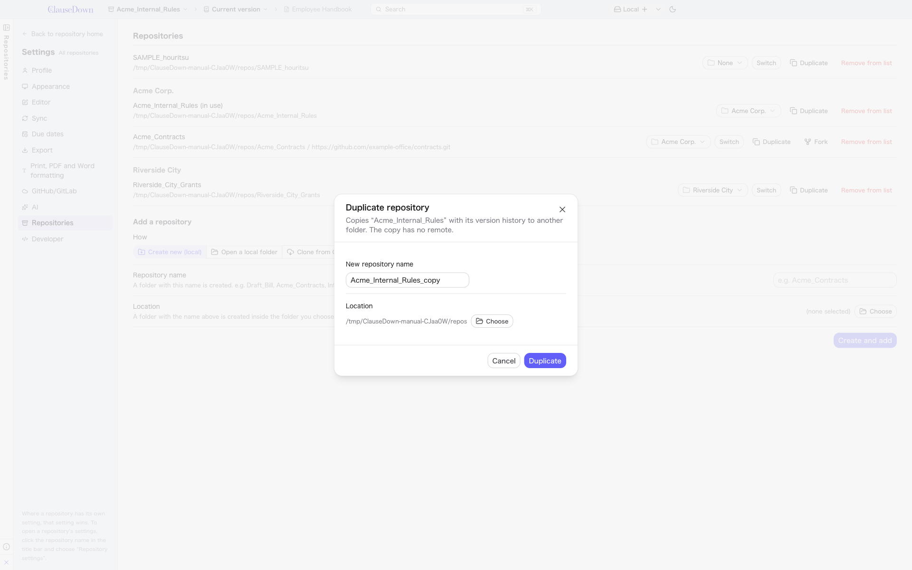

The copy has no remote. It is independent of the original: changing one does not change the other.

### Forking a repository

Repositories whose remote is on GitHub or GitLab have a **Fork** button. Click it to create a copy (a fork) of that repository in your GitHub or GitLab account. The local repository is then set to push to your fork.

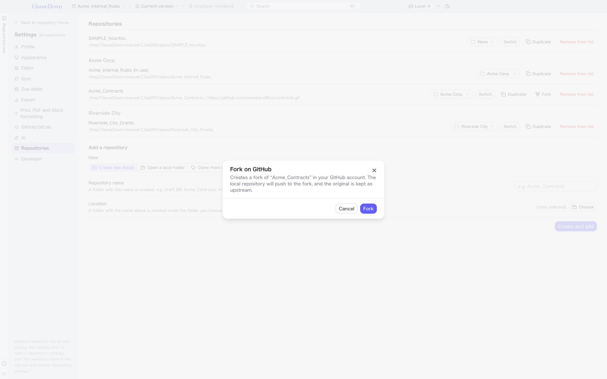

Use this when you have cloned a template repository someone else has published but do not have permission to push to it. The original repository is kept under the name "upstream". Unlike a duplicate, a fork keeps its link to the original repository on GitHub or GitLab.

### Switching repositories

Click the repository name in the title bar to open the list of your repositories. You can also switch by clicking a name in the left pane.

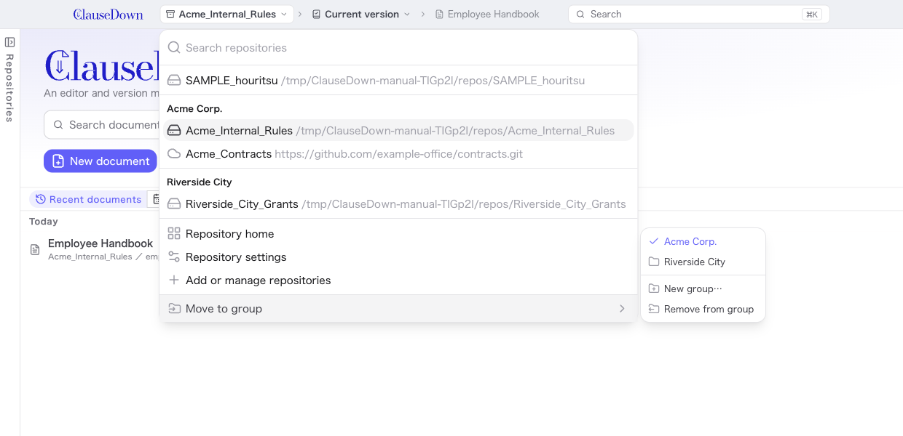

### Grouping repositories

You can group repositories under a heading such as "Company A". Groups only affect how the list looks; folders and repository contents do not change.

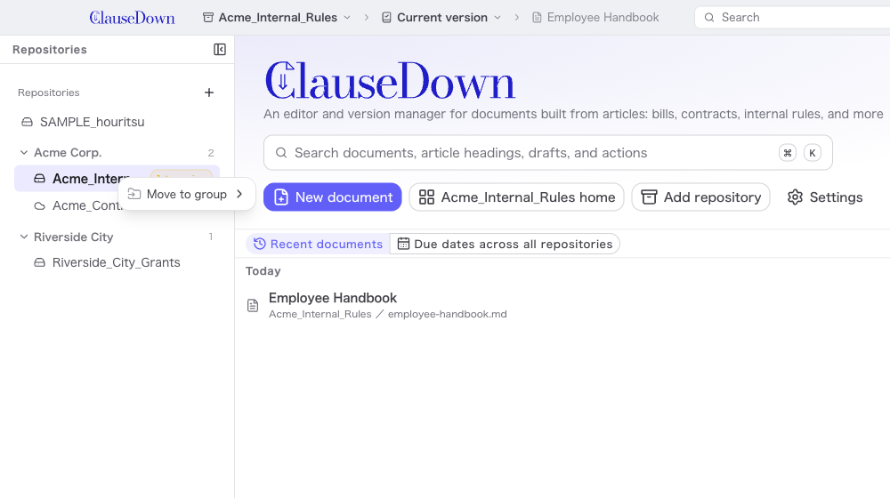

- **Adding to or moving between groups**: Use any of the following.
  - Right-click a repository in the left pane and choose a group from **Move to group**.
  - Click the repository name in the title bar and choose from **Move to group** at the bottom of the list. This applies to the repository that is currently open.
  - In **Repositories** in Settings, choose from the group field on each row.
  - Choose **New group…**, or type a new name in the field in Settings, to create a group and move the repository into it.
- **Dragging**: In the left pane, drag a repository onto a group heading to move it to the end of that group, or onto another repository to place it before that one. Drop it on the **Repositories** heading to remove it from its group.
- **Headings**: Click to expand or collapse. When a group is collapsed, the repository that is currently open stays visible. Right-click a heading to choose **Rename…** or **Ungroup**.

Repositories that are not in a group appear at the top of the list as before. Groups appear the same way in the left pane, the list in the title bar, **Repositories** on Home and **Repositories** in Settings.

---

## 4. Repository home: documents and drafts at a glance

When you choose a repository, its repository home opens. This screen shows the repository's documents, drafts, due dates, validity periods and deliveries together. You can browse documents folder by folder, just as in Windows Explorer or the macOS Finder.

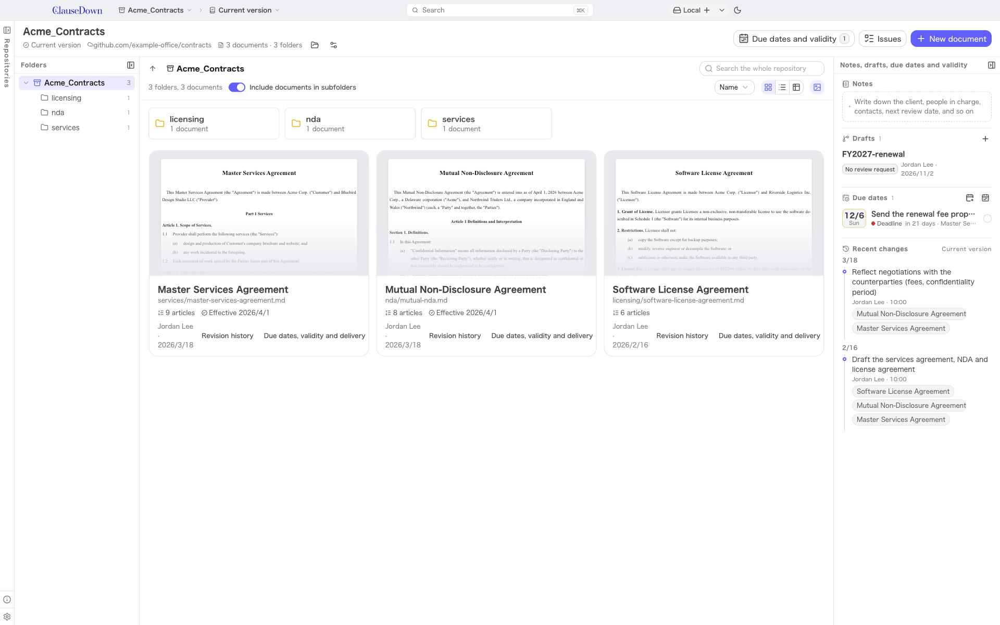

- **Top row**: Below the repository name you see the working draft, whether there is a remote (**Local only** if not), and the number of documents and folders. The buttons to the right open the repository folder and the repository settings. **Due dates and validity** and **Issues** at the top right open the due dates screen and the issues screen. The **Issues** button shows the number of open issues. **New document** at the far right creates a document in the folder that is currently open.
- **Folders on the left**: The repository's folders as a tree. Click a name to open that folder; click the arrow to its left to expand or collapse it. The number on the right is the number of documents inside.
- **Center**: The contents of the folder that is currently open.
- **Right pane**: From the top: **Notes** (a place to write down the client, the person in charge, the next scheduled review and so on), **Drafts**, **Due dates** and **Recent changes**. Each draft shows its review status (**Awaiting review**, **Approved** or **No review request**).

Drag the borders to change the width of the left and right panes. You can also collapse a pane with the button at its top right.

### Browsing folders

The top of the center area shows where you are, for example "SAMPLE_houritsu_法令 › laws › act". Click a name to go back to that level, or click the up arrow on the left to go up one level.

Folders are listed first in the center, followed by documents. Click a folder to open it. Turn on **Include documents in subfolders** to also list documents in lower levels. This is useful for getting an overview of documents in deep folders without opening each one.

Type in the search box at the top right to search the whole repository, regardless of the current folder, for documents and folders whose name or path matches.

### Changing the view

Use the buttons at the top right to choose one of three views.

| View | Contents |
|---|---|
| Cards | For each document: a thumbnail of the first page, the number of articles, the effective date of the version in force, and who saved it last and when. Click the image button to hide the thumbnails |
| List | Only the document name and file name. Use this to scan many documents |
| Details | A table with the name, number of articles, version in effect, next effective date, last update and status. Click a column heading to sort by that column; click it again to reverse the order |

In the **Cards** and **List** views, choose the sort order in the box at the top right (**Name**, **Most articles**, **Latest effective date**, **Next effective date** or **Recently updated**). Your chosen view and sort order are kept the next time you open the screen.

Click a document name to open it in the editor. Click **Revision history** or **Due dates, validity and delivery** on a card to open that screen.

### Right-click and drag actions

Right-click a document to choose from these actions.

- **Open**, **Revision history**, **Due dates, validity and delivery**
- **Copy**, **Move to folder**, **Copy to another repository**
- **Show in Explorer** (**Show in Finder** on a Mac)
- **Delete**

Right-click a folder to choose **Open** or **New document here**. Right-click an empty area to choose **New document**.

Drag a document onto a folder (a folder in the center, a folder in the tree on the left, or a name in the location path at the top) to move it there. A confirmation screen appears before the move. The move is recorded as a version.

---

## 5. Creating a document

Click **New document** in the repository home or on Home.

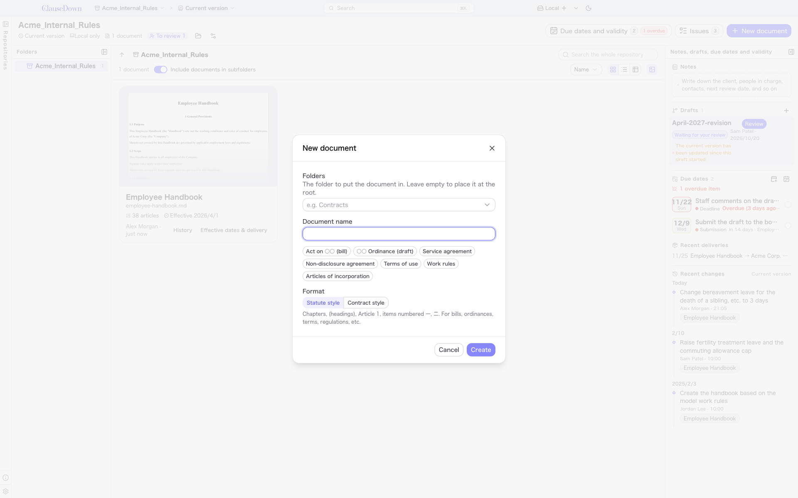

1. Under **Folders**, enter the name of the folder for the document. Leave it blank to place the document at the top level of the repository.
2. Enter the **Document name**. Click one of the suggestions below the field (for example, a services agreement or work rules) to fill it in.
3. Choose a **Format**.
   - **Statute style**: Chapters, a heading in parentheses on the line before the article, article numbers like 第1条 (Article 1), and items numbered 一, 二 (Japanese numerals). Suited to bills, ordinances, bylaws and internal rules.
   - **Contract style**: The heading follows the article number on the same line, as in 第1条（目的） ("Article 1 (Purpose)"), and paragraph numbers use Arabic numerals.

   These two formats are Japanese document styles. For English, German, French or other non-Japanese documents, choose the format system under **Formatting** after you create the document (see [Overseas formats](#overseas-formats)).
4. Click **Create**. The new document opens in the editor.

---

## 6. Writing articles

Click a document name to open the editor.

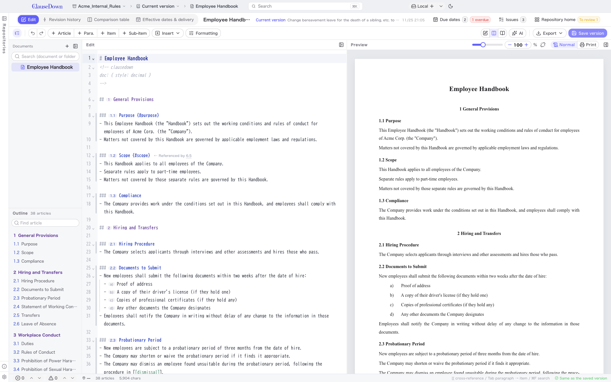

The editor is divided into three areas, from left to right.

- **Documents and outline**: The upper part lists the documents in the repository; the lower part is the outline (chapters and articles) of the open document. The document list uses the same tree as the folders in the repository home, and expanding or collapsing a folder applies to both. Click an article in the outline to jump to it. Type in the box above the outline to filter articles by heading.
- **Edit**: Where you write the text.
- **Preview**: How the document will look when printed. Use the switch to the right of the heading to choose **Normal** or **Print**.
  - **Normal**: Shows the text on one long sheet. When you move the cursor in the editor, the preview follows to the same place.
  - **Print**: Shows the document split into pages, exactly as it will be exported to PDF. Use this to check page breaks, margins and page numbers. The view is rebuilt about one second after you stop typing.

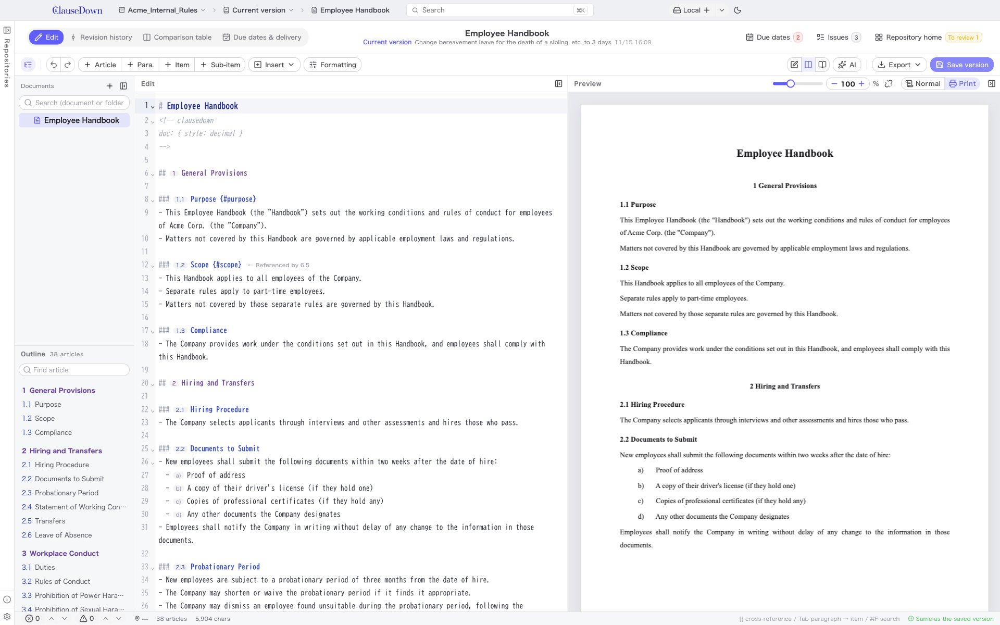

Hold Ctrl and turn the mouse wheel over the editor to change the editor's font size (the same setting as the font size under **Editor** in Settings). Do the same over the preview to change the preview zoom in 10% steps. You can also change the zoom with the slider and number box to the right of the preview heading; the box accepts values from 50 to 200 in 1% steps. Turn on the chain button to its right (**Sync zoom with the editor**) to zoom both panes by the same number of steps when you zoom one of them. This does not make the two sizes equal; each moves from its current size, one step being 1px for the editor and 10% for the preview. Both sizes are kept until the next time you start the app.

At the top of the screen are the **Edit**, **Revision history**, **Comparison table** and **Due dates & delivery** tabs, with the editing tools below them. Click **Repository home** at the right end of the tab row to go to the repository home. If someone has asked you to review a draft, the button shows the number of drafts awaiting review. Click **Issues** to its left to go to the issues screen (it shows the number of open issues). When the window is narrow, the **Insert**, **Formatting**, **Export** and **Discard changes** buttons are shown as icons without text. Hover over an icon to see its name.

### Writing articles, paragraphs and items

In the editor, the symbol at the start of each line tells the app what kind of element the line is. **Do not type the numbers: they are assigned automatically.** The app calculates the numbers and shows them faintly at the start of each line.

The examples below use the Japanese format, where articles are numbered 第1条, items 一, 二 (Japanese numerals) and sub-items イ, ロ (Japanese syllabary). With an overseas format system the same lines are numbered as Section 1, (a), (i) and so on (see [Overseas formats](#overseas-formats)).

| What you write | How to write it | Example of the number shown |
|---|---|---|
| Document title | `# 就業規則` (work rules) | — |
| Chapter | `## 総則` (general provisions) | 第一章 (Chapter 1) |
| Article | `### 目的` (purpose) | 第1条（目的） (Article 1 (Purpose)) |
| Paragraph | `- この規則は、…` | 2, 3… (the first paragraph is not numbered) |
| Item | Under a paragraph, indented by two spaces: `- 正社員` | 一, 二… |
| Sub-item | Under an item, indented by two more spaces: `- 有期` | イ, ロ… |

When you add or delete an article, the app renumbers the articles that follow. To refer to another article in the text, use a cross-reference (next section); it follows the article even when its number changes.

**Bracket pair guides**: to the right of the line numbers, vertical bars show the extent of each chapter and article. The left column is the chapter and the right column is the article; the bars for the chapter and article with the cursor are darker. Lines inside `:::` blocks and indented items and sub-items get vertical lines to the left of the text. When the cursor is on a `:::` line, its matching `:::` is highlighted too. Under **Editor** > **Bracket pair guides** in the settings, you can turn each kind on or off: chapters, articles, `:::` blocks, and item and sub-item indentation. All except chapters are on by default. Turning off `:::` blocks also removes the indentation inside them.

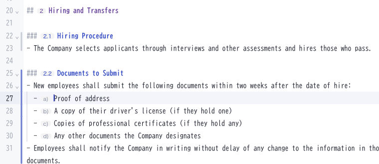

To give an article a fixed number, write `{n=10}` after its heading to make it Article 10, or `{n=10 b=2}` to make it Article 10-2 (第10条の2). For items, write `{n=3}` or `{b=2}` (a branch number of the previous item, such as 一の二) at the start of the line. Use this in documents whose numbers do not run consecutively from 1, such as imported statutes.

### Adding articles, paragraphs and items with buttons

Click **+ Article**, **+ Para.**, **+ Item** or **+ Sub-item** on the toolbar to add a line of that kind after the cursor. Press Tab to demote a paragraph to an item or an item to a sub-item, and Shift+Tab to promote it.

**Insert** lets you add everything described in this manual: chapters, articles (branch-numbered, deleted, or with a set number), paragraphs and items (sub-items, set numbers, branch numbers), a cover page, a table of contents, a preamble, supplementary provisions, a closing and signature block, seals and signatures ([chapter 19](#inserting-seals-and-signature-images)), an appendix, tables (with merged cells), diagrams (such as flowcharts), math, images, cross-references, page breaks and formatting.

You can also add an image by copying it (for example, a screenshot) and pasting it into the editor, or by dropping an image file onto the editor. The image is saved in `images/<document name>/` in the same folder as the document, and a line such as `` is inserted. When you save a version, the image is recorded with it and is included in PDF and Word exports. PNG, JPEG, GIF and WebP files up to 20 MB are supported.

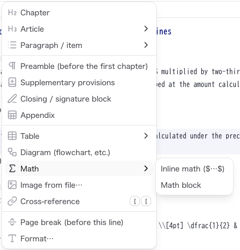

### Cross-references: referring to other articles

Type `[[` in the text to see a list of articles. Choose one to insert a reference such as `[[適用範囲]]`; in the preview and printout it is replaced by the article number, such as "第2条" (Article 2). If articles are added and numbers shift, the reference keeps pointing to the right number.

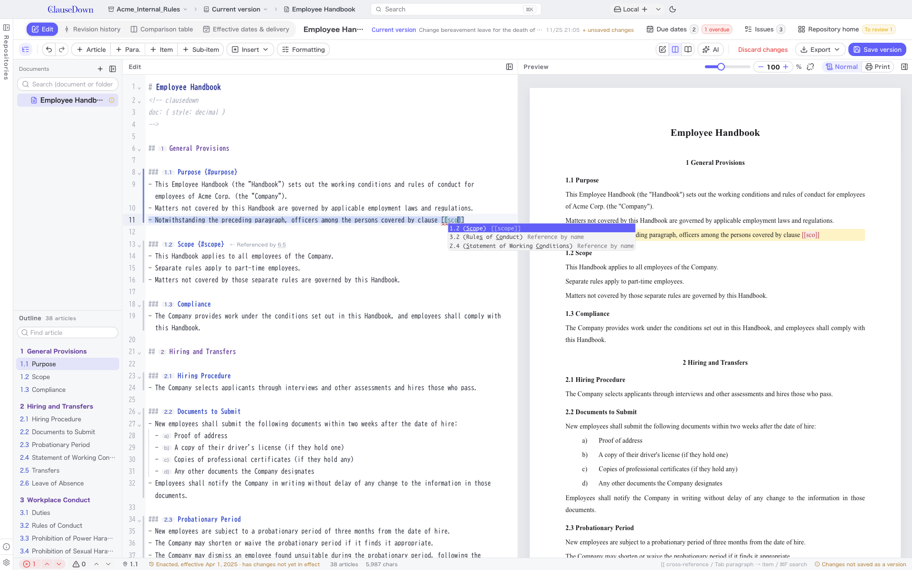

The image below shows a third paragraph added to Article 1 with **+ Para.** and a reference to Article 2. In the preview, the reference appears as "第2条". **+ unsaved changes** below the title means the version has not been saved yet.

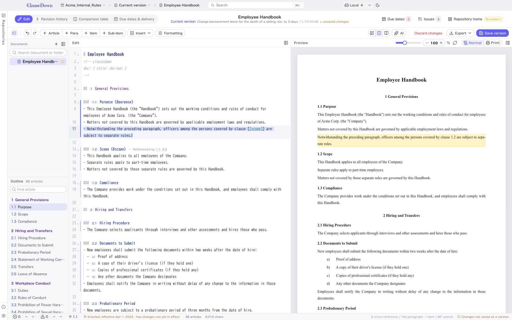

If the referenced article cannot be found, or two articles have the same name, the reference is underlined.

Cross-references also work in article headings. For example, `### [[目的]]の特例` ("special provisions to [[Purpose]]") is shown as "（第1条の特例）" ("(Special provisions to Article 1)").

**Referenced by**: When an article is referenced from other articles, the heading line in the editor shows "← Referenced by Article 2, Article 3" on the right. Click an article number to jump to the line that references it. Right-click an article and choose **Referenced by** to see a list of the paragraphs and items that refer to it, and jump to the one you choose. If you delete an article that is referenced elsewhere, the app tells you the reference no longer has a target. Only references written with `[[…]]` are counted; numbers typed directly, such as "第5条", are not.

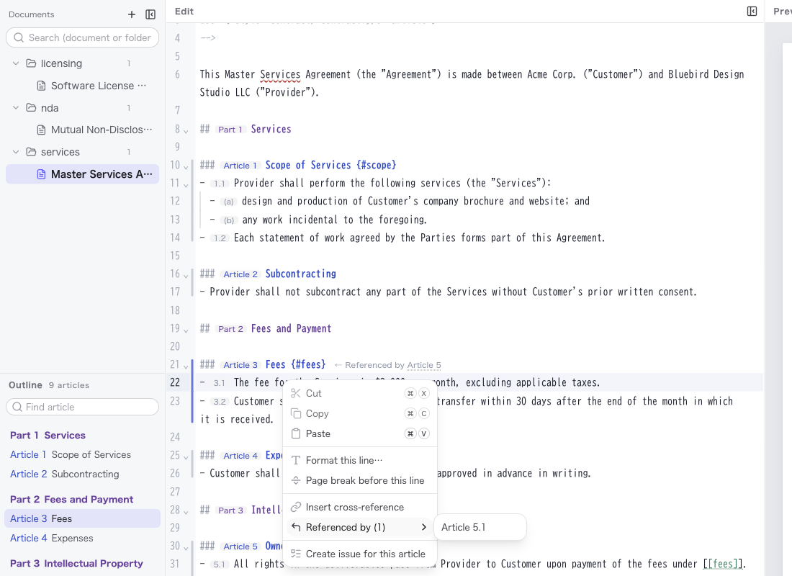

### Amendment history of an article

The status bar at the bottom of the editor shows, to the right of the current article, the effective version in which that article took its present form, for example "Amended, effective April 1, 2023". An article that has existed since the first effective version is labeled **Enacted**, and one added in a later effective version is labeled **Added**. If you have changed the article since the last effective version, "· has changes not yet in effect" is appended. A document with no effective versions shows **Not yet in effect**.

Click it to open the amendment history of that article.

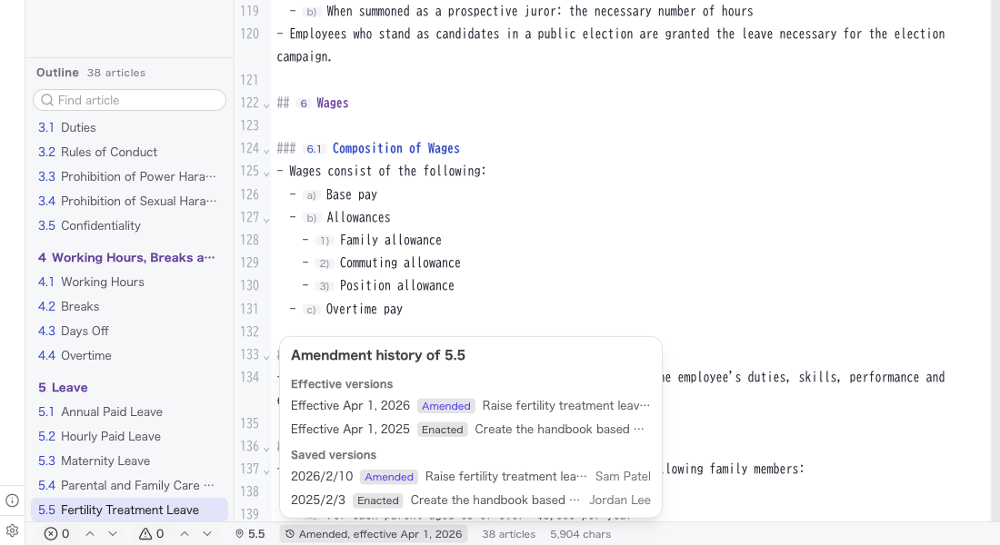

- **Effective versions**: The effective versions that enacted, added or amended the article, newest first. Click one to open it on the **Due dates & delivery** tab.
- **Saved versions**: All versions that changed the article, including those without an effective date. Click one to open it in the revision history.

An article whose number only shifted because other articles were added is not counted as amended. An article is treated as the same article if it has the same `{#name}`, or otherwise the same heading.

### Defined-term checks

For terms defined in the text, the app draws a red squiggle in the following cases. Hover over the squiggle to see the reason.

- The same term is defined twice.
- A term defined with a "hereinafter" clause is used before its definition. (A term defined with "means" applies to the whole document, so using it earlier is not flagged.)
- A term is defined but never used.

In Japanese text, "hereinafter" definitions look like （以下「甲」という。） and "means" definitions look like 「消費者」とは、.

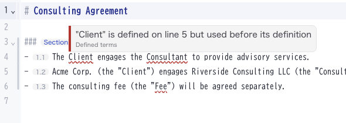

In this example, "Client" and "Consultant" appear in paragraph 1.1 before they are defined in paragraph 1.2, and "Fee", defined in paragraph 1.3, is never used. In English text, definitions such as `(the "Client")`, `(each, a "Party")` and `"Affiliate" means …` are recognized, curly quotes included; plurals (Parties) and possessives (Party's) count as uses.

The same checks apply to English definitions: definitions in parentheses such as `(the "Agreement")` and `(each, a "Party")`, and definitions such as `"Affiliate" means`. Curly quotes (“ ”) are treated the same way. English terms are matched case-sensitively and on word boundaries. Plural forms (Parties) and possessives (Party's) count as uses.

Definitions limited to a scope, such as 以下この項において ("hereinafter in this paragraph"), are not checked, because the scope cannot be determined from the text. Each set of supplementary provisions is treated as a separate scope. A term that appears only as part of another word (for example, 規則 inside 就業規則) does not count as a use. Terms in the title and headings are not flagged even if they appear before the definition.

### Proofreading

The app draws a yellow squiggle under wording that may need attention.
Hover over the squiggle to see the reason and the rule, such as "Proofreading: English contract wording".

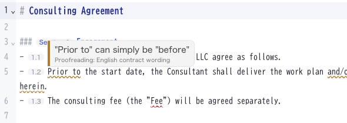

Most rules below apply only to Japanese text; the rule for English text is described after the list. They follow the conventions of Japanese official and legislative writing, so the examples are in Japanese.

| Rule | What it flags |
|---|---|
| Repeated particles | The same Japanese particle, such as は, appears twice in one sentence, as in 「甲は乙は」. Because legal sentences are long, repetitions of に, が, の and similar particles are not flagged |
| Ra-dropping | Colloquial verb forms such as 「来れる」「見れる」 |
| Double negatives | Phrases such as 「しないことはない」 ("it is not that it does not") |
| Mixed full-width and half-width | Full-width and half-width Latin letters are mixed in the same document |
| Character usage | Spellings that do not follow official and legislative style, such as 「または」→「又は」, 「および」→「及び」, 「但し」→「ただし」, 「出来る」→「できる」 |
| Legislative character usage | Replacements from the Cabinet Legislation Bureau guidelines on kanji in legislation (「法令における漢字使用等について」, 2010), such as 「捺印」→「押印」, 「虞」→「おそれ」, 「斡旋」「あっ旋」→「あっせん」, 「繋留」→「係留」, 「従って、」→「したがって、」 |
| Legislative okurigana | Okurigana (kana endings) from the same guidelines, such as 「取り消しの」→「取消しの」, 「支払いを」→「支払を」, 「手続き」→「手続」. Flagged only when the word is used as a noun, not as a verb (as in 「これを取り消し、」) |
| Common misuse | For example 「規定を適応する」 (→適用) and 「似て異なるもの」 (→似て非なるもの) |
| Half-width kana | Half-width katakana such as 「ｶﾀｶﾅ」 |
| Too many commas | A sentence contains seven or more Japanese commas (、). The limit is set high because legal sentences are long |
| Redundant expressions (off by default) | Phrases such as 「請求を行う」 (→請求する) and 「することができる」. This rule also flags wording that is normal in legal text, so turn it on only when you need it |

English text is checked with the **English contract wording** rule. It flags ambiguous wording such as "and/or" and "herein", and stock phrases that can be shortened, such as "prior to" → "before". It also flags documents that mix "including but not limited to" and "including without limitation". This rule does not apply to Japanese text.

In documents that use an overseas format, spelling mistakes get a red underline. The spelling language follows the format system (British English for UK legislation and EU regulations; German or French for the German and French systems). Turn this on or off with **Check English spelling** under **Editor** in Settings.

Turn off **Show proofreading (yellow squiggles)** under **Editor** in Settings to hide all proofreading. Below it is a switch for each rule, so you can choose which rules to use. For **Repeated particles**, you can change which particles are allowed to repeat (by default に, が, と, の, を and others are allowed). Defined-term errors (red squiggles) are always shown, regardless of these settings. Cross-references, comments in the settings block, `{…}` attributes and code blocks are not proofread.

**Counts and navigation**: At the left end of the status bar at the bottom of the editor are buttons for red squiggles (errors) and yellow squiggles (warnings), each in the form "count | ▲ | ▼". Click ▼ to go to the next problem and ▲ to go to the previous one; the reason appears on the right of the bar. After the last one, it wraps around to the first. Click the count or press Ctrl+Shift+M to open the **Problems** pane below the editor, which lists all problems. Click a row to jump to it. Use **All**, **Errors** and **Warnings** at the top of the pane to filter, and drag the top border to change its height.

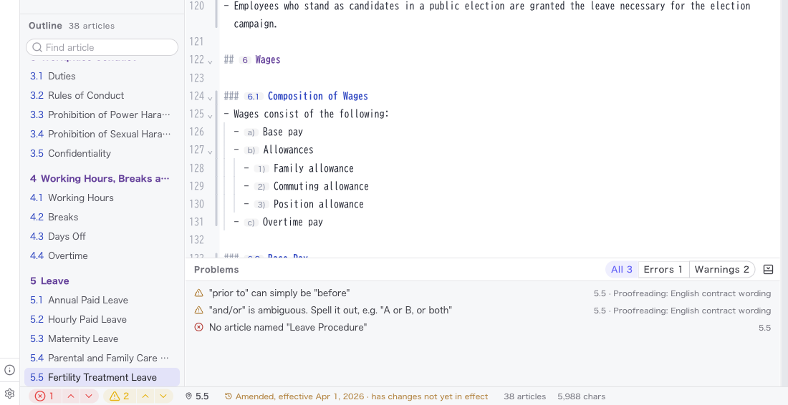

### Formatting: changing how chapters and paragraphs are numbered

Click **Formatting** to open the formatting sheet below the editor. These settings apply only to this document. To close the sheet, click **×** at the top right or click **Formatting** again.

At the top of the sheet, **Format system** sets how articles are numbered and how cross-references are written (see [Overseas formats](#overseas-formats)). An English document is detected as **US/UK contract**, and the article numbers follow that system (Section 1, 1.1, (a)). With **US/UK contract**, use **Contract type** to choose whether articles are written as `Section 1`, `1.` or `Article 1`.

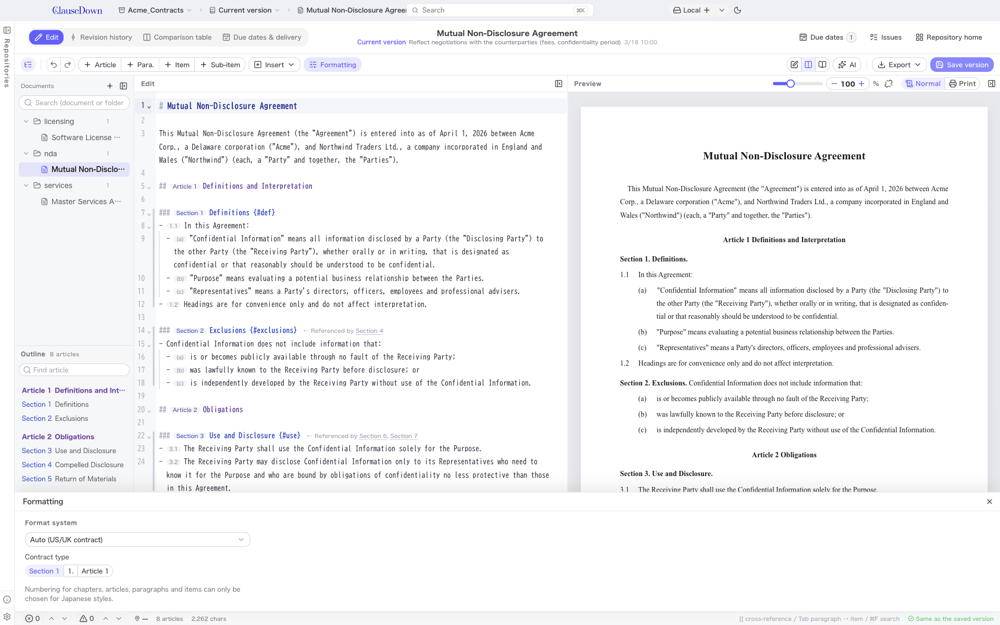

For Japanese documents (the **Japan** format system), the sheet also has columns for choosing how chapters, articles, paragraphs and items are numbered. Choose each option by clicking a sample, such as `第一章`, `第1条` or `（1）`.

- **Presets:** Click the **Statute style** or **Contract style** card to switch all options at once. The card that matches the current settings shows **In use**. If neither matches, the sheet shows **Customized**.
- **Chapters:** Number (第一章, 第1章 and so on).
- **Articles:** Number, heading position (on the line before the article, or after the article number) and numbering.
- **Paragraphs:** First paragraph number, number, position and line wrapping.
- **Items:** Item marker and sub-item marker.

Use **Line wrapping** to choose where the second and later lines of a paragraph or item start: **Indent by one character (legislative)** indents them one character from the number, and **Align with the text** lines them up with the text after the number. **Contract style** selects **Align with the text**.

#### Overseas formats

ClauseDown is not limited to Japanese documents. Use **Format system** at the top of **Formatting** to choose how articles are numbered and how cross-references are written.

| Format system | Article | Paragraph | Item | Example cross-reference |
|---|---|---|---|---|
| Japan | 第1条 | ２ | 一 | 第3条第2項第1号 |
| US/UK contract | Section 1 | 1.1 | (a) | Section 3.2(a) |
| US legislation | SEC. 1. | (a) | (1) | section 3(b)(1)(A) |
| UK legislation | 1 | (1) | (a) | section 3(2)(a) |
| EU regulation | Article 1 | 1. | (a) | point (a) of Article 3(2) |
| Germany | § 1 | (1) | 1. | § 3 Absatz 2 Nummer 1 |
| France | Article 1er | not numbered | 1° | 1° du deuxième alinéa de l'article 3 |
| Internal rules / standards | 1.1 | not numbered | a) | 3.2 a) |

- The default is **Auto**. If at least 70% of the text is Latin letters and it is longer than 200 characters, the document is treated as **US/UK contract**; otherwise as **Japan**. The field shows the result, for example "Auto (US/UK contract)".
- German and French documents are also detected as **US/UK contract** in **Auto**. Choose the system yourself.
- With **US/UK contract**, use **Contract type** to choose whether articles are written as "Section 1", "1." or "Article 1".
- Paragraphs are numbered, starting from the first paragraph, only in articles that have two or more paragraphs (the France and internal rules systems do not number paragraphs).
- In systems other than Japan, the Japan-specific options, such as chapter numerals and item symbols, and the **Statute style** and **Contract style** presets are not used (they are not shown on the sheet).
- The Markdown syntax is the same for all systems. Cross-references can go to any depth, as in `[[name:2:1:3]]` (article, paragraph, item, sub-item).
- In documents with an overseas format, the comparison table uses the document's language for its headings and placeholders (see [chapter 9](#9-creating-a-comparison-table)).
- If you open a document with a chosen format system in ClauseDown 0.8 or earlier, a settings warning appears and the document is shown in the Japanese format. The text itself is not changed.

### Search and replace

Press Ctrl+F in the editor to open the search bar. Matches are highlighted in the editor, and articles that contain the term are also highlighted in the preview. Click ">" at the left of the bar to open the replace field.

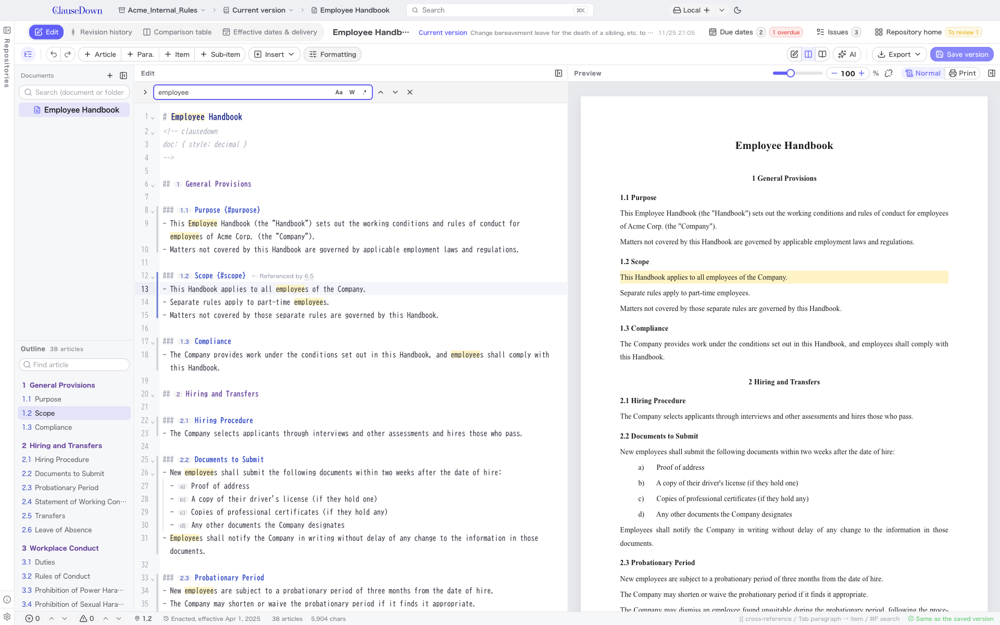

### Page breaks, font size and alignment

Settings that plain Markdown cannot express are written in curly braces `{…}`, using the same syntax as Pandoc. You can type them yourself or add them from the screen.

- Select text or lines in the editor, right-click and choose **Format selection…**. A screen opens where you can choose the font size, font, alignment, line height, table column widths and page break. Check the result in the sample, then click **Apply**.
  - If you selected part of a line, you can choose **Selected text only** or **Whole lines (article, paragraph, table, etc.)**. With whole lines, the formatting applies to the whole article, paragraph, table or other element.
  - If you open it without selecting anything, the formatting applies to the line with the cursor.
- **Format…** in the **Insert** menu opens the same screen. **Page break (before this line)** inserts a page break before the line with the cursor.
- The right-click menu also has **Cut**, **Copy**, **Paste** and cross-reference commands.

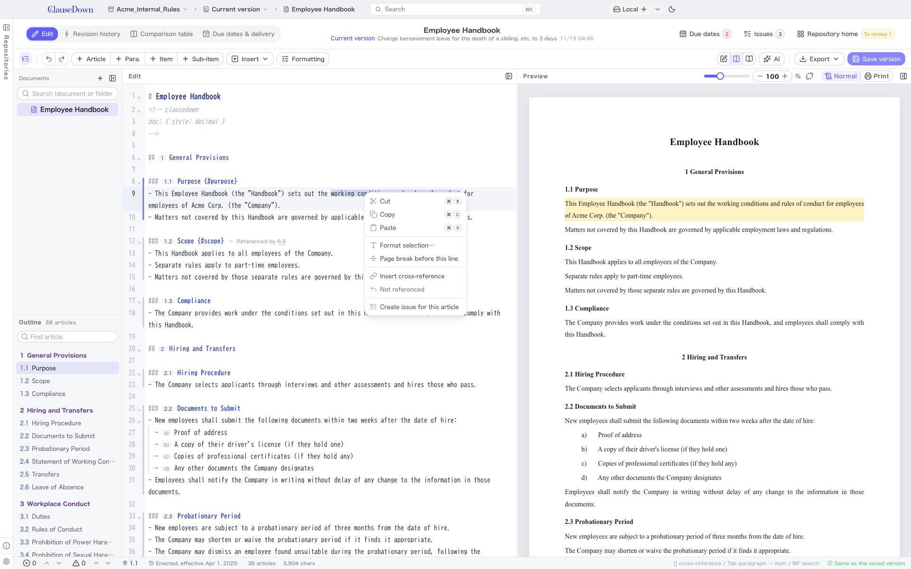

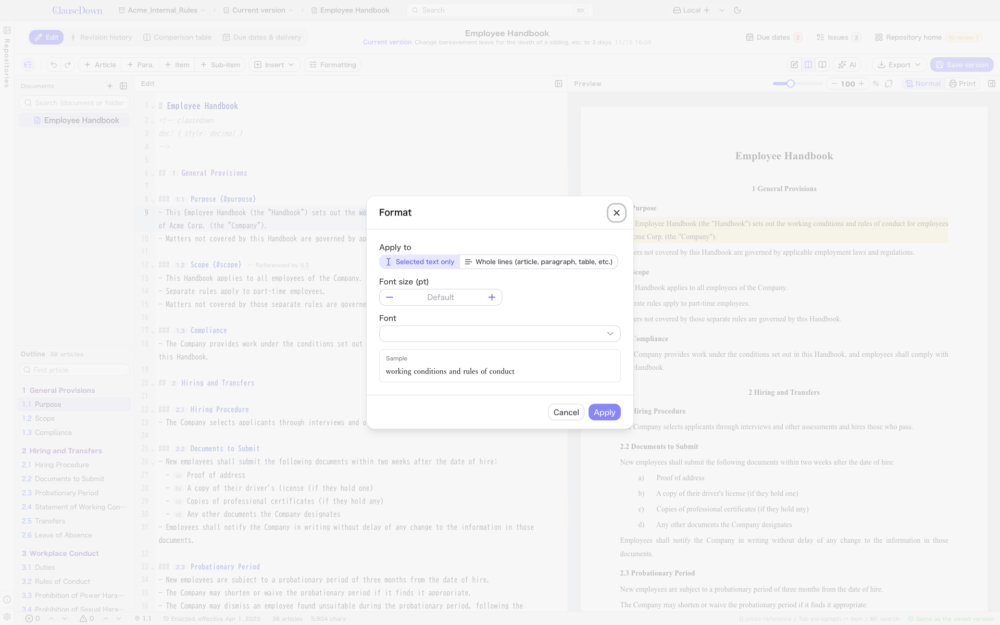

| How to write it | What it applies to |
|---|---|
| `[selected text]{size=12pt}` inside a sentence | The text inside the brackets |
| From a `::: {size=9pt}` line to a `:::` line | The articles, paragraphs, items, tables or closing lines between them |
| A line containing only `{right}` | The element on the next line (article, paragraph, item, table and so on) |
| A line containing only `{break}` | Inserts a page break before the element on the next line |

You can specify the following. To combine several, separate them with spaces (for example `{size=9pt right}`).

| Option | Example | Meaning |
|---|---|---|
| `size` | `size=9pt` | Font size, in pt, mm, % and so on. A plain number means pt |
| `font` | `font="BIZ UDゴシック"` | Font. Put names that contain spaces in `"` |
| `left`, `center`, `right` | `right` | Alignment |
| `line` | `line=1.4` | Line height (as a multiple of the font size) |
| `cols` | `cols=25,75` | Table column widths. A plain number means % |
| `break` | `break` | Page break before this element |

You can also use CSS names such as `font-size`, `font-family`, `text-align` and `line-height`.

The following example makes the table text smaller than the body text and sets the column widths to 1:3. (The text says "The fee shall be as shown in the following table", with a row for the monthly base fee.)

```md
- 委託料は、次の表のとおりとする。
  ::: {size=8.5pt cols=25,75}
  | 区分 | 内容 |
  |---|---|
  | 基本料 | 月額300,000円（消費税別） |
  :::
```
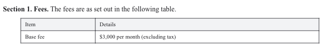

These settings are reflected in the preview, PDF and Word.
The comparison table ignores them when comparing, so a version that changes only these settings does not show as a change in the comparison table.

### Cover page and table of contents

You can put a cover page and a table of contents between the title (the `# ` line) and the first chapter. You can also add them with **Cover page** and **Table of contents** in the **Insert** menu.

```md
# Employee Handbook

::: cover
{right}
Confidential

{center size=26pt}
Employee Handbook

::: {center}
Policy No. 12

Effective April 1, 2026

Acme Corp. Human Resources
:::
:::

[[_TOC_]]

## General Provisions
```

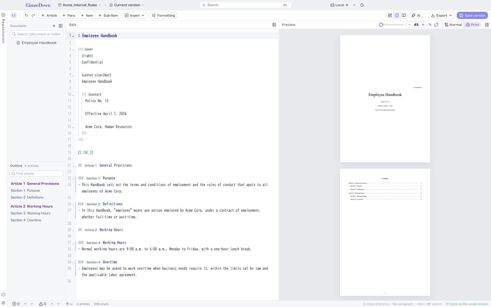

**Cover page**: everything from the `::: cover` line to its matching `:::` line is the cover page.

- Write it the same way as the body. There are no fixed fields or layout. You can use attributes such as `{right}` and `{center size=26pt}`, `::: {center}` blocks and images such as a logo.
- In PDF, the cover is the first page, centered vertically. It has no page number, and the body's page numbers start at 1 on the next page.
- In Word, the cover is a separate section, centered vertically.
- **Insert > Cover page** adds a template (confidentiality notice, title, subtitle, date and organization) right after the title. If the document already has a cover page, it moves to that line instead.

**Table of contents**: a line with only `[[_TOC_]]` shows the table of contents. This is the same syntax as GitLab, so GitLab also shows it as a table of contents. You can also write `[TOC]`.

- It lists chapters, articles, supplementary provisions and schedules. It leaves out the closing and signature block, and deleted articles.
- In PDF, each entry has its page number on the right, and clicking an entry jumps to that chapter or article. The table of contents gets its own page, followed by a page break.
- In Word, the page numbers are Word fields. When Word asks whether to update the fields that may refer to other files, choose **Yes** to fill in the page numbers. Ctrl-click (Command-click on a Mac) an entry to jump to that chapter or article.
- In the preview and in HTML exports, entries have no page numbers; clicking one jumps to that chapter or article.
- If you write it right after the cover page (before any preamble text), it comes on a page before the title. If you write it in the middle of the preamble, it appears at that point.
- **Insert > Table of contents** puts it after the cover page if there is one, or right after the title otherwise.

**Notes**

- A document can have one cover page and one table of contents. A second one, or one after the first chapter, produces a warning and is not treated as a cover page or table of contents.
- The comparison table does not show the cover page or the table of contents, and the houritsu export leaves them out.

### Merging table cells

Write only `>` in a table cell to merge it with the cell to its right, or only `^` to merge it with the cell above. This is the same syntax as the extended table syntax of Markdown Preview Enhanced, a VS Code extension.

```md
| 区分 | > | 内容 |
|---|---|---|
| 正社員 | 月給 | 期間の定めなし |
| ^ | 時給 | 試用期間中 |
```
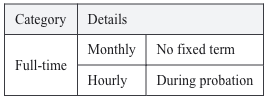
In this example, the first header cell (区分, "category") spans two columns, and 正社員 ("full-time employee") spans two rows.

- The text that is kept is the one in the top-right cell of the merged block.
- You cannot merge across the header row and body rows.
- Merged cells are reflected in the preview, PDF and Word. The comparison table compares tables with the merged-away cells removed.
- When you import houritsu statutes, merged cells are kept using this syntax.

### Writing math

You can write formulas, such as the calculation of a subsidy amount or a pro-rata formula, in LaTeX notation. They are displayed as math in the preview, printout and PDF. You can also insert them with **Math** in the **Insert** menu.

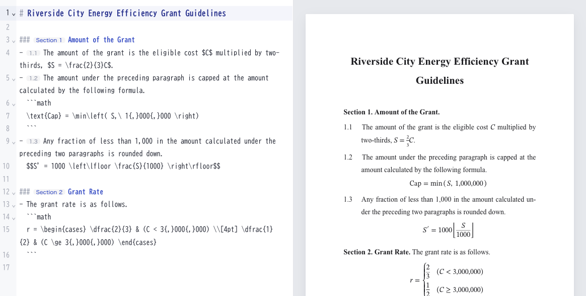

| How to write it | Result |
|---|---|
| `$S = \frac{2}{3}C$` inside a sentence | Math within the sentence |
| `$$S = \frac{2}{3}C$$` alone on a line | The line becomes a centered math block |
| A ` ```math ` block | A math block. Use it for long formulas or cases (`\begin{cases} … \end{cases}`) |

- Put Japanese (or other) words inside math in `\text{}`, as in `\text{上限額}` ("maximum amount").
- A `$` in an amount such as "US$1,000" is not treated as math. If there is Japanese text between two `$` signs, or the closing `$` is followed by a digit, the text stays as ordinary text. To write a literal `$`, type `\$`.
- If the syntax has an error, a yellow squiggle appears in the editor and the preview shows the reason.
- When you export to Word, math blocks are inserted as images. Math within a sentence is inserted as its source text (`S = \frac{2}{3}C`).
- Math is converted with [Temml](https://temml.org/) and displayed with the OS math font (STIX Two Math on macOS, Cambria Math on Windows).

### Exporting to PDF, Word and HTML

Choose a format from **Export** to open a screen where you choose where to save the file.

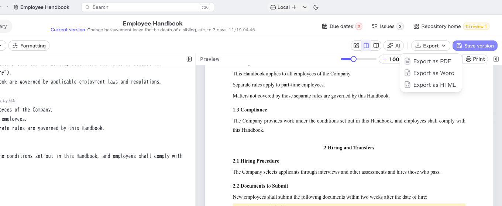

- **Export as PDF**, **Export as Word**: Exports the document as it will look when printed. Set the font, font size, margins and so on in **Print, PDF and Word formatting** in Settings ([chapter 17](#17-settings)).
- **Export as HTML**: Creates an HTML file that looks the same as the preview. Images are embedded in the file, so the single file opens in a browser.
- **Export as Markdown (houritsu)**: Creates Markdown with the article and paragraph numbers written into the text. This appears in the menu only when you turn it on under **Experimental features** in **Developer** in Settings ([chapter 15](#15-importing-and-exporting-houritsu-statutes)).

When the export finishes, the file name appears at the bottom right with **Open** and **Show in Explorer** (**Show in Finder** on a Mac) buttons. **Open** opens the file in the app installed on your computer; **Show in Explorer** opens the folder and selects the file. The same applies to exporting comparison tables and exporting due dates to a calendar.

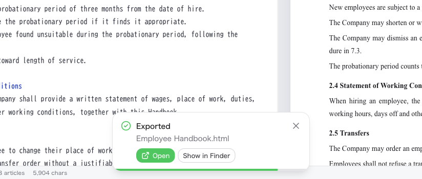

### How your writing is saved

What you type in the editor is written to the file on your computer automatically about 0.5 seconds after you stop typing. However, it is not yet recorded as a version. To keep a record you can look back at later, click **Save version** (next chapter). To throw away changes you have not saved as a version, click **Discard changes**.

---

## 7. Saving a version

At a good stopping point, click **Save version** at the top right, or press Ctrl+S in the editor. If nothing has changed since the last version, the button is disabled, and Ctrl+S tells you nothing has changed.

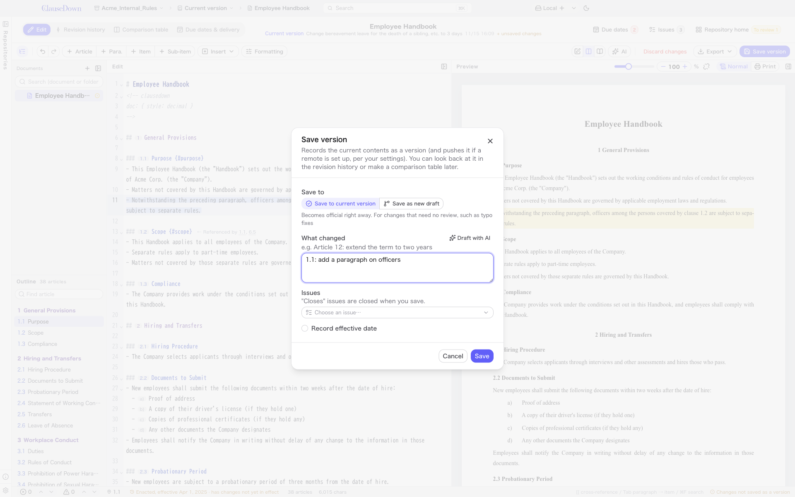

1. Choose **Save to**.
   - **Save to current version**: Becomes an official version immediately. Use this for changes that need no review, such as fixing typos.
   - **Save as new draft**: Moves your changes into a draft and saves them there. The current version does not change. Use this for changes you want someone else to review ([chapter 10](#10-revising-in-a-draft-getting-it-reviewed-and-merging-it-into-the-current-version)).
2. Under **What changed**, describe the change in one line, for example "Article 12: extend the term to two years". This text appears in the revision history list, so write it in a way that is easy to find later.
   - If AI is set up ([chapter 16](#16-asking-ai-to-check-or-rewrite)), a **Draft with AI** button appears above the field. Click it to have the AI read the changes since the last version and fill in a description. Check the text before you save; do not use it as is without reading it.
3. If the version is to take effect on a known date, turn on **Record effective date** and enter the date.
4. Click **Save**.

If there is a remote and **Push when saving a version** is on under **Sync** in Settings, the saved version is pushed to the remote right away.

**When the document is not yet in the current version** (a new document, or the first document saved in a repository), the dialog opens with **Save as draft** selected and the draft name set to "Create (document name)". Save your work in progress at each milestone, and when it is complete and reviewed, use **Merge into current** ([chapter 10](#10-revising-in-a-draft-getting-it-reviewed-and-merging-it-into-the-current-version)). Until then, it does not enter the current version. If the content is already final, choose **Save to current version** to make it an official version right away.

---

## 8. Viewing past versions in the revision history

Click the **Revision history** tab to see the list of versions of the document.

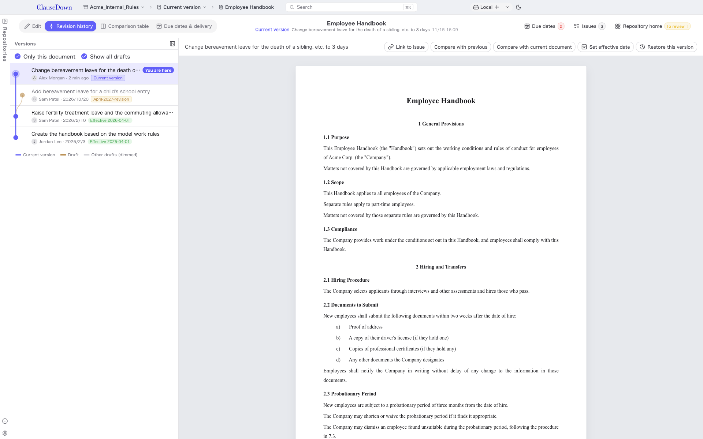

- The newest version is at the top of the list on the left. The line color distinguishes versions in the current version (blue) from versions in drafts (brown). Versions with a recorded effective date are marked, for example "Effective 2026-04-01".
- Turn on **Only this document** to show only versions that changed this document. Turn off **Show all drafts** to hide versions in drafts.
- Click a version to see its text on the right. The buttons at the top right let you:
  - **Compare with previous**, **Compare with current document**: Compare on the comparison table screen.
  - **Set effective date**: Make this version an effective version ([chapter 11](#11-recording-effective-dates-and-delivering)).
  - **Restore this version**: Return the document's contents to this version. The restored contents are treated as unsaved changes until you save a version.

---

## 9. Creating a comparison table

Click the **Comparison table** tab to build a table that sets two versions side by side, article by article. (In Japan, a comparison table of old and new text, 新旧対照表, is the standard way to present amendments.)

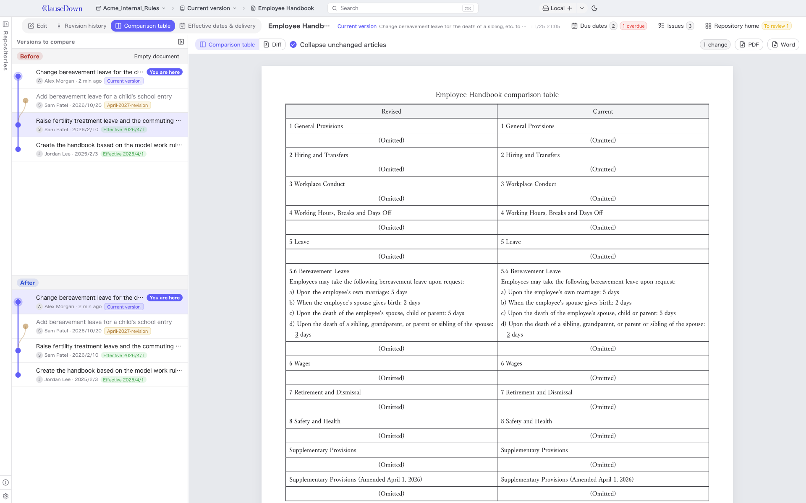

The **Versions to compare** pane on the left is split into upper and lower halves: choose the version before the change in the upper half and the version after the change in the lower half. Both are lists of this document's versions, the same as in the revision history, so you can see each version's description, who saved it, the date and any effective date marks while choosing.

1. In the **Before** list at the top, click the version to compare from. To compare with nothing, click **Empty document** to the right of the heading.
2. In the **After** list at the bottom, click the version to compare to. If you have unsaved changes, choose **Unsaved changes** at the top of the list to include them in the table.
3. Changed text is underlined. Turn on **Collapse unchanged articles** to replace unchanged articles with "（略）" ("(Omitted)").
4. The number of changes is shown at the top right. Click **PDF** or **Word** to export the table in the format currently shown.

For documents in an overseas format, the table is shown in the Diff format from the start, and the table headings and the omitted-text placeholder are written in the document's language (in English, "Revised / Current" and "(Omitted)"; German and French documents use German and French words).

When the screen opens, **Before** is set to the latest effective version (the current version if you are working in a draft, or the previous version if there are no effective versions), and **After** is set to the current document. If you opened it with **Compare with previous** or **Compare with current document** in the revision history, those two versions are selected.

Use the switch on the toolbar to choose the display format.

- **Comparison table**: A table with the revised text and the current text side by side. PDF and Word are exported in landscape.
- **Diff**: The text in document order, with deleted text in red strikethrough and added text in blue underline. You can follow each change within a single text. PDF and Word are exported in portrait, titled "(document name) changes".

Your chosen format is kept the next time you open the screen.

If you delete an article and add a different one, and the two have little in common, they are shown as two rows, "deleted" and "new", rather than as a change to one article.

---

## 10. Revising in a draft, getting it reviewed, and merging it into the current version

When you revise several articles at once, or want someone to review changes before they become official, work in a draft. What you write in a draft does not change the current version until you merge it.

### Creating a draft

Click the working draft in the title bar (**Current version ▾**) to open the list of drafts. The list shows, for each draft, the number of versions not yet merged into the current version, who saved last and the review status.

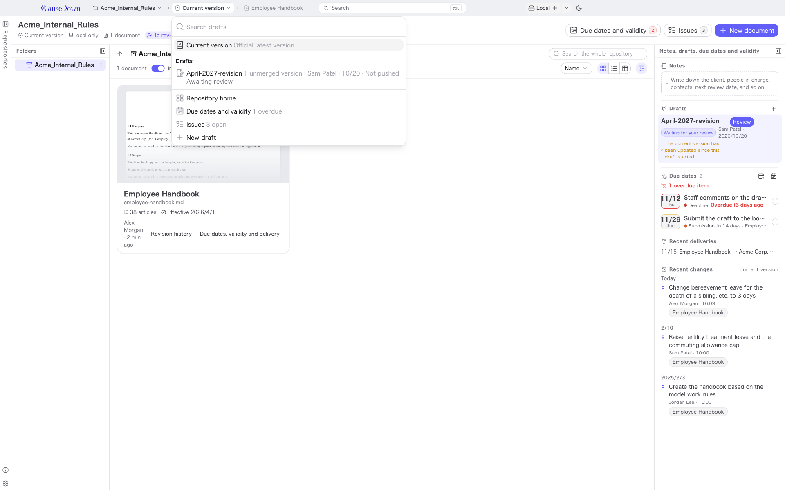

Click **New draft**, enter a **Draft name** (for example "April 2027 revision" or "Review of Article 3"), choose the version it is **Based on**, and click **Create and switch**. You can also create a draft by choosing **Save as new draft** when you save a version.

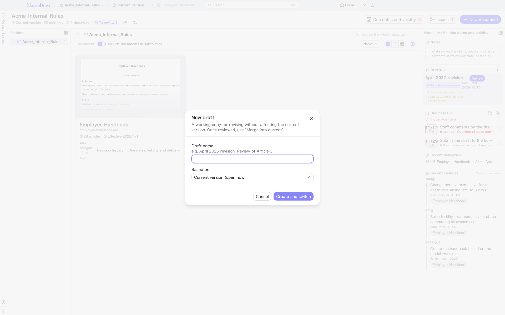

### Working in a draft

When you switch to a draft, its name in the title bar turns brown. A bar at the top of the screen says you are working on the draft and that changes here do not affect the current version. What you write and the versions you save in this state are recorded only in the draft.

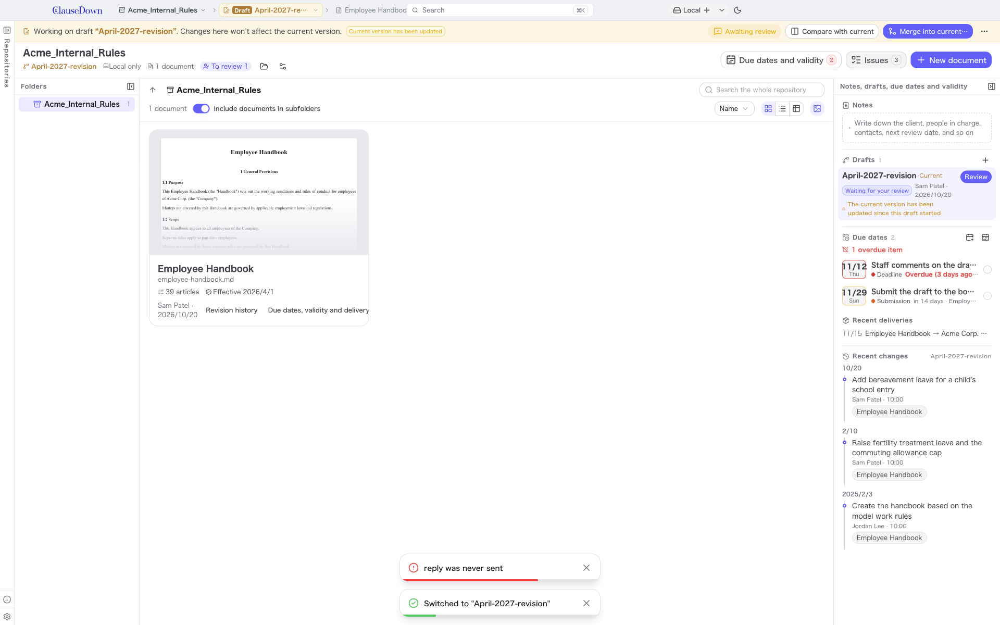

If the current version is updated after you created the draft, **Current version has been updated** appears. Use **Bring in latest current version** under "…" on the bar to bring those changes into your draft.

The buttons on the bar do the following.

- **Request review** (shows **Awaiting review** or similar depending on the review status): Opens the review request screen.
- **Compare with current**: Opens a comparison table against the current version.
- **Merge into current**: Puts the draft's contents into the current version.

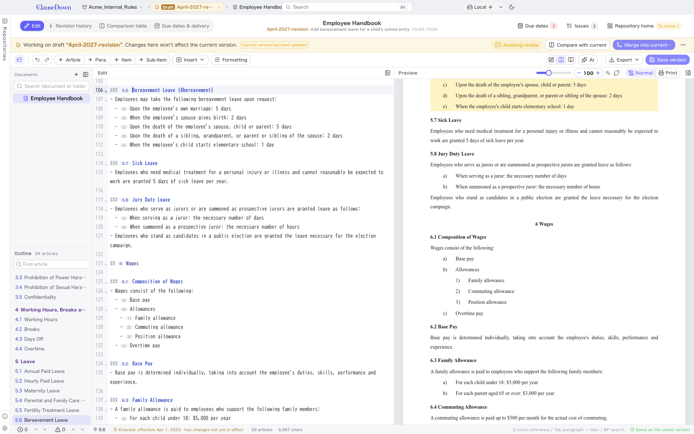

### Requesting and giving a review

The review request screen shows the request and its activity on the left, and a comparison table against the current version on the right.

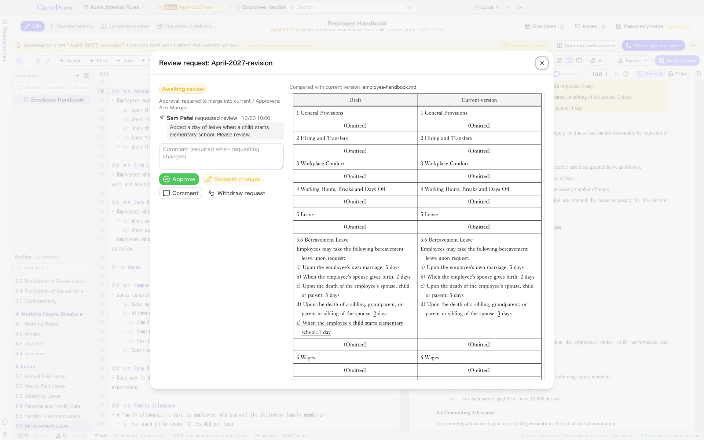

- The author of the draft clicks **Request review** to ask for a review.
- The reviewer looks at the contents and clicks **Approve**, **Request changes** or **Comment**. **Request changes** requires a comment.
- The requester can cancel the request with **Withdraw request**.

If the draft is changed after approval, the approval must be given again. If **Who can approve** is not set in the repository settings, anyone except the requester can approve; the requester cannot approve their own draft. Drafts you have been asked to review also appear under **Waiting for your review** on Home.

Signing approvals makes impersonated approvers and tampered records detectable. If **Approvals required** is set to 2 or more in repository settings, a draft cannot be merged until that many different approvers have approved it ([chapter 19](#signing-approvals)).

### Merging into the current version

Click **Merge into current** to open the merge screen. If the repository settings require approval and the draft has not been approved, the process stops here and suggests **Open review request**.

The same document may have changed in the current version after you created the draft. In that case, changes in different places are both kept automatically. You only need to choose, one by one, the places where both sides changed the same text (conflicts). In the image below, the number of days in Article 30 was changed in the current version and an item was added to the same article in the draft, so there is one conflict.

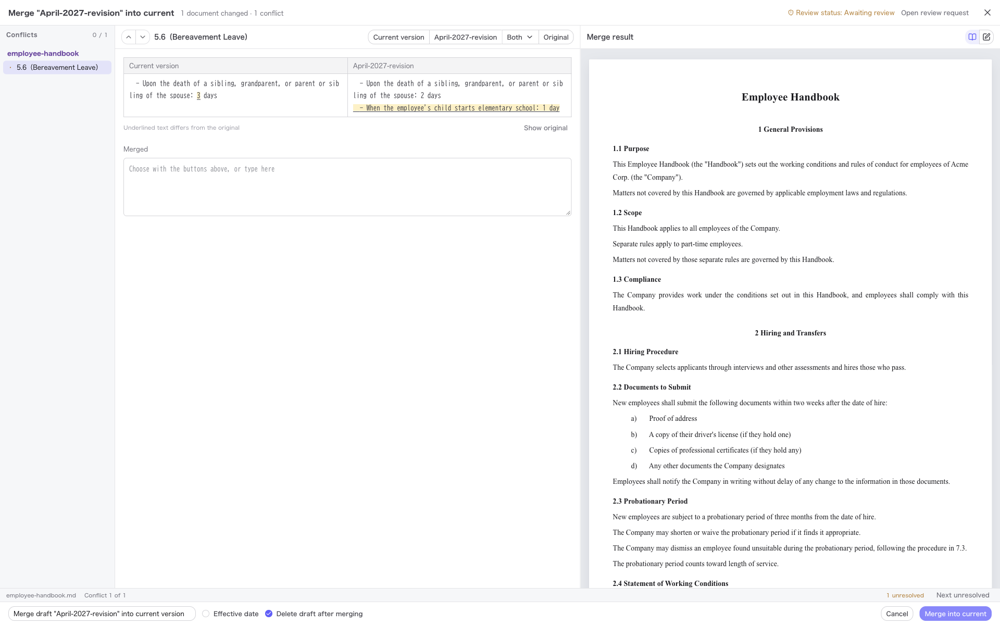

1. The conflicts are listed on the left. Compare the current version's text and the draft's text in the table in the center.
2. Use the buttons at the top to choose which to use (**Current version**, the draft's name, **Both** or **Original**). You can also type directly in the **Merged** field. The merged document is shown on the right.
3. When you have resolved every conflict, check the version message, effective date and **Delete draft after merging** in the fields at the bottom, then click **Merge into current**.

You cannot merge while any conflict is unresolved. If you stop partway, the document stays as it was before the merge.

---

## 11. Recording effective dates and delivering

### Setting an effective date

You can set an effective date with **Record effective date** when you save a version, or later by choosing a version in the revision history and clicking **Set effective date**. If an effective date with the same date already exists, it is moved to the newly chosen version.

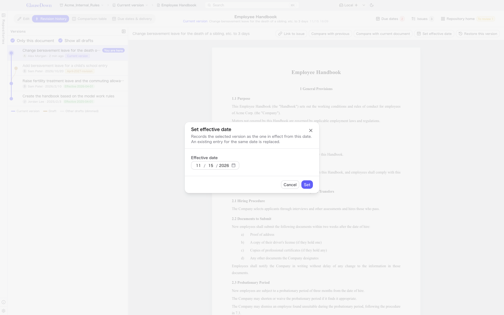

### The due dates and delivery tab

The document's **Due dates & delivery** tab shows the document's due dates, effective versions and delivery records together.

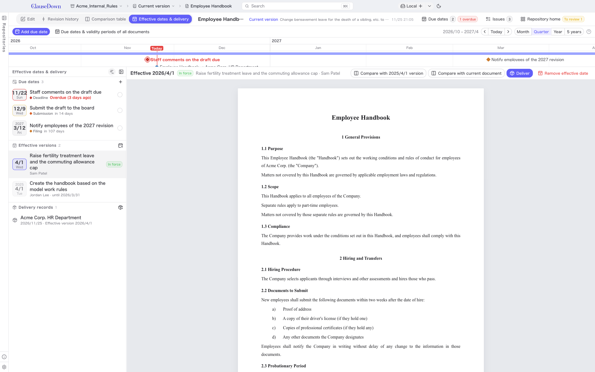

- At the top is a timeline for this document only. Use **Add due date** to record a due date for this document. The validity period of each effective version is shown as a band at the top of the row. Drag the border between the timeline and the list below to change the timeline's height (double-click to reset).
- The list on the left has three sections: **Due dates**, **Effective versions** and **Delivery records**. The version in force today is labeled **In force**. Effective versions that have a later version show the last day they are in force ("until …").
- Choose an effective version to see its text on the right. There are buttons to open a comparison table against the previous effective version or the current document, and **Deliver** and **Remove effective date** buttons. **Remove effective date** removes only the effective date record; the version itself is kept.

### Delivering

Choose an effective version and click **Deliver**.

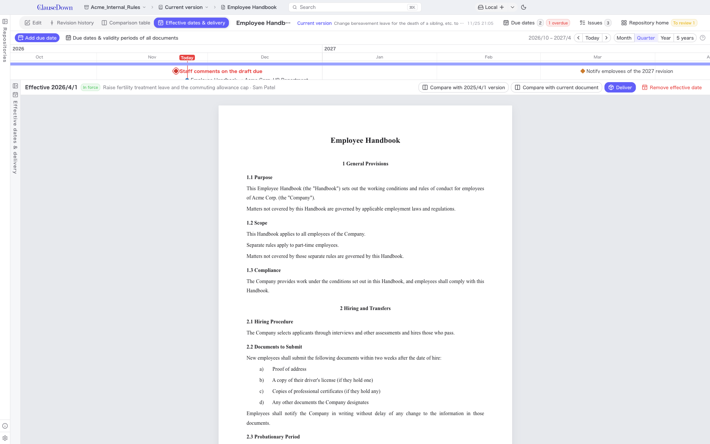

1. Under **Recipient**, enter who you are delivering to, for example "Legal Dept., Company A".
2. Under **Comparison base (before)**, choose the effective version to compare from.
3. Under **Items to deliver**, choose whether to include the document itself and the comparison table as PDF or Word.
4. Click **Choose folder and create** and choose a folder. Inside it, the app creates a folder named with the date, folder name and document title (for example "20261107_就業規則_納品") and places the chosen files in it.

The delivery is recorded in **Delivery records**. If the remote is on GitHub or GitLab, you can also attach the deliverables to a release on the remote.

If a PDF signing certificate is registered under **Digital signatures** in Settings, **Sign digitally** in the delivery dialog adds a digital signature to the delivered PDFs. With two or more certificates, choose which one next to it ([chapter 19](#adding-a-digital-signature-to-pdfs)). When the other party signs and returns a PDF, **Save the signed PDF you received** in the delivery record saves it to the delivery folder and adds it to the record ([chapter 19](#saving-a-returned-signed-pdf)).

---

## 12. Managing issues

You can record things to do, such as "Review the holidays in Article 12", as issues. Each issue gets a number (#1, #2 …), and by linking issues to versions and drafts you can later see which version resolved them. Issues work the same way as GitHub and GitLab issues, and you can use them even if the repository is not connected to a remote.

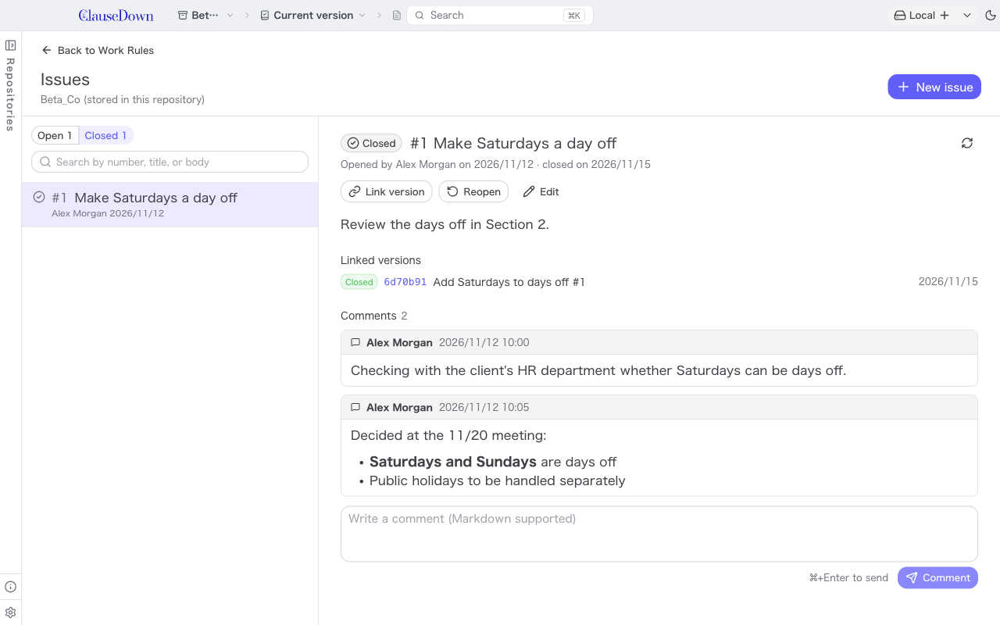

Open the issues screen with **Issues** at the top right of the repository home, **Issues** at the top right while a document is open, **Issues** in the draft menu, or **Issues** in the search window (Ctrl+K). The button shows the number of open issues. Click **← Back to …** at the top left to return to the screen you came from (a document or the repository home).

The list of issues is on the left; switch between **Open** and **Closed**. Click an issue to see its description and linked versions on the right.

### Creating an issue

1. Click **New issue** at the top right.
2. Write a title and a description. You can use Markdown in the description.
3. Click **Create**.

Right-click in the editor and choose **Create issue for this article** to open the form with the document name and article already filled in, for example "就業規則 第2条（休日）" ("Work rules, Article 2 (Holidays)").

### Linking versions and issues

**Choosing issues when you save a version**

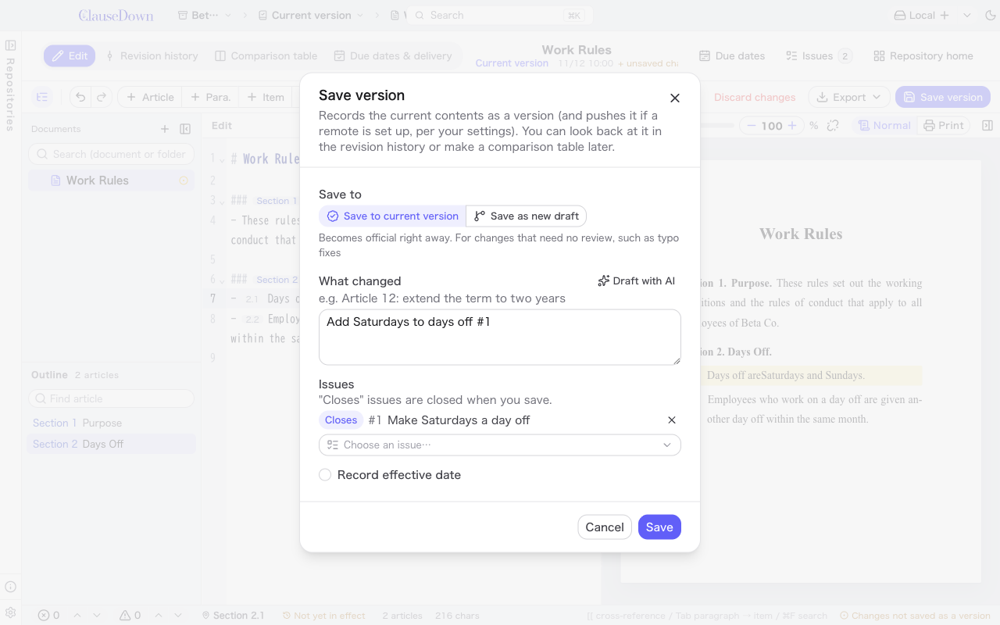

In the **Issues** field of the Save version dialog, choose open issues. Click the button to the left of a chosen issue to switch between the following.

- **Closes**: This version resolves the issue. A `Closes #1` line is added at the end of the message and the issue is closed (see the next section for when).
- **Relates to**: The version is kept as related to the issue. A `Refs #1` line is added to the message and the issue stays open.

**Writing the number in the message**

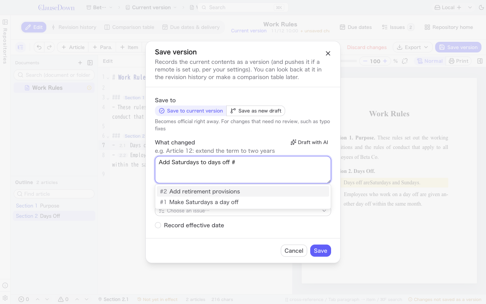

Type `#` in the **What changed** field to see a list of open issues. Choose one with ↑↓ and press Enter to insert its number. A version whose message contains `#1` is linked to issue #1; a version whose message contains `Closes #1`, `Fixes #1` or `Resolves #1` resolves issue #1. (These keywords are the same ones GitHub and GitLab use.)

`#1` in messages shown in the revision history, on Home and elsewhere opens the issue when clicked.

**Linking a version after saving**

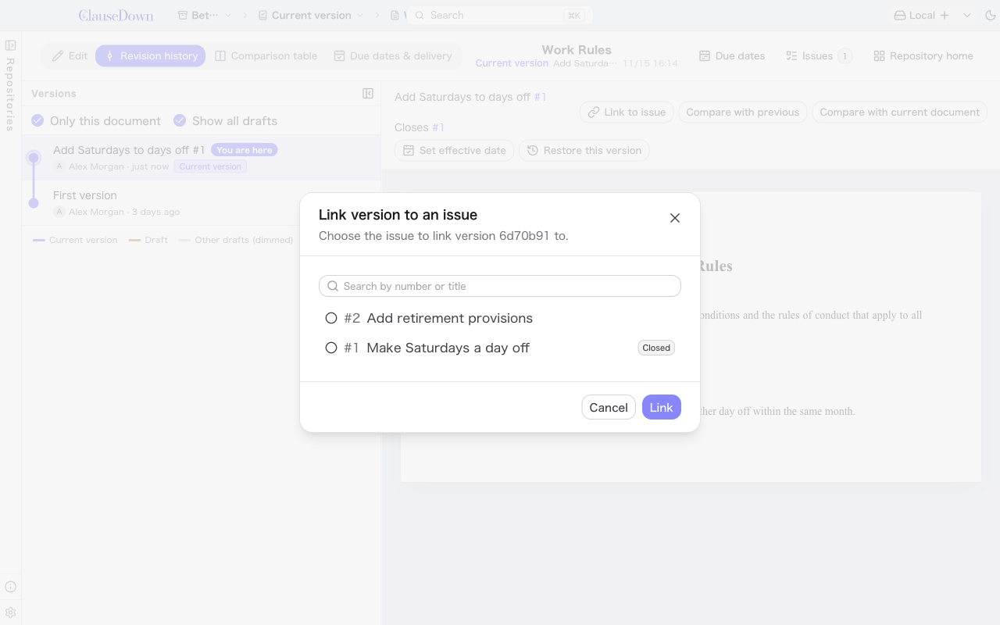

In the revision history, choose a version, click **Link to issue** at the top right and choose an issue. You can do the same with **Link version** on the issues screen.

**Linking a whole draft**

While working in a draft, choose issues with **Issues resolved by this draft…** in the draft menu. The chosen issues are closed when the draft is merged into the current version.

### Closing an issue

An issue is closed when the version that resolves it **enters the current version**.

- When you save a `Closes #1` version to the current version: it closes immediately.
- When you save a `Closes #1` version to a draft: it does not close yet. It closes when the draft is merged into the current version.
- Issues linked through the draft menu: they close when the draft is merged into the current version.

To close an issue by hand, click **Close** on the issues screen. You can choose the version that resolved it (or close it without choosing one). Click **Reopen** to return a closed issue to open.

### Discussing in comments

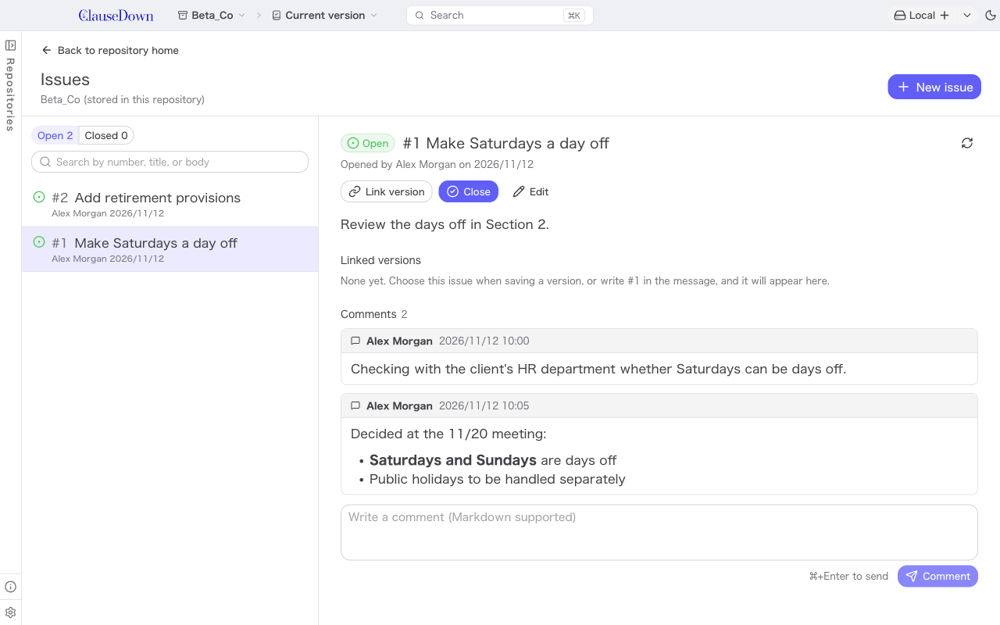

Write a comment in the field below the issue and click **Comment** to add it. You can also send it with Ctrl+Enter (⌘+Enter on a Mac). Recording progress such as "Checking with the other party" or "Decided at the Nov 20 meeting" lets you trace later why the text was written that way.

- You can use Markdown in comments (lists, bold, links and so on). Links open in your browser.
- Comments are listed oldest first, with the author and date and time.
- At present, you cannot edit or delete comments in the app.

Comments work in repositories without a remote too. They are saved in the repository's records, and after syncing they can be seen on other computers. If two computers add comments at the same time, both are kept.

### When connected to GitHub or GitLab

When the remote is on GitHub or GitLab, issues are that site's issues. Issues created in the app appear on the site, and issues created on the site appear in the app. Click **Open on GitHub** (**Open on GitLab** for GitLab) to open the issue in your browser.

- Comments are the issue's comments. Comments written on the site appear when you open the issue. To see new comments while the issue is open, click the reload button at the top right. To edit or delete a comment, do it on the site.
- Linked versions are recorded on the site as an issue comment ("Linked version … (ClauseDown)"). In the app's comment list, these are shown as one-line records, separate from discussion comments.
- When a `Closes #1` version enters the current version, the site closes the issue.
- Issues linked to a draft are added to the description of the review request (pull request or merge request) as `Closes #1`.

**Moving issues created locally**: Issues you created before connecting to a remote can be moved to the site from a prompt on the issues screen after you connect. Their comments move with them. Because the author on the site will be the account that connected, the original author and date are written at the top of each comment, for example "(Comment by Clerk A, 2026/11/12 14:03)". In a new, empty repository, the numbers stay the same (#1 stays #1). If the site already has issues or pull requests and the numbers shift, the original number is noted in the moved issue's description. `#number` references in the messages of past versions may point to a different issue on the site.

On GitHub, the ClauseDown GitHub App needs the Issues permission. If it lacks the permission, a message appears when you open an issue.

---

## 13. Managing due dates and validity periods

Record dates such as effective dates, promulgation, submission, filing, application, start, end, renewal and deadlines for each document (or for the whole repository). Recorded due dates are shared with everyone who uses the repository. They are recorded without saving a version.

### The due dates screen

Open the due dates screen with **Due dates** at the top right of the repository home, or with **Due dates** in the right pane.

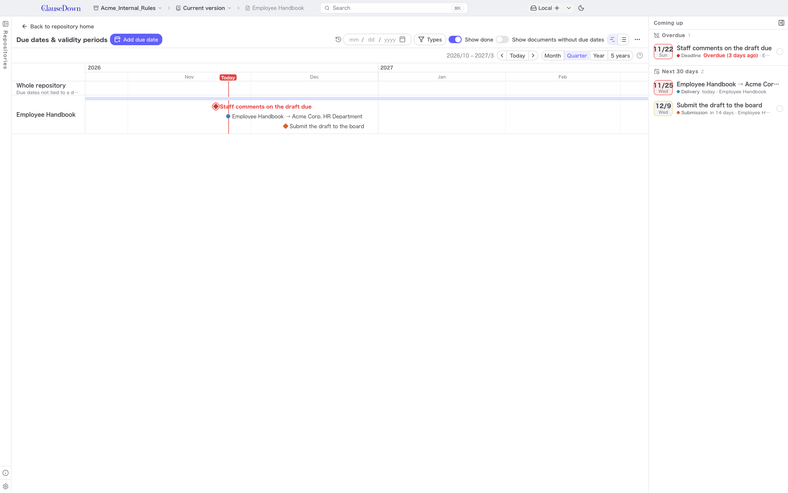

- It is a timeline with documents arranged vertically and dates horizontally. The top row, **Whole repository**, is for due dates not tied to a document.
- A single-day due date is shown as ◆, and a period (a due date with a start and end date) as a band. The color depends on the due date type.
- The red vertical line is today. Due dates that have passed and are not marked as done are outlined in red.
- **Due date details** on the right shows overdue items, items in the next 30 days and items recently marked as done.

Timeline controls:

| Action | Result |
|---|---|
| Click **Month**, **Quarter**, **Year** or **5 years** | Change the scale |
| Ctrl+wheel | Zoom in or out |
| Drag the background, or Shift+wheel | Move to earlier or later dates |
| Click **Today** | Center on today again |
| Double-click an empty area | Add a due date on that date |
| Click the scale at the top | Set that day as the selected date |
| Click a validity period band | Select that effective version |
| Drag a due date | Move its date (repeating due dates, effective versions and delivery records cannot be moved) |
| Click a due date | Show its details on the right |

Click a due date to see its details on the right, with **Mark as done**, **Edit** and **Delete** buttons. The image below shows a due date for submitting a draft to the board of directors selected.


Use **Type** on the toolbar to filter by type, and **Show done** to show or hide due dates marked as done. Use the button on the right to switch between the timeline and the list.


### Validity periods and versions on a given date

A version with an effective date is in force from that date until the day before the next version's effective date. This period is called the validity period and is shown as a band at the top of the document's row on the timeline. The band for the last effective version extends to the right with no end.

Enter a date in the date field on the toolbar, or click the scale at the top, to see which versions were in force on that date.

- A blue dotted line is drawn on the timeline, and the bands that include that date are shown darker.
- The top of the right pane shows "Versions on (date)". For each document, it lists the validity period of the effective version in force on that date. Documents that first took effect after that date show **Not yet effective**.
- Click a document to open its **Due dates & delivery** tab with that effective version selected and its text shown.
- Click × in the date field to clear the date.

Click a validity period band to select that effective version's effective date and show the validity period in the details on the right. Click **Open due dates, validity & delivery** to open the tab with that effective version selected.

Effective dates set on **Whole repository** (not tied to a document) are shown as bands in the **Whole repository** row and are not included in each document's validity periods.

### Adding a due date

Click **Add due date**.


1. Choose a **Type**.
2. Enter a **Name**. If you leave it blank, the type name (for example "Renewal") is used.
3. Under **Applies to**, choose a document. **Whole repository** means the due date is not tied to a document.
4. Enter the **Date**. Type numbers into the year, month and day fields, or click the calendar button to pick a date. Dates that do not exist (such as February 30) cannot be entered. Turn on **Make it a period** to also enter an end date.
5. Under **Repeat**, choose **Yearly** or **Monthly** to repeat on the same date. You can also set when it ends. If a month has no such date (for example the 31st), the last day of the month is used.
6. Under **Notify**, choose how many days in advance to be notified. Choose the type default to use the number of days set for the type.
7. Click **Add**.

### Done and overdue

Among the default types, Submission, Filing, Application, Renewal and Deadline are types you mark as done. They stay in the list until you mark them as done, and once the date has passed they show as **Overdue**. Effective, Promulgation, Start and End are treated as complete once the date arrives, so no **Mark as done** action is shown for them. You can change which types are marked as done in the due date type settings.

Repeating due dates are marked as done one occurrence at a time. Occurrences older than 90 days (monthly) or 400 days (yearly) do not count as overdue even if they are not marked as done.

### Changing due date types

Change each type's name, color, whether it can be marked as done, and how many days in advance to notify by default under **Due date types** in the repository settings. You can also open it with the button at the right end of the due dates screen's toolbar. Types are set per repository and shared with everyone who uses it.


Use **Add type** to add your own types (for example, inspections or shareholders' meetings). Types that are in use by a due date cannot be deleted.

### Desktop notifications

Turn on **Show desktop notifications for due dates** under **Due dates** in Settings. While the app is running, it checks due dates every hour and notifies you through the OS of due dates whose notification day has arrived and of overdue ones. Each due date is notified only once. No notifications are shown while the app is closed.


### Exporting to a calendar app

Click the button with a calendar and a down arrow on the due dates screen's toolbar (**Export to calendar**) to export due dates to an iCalendar (.ics) file. You can import it into calendar apps that support iCalendar, such as Outlook and Google Calendar.

- Due dates not marked as done and effective dates from one year ago to five years ahead are exported.
- Each occurrence of a repeating due date becomes one event.
- An alarm is set for 9:00 on the notification day.
- The exported file is a snapshot of the due dates at that time. Changes you make later in the app are not reflected in the calendar; export and import again. Whether reimporting replaces the earlier events or adds duplicates depends on the calendar app.

Clicking the same button in **Due dates across all repositories** on Home exports the due dates of all repositories together.

---

## 14. Sharing with other computers and other people

With a remote (GitHub or GitLab), several computers in your organization and other people can use the same repository. Repositories without a remote are managed only on your computer.

### Connecting to GitHub.com

On GitHub, first install the ClauseDown GitHub App on the repositories you will use, then sign in from the app. You install it only once per account (or organization).

**Installing on repositories**

1. Under **GitHub/GitLab** in Settings, click **Install** for GitHub. The ClauseDown GitHub App page opens in your browser.

2. Click "Install". If it is already installed, the button says "Configure"; click it to change where it is installed.

3. Choose the account or organization to install it on and click "Continue".

4. Under "Repository access", choose "Only select repositories", then under "Select repositories" choose only the repositories you will use with ClauseDown. When done, click "Install" (or "Save" if you are changing the settings).

   

To add more repositories later, use the same **Install** button and choose again.

**Signing in from the app**

1. Under **GitHub/GitLab** in Settings, click **Sign in** for GitHub. A code appears in the app and a GitHub page opens in your browser.

   

2. Click **Copy** in the app to copy the code.

3. In the browser, choose your account and click "Continue", paste the code and click "Continue".

4. Click "Authorize ClauseDown".

5. Back in the app, the GitHub section shows the name of the account you signed in with.

The code expires after 15 minutes. If it expires, click **Sign in** again.

### Connecting to GitLab.com

1. Under **GitHub/GitLab** in Settings, click **Sign in** for GitLab.com. A code appears in the app and a GitLab page opens in your browser.

2. Click **Copy** in the app to copy the code, paste it into "Device code" in the browser and click "Authorize".

   

3. On the authorization screen, click "Authorize" again.

4. Back in the app, the GitLab.com section shows the name of the account you signed in with.

Unlike GitHub, GitLab has no way to choose only certain repositories. ClauseDown can connect to every project the signed-in account can access.

### Connecting to your company's GitLab

If your organization hosts its own GitLab, enter its URL in the company GitLab field under **GitHub/GitLab** in Settings and add it. Ask your GitLab administrator how to sign in.


### Pushing a repository to a remote

For a repository without a remote, the sync button on the right of the title bar shows **Local**. Choose **Add remote…** from **+** or from **▾** on its right.


Follow the steps on the screen that opens.

1. Choose where to host the remote (GitHub.com, GitLab.com or a company GitLab you have added).
2. If you are not signed in yet, sign in with **Open sign-in settings**.
3. Click **Create on GitHub** (**Create on GitLab** for GitLab) and create an empty repository in your browser.
   - On GitHub, choose "Private", do not add "Add README", "Add .gitignore" or "Add license", and click "Create repository".

     

   - On GitLab, choose "Private", uncheck "Initialize repository with a README" and click "Create project".

     

4. On GitHub, use **Open app settings** to add the repository you created to the repositories where the ClauseDown GitHub App is installed.
5. Copy the URL of the repository you created, paste it, and click **Push to remote**.
   - On GitHub, copy the HTTPS URL under "Quick setup" on the page shown right after creating the repository.

     

   - On GitLab, click "Code" and copy the URL under "Clone with HTTPS".

     


The current version, drafts and all records are pushed, and from then on the repository syncs with that remote.

### Syncing

In a repository with a remote, the sync button shows the current state. If there are versions not yet pushed, it shows the count, for example "2 to push". If you have unsaved changes and the remote's versions cannot be fetched, it shows **Can’t pull**. Click the button to fetch versions from the remote and push your local versions. If you click it while a sync is running, a second sync does not start; it waits for the running one to finish. Under **Sync** in Settings, choose whether to sync on startup and whether to push when you save a version.

If the same place was changed on two computers, the sync button shows **Conflicts**. Click it to resolve each conflict on the same screen used for merging into the current version ([chapter 10](#merging-into-the-current-version)). Due dates, review requests and delivery records are all kept even if they were added on two computers at the same time.

---

## 15. Importing and exporting houritsu statutes

[houritsu](https://github.com/Kohei-Wada/houritsu) is a repository that converts Japanese statutes from e-Gov Law Search (the Japanese government's statute database) into Markdown and keeps their amendment history as Git versions. ClauseDown can convert statutes in this format into ClauseDown documents and import them. It can also export ClauseDown documents in the same format. This feature is for Japanese statutes.

### Importing

When you add a folder containing houritsu-format .md files as a repository, a screen asks whether to convert them. The app recognizes the houritsu format by the information at the top of each document (the section with the statute number and similar details).


Click **Convert and save version** to convert all documents to the ClauseDown format and save them as one version.

- Article, paragraph and item numbers and text are kept as they were. Places where numbers do not run consecutively from 1 (articles in supplementary provisions, branch numbers such as 第三条の二 (Article 3-2), deleted articles) are kept using the syntax for fixed numbers ([chapter 6](#writing-articles-paragraphs-and-items)).
- Chapter headings are kept. Headings for parts, sections, subsections and divisions (編・節・款・目) are removed.
- HTML tables are converted to ClauseDown tables. Merged cells are kept with the `>` and `^` syntax ([Merging table cells](#merging-table-cells)).
- Documents with unsaved changes are not converted.
- The original form remains in the version history.

When the conversion finishes, the app lists documents with points you should check, for example when paragraph numbers were added to old supplementary provisions that had none, or when article numbers do not match the original.


Converted documents can be edited, saved as versions and used in comparison tables like any other document.


### Exporting

Turn on **Export to Markdown (houritsu)** under **Experimental features** in **Developer** in Settings, and the item appears in the editor's **Export** menu. **Export** → **Export as Markdown (houritsu)** creates Markdown with article, paragraph and item numbers written into the text. For imported documents, the information at the top (statute number and so on) is restored as it was. Consecutive deleted articles are combined, as in 第三条から第五条まで　削除 ("Articles 3 to 5: Deleted").

---

## 16. Asking AI to check or rewrite

Click **AI** in the editor to open the AI panel on the right. You can ask for a legal check of the text, polishing of wording, fixing cross-references, an explanation of the changes and more.

The AI can only read documents, run mechanical checks and rewrite documents on your computer. Saving versions, merging into the current version, effective dates, delivery and review requests are done by people on screen. Changes made by the AI appear in the editor immediately. You can undo them with Ctrl+Z, **Undo the AI changes** or **Discard changes**. If you type in the editor while the AI is rewriting, changes in different places are both kept; if they are in the same place, what you typed in the editor is kept.


If the window is too narrow to show the editor, preview and AI panel side by side with a readable preview, the preview is collapsed into a thin strip at the right edge. Click the strip to collapse the AI panel and show the editor and preview side by side.

Before you start, choose a provider under **AI** in Settings.


- Under **AI provider**, choose Claude (Anthropic), an OpenAI-compatible service, Ollama (AI that runs on your computer), OpenRouter or GitHub Models.
- Enter the API key the provider needs, or sign in. Click **Test connection** to check that it works.
- Your document's contents are sent to the AI company you chose. If you do not want documents to leave your computer, choose Ollama.
- To use Ollama running on a server on your company network, turn on **Connect to Ollama on the LAN** under **Experimental features** in **Developer** in Settings, and enter an address such as `http://192.168.x.x:11434/v1` in **Ollama address**. The same applies to OpenAI-compatible endpoints (such as LM Studio). LAN addresses are private addresses (10.x.x.x, 172.16–31.x.x, 192.168.x.x) and names ending in `.local` and similar. Documents travel over the LAN unencrypted.

### Using Claude Desktop or Claude Code

You can also read, check and rewrite ClauseDown documents from Claude Desktop (via MCP).

1. Under **AI** in Settings, turn on **Connect from external AI (MCP)**.
2. **Claude Desktop**: Click **Register** under **Claude Desktop** and restart Claude Desktop. Ask in the chat, for example, "Look up the Ministry of Health, Labour and Welfare's model work rules online and write rules for a monthly variable working-hours system", and Claude answers and edits using your ClauseDown documents.
3. **Claude Code**: Copy the command under **Claude Code** and run it in a terminal.

- It works only while ClauseDown is running. If ClauseDown is closed, Claude replies that ClauseDown is not running.
- It can do the same things as the AI panel in the editor. It cannot save versions, merge into the current version or deliver. Changes made by Claude appear in the editor immediately and can be undone with Ctrl+Z or **Discard changes**.
- If you move ClauseDown to another location, click **Register again**. When you no longer use it, click **Unregister**.

---

## 17. Settings

There are two kinds of settings: settings for the whole app on your computer, and settings for each repository.

When Settings is open, **Settings** in the left pane changes to **Close settings**. Click it to return to the screen you were on before (such as the document you were editing). You can also go back with the **Back to (document name)** button at the top left of the Settings screen. The repository settings and **About ClauseDown** have the same back button.

### App-wide settings

Open these with **Settings** at the bottom of the left pane. They are saved only on your computer and do not affect anyone else.

| Section | Main options |
|---|---|
| Profile | How the name recorded on versions and review requests is chosen, and the name and email (git: user.name, user.email) |
| Appearance | Display language, light or dark mode, zoom, and whether to reopen the last document on startup |
| Editor | Editor font, font size, line numbers, line wrapping, bracket pair guides, number display, spelling and proofreading |
| Sync | Sync on startup, push when saving a version |
| Due dates | Desktop notifications |
| Export | Default folder for exported files, whether to add the date to file names |
| Digital signatures | Signing keys for versions and approvals, PDF signing certificates and timestamps, seals and signature images ([chapter 19](#19-digital-signatures)) |
| Print, PDF and Word formatting | Defaults for body font, font size, line spacing, margins and page numbers |
| GitHub/GitLab | Signing in to remotes ([chapter 14](#14-sharing-with-other-computers-and-other-people)) |
| AI | AI provider ([chapter 16](#16-asking-ai-to-check-or-rewrite)) |
| Repositories | Adding, switching, duplicating, forking and removing repositories ([chapter 3](#3-setting-up-a-repository)) |
| Developer | Adding sample repositories, typesetting CSS, resetting settings |

### Profile

Under **Name from**, choose where the name recorded as the person who saved a version comes from.


- **GitHub or GitLab account**: Uses the name and email of the account you signed in with. In repositories whose remote is on GitHub or GitLab, that account's name is used, so names match the remote's history. If you are signed in to two or more accounts, you can choose the account to use for repositories without a remote.
- **Enter it myself**: Uses the name and email you enter in every repository. If you leave the name blank, the name of a signed-in account is used.

You cannot save versions until a name is set.

### Developer


- **Add sample repositories**: Creates the samples from [chapter 3](#trying-the-sample-repositories) in the folder you choose. If a folder with the same name exists, a number such as (2) is added to the name.
- **Typesetting CSS**: The CSS that controls how the text looks in the preview and in PDFs (including comparison table PDFs). The field starts with the default CSS, which you edit. Changes appear in the preview immediately. You can find class names such as articles (`.cd-article`), article headings (`.cd-art-title`), paragraphs (`.cd-para`) and items (`.cd-item`) in the default CSS in the field. **Restore default** returns to the default CSS. It is not used for Word export.
- **Reset appearance, editor and other settings**: Returns the theme, zoom, editor, sync, due date notifications, export, print formatting and typesetting CSS to their initial state. Your profile, sign-ins, AI settings and repository list are not changed.
- **Reset everything**: Deletes all settings, sign-ins, AI API keys and the repository list saved on your computer, and restarts the app. Repository folders and documents are not deleted. Permissions granted on GitHub and GitLab remain; to remove them completely, revoke them on each site.
- **Experimental features**: Turn on features that are not finalized yet to try them. Their names and behavior may change, or they may be removed.
  - **Clause library**: Keep frequently used clauses (confidentiality, exclusion of organized crime groups and so on) in a library repository, and insert them into documents with **Insert** → **From clause library…** in the editor. After turning it on, choose the repository that holds the clauses under **Library repository**. Library documents are written, saved as versions and synced like any other document. When you choose a clause, it is inserted after the article with the cursor. If the clause contains references to other articles (such as `[[purpose]]`), a screen asks which article in the target document each one should point to. Articles with the same heading are preselected. If there is no matching article, you can either remove the reference and keep the heading text, or leave it as is.
  - **Connect to Ollama on the LAN**: Allows LAN http addresses (such as `http://192.168.x.x:11434`) for Ollama and OpenAI-compatible endpoints ([chapter 16](#16-asking-ai-to-check-or-rewrite)).
  - **Export to Markdown (houritsu)**: Adds **Export as Markdown (houritsu)** to the editor's **Export** menu ([chapter 15](#15-importing-and-exporting-houritsu-statutes)). Because houritsu is a format meant to be used together with a Git version history, exporting a single document has limited use.

### Repository settings

Open these by choosing **Repository settings** from the repository name in the title bar, or with the settings button in the repository home. Except for the display name, they are recorded in the repository and shared with everyone who uses it.

**Print, PDF and Word formatting**: For the whole repository or for each folder, override the font, font size and so on from the app-wide settings. Options you do not change use the setting one level up (the whole-repository setting for a folder, and your computer's settings for the whole repository). A sample printed with the chosen formatting is shown below.


**Approval rules**: Turn on **Require approval before merging into current** to prevent unapproved drafts from being merged into the current version. Enter names under **Who can approve** to count approvals only from those people. Use the name from each person's **Profile**, or their GitHub or GitLab username.

For the number of approvals required, how unsigned approvals are treated, signing the rules and exporting the key list, see [chapter 19](#signing-the-rules).


**Due date types**: See [chapter 13](#changing-due-date-types).

### Dark mode

Use the button at the right end of the title bar to switch between light and dark mode.


### Updating the app

Open **About ClauseDown** at the bottom of the left pane and click **Check for updates**.

1. If a new version is available, its version number and changes are shown. Click **Download**.
2. When the download finishes, the button changes to **Restart to update**. Click it to close the app, install the new version and restart. Any document you are in the middle of writing is saved to your computer before the app closes.

The app never installs a new version on its own. If you close the app without clicking **Restart to update**, you keep using the current version.

How updating works depends on how you installed the app.

| Installed with | How to update |
|---|---|
| Windows (download, PowerShell, winget) | Update inside the app as described above. You can also update with `winget upgrade ShiozakiShota.ClauseDown` |
| macOS (Homebrew) | Click **Update** → **Restart to update** to close the app, replace it with the new version through Homebrew and restart. If this fails, the next time you start the app it shows the reason and the command to run by hand |
| macOS (download, Terminal command) | Install the new version from **Open download page**. You can also update by running the Terminal command again |

---

## 18. Keyboard shortcuts

| Key | Action |
|---|---|
| Ctrl+K | Find documents, articles, drafts and actions by name |
| Ctrl+S | Save a version (in the editor) |
| Ctrl+F | Search and replace in the editor |
| F8 / Shift+F8 | Go to the next / previous problem (squiggle) |
| Ctrl+Shift+M | Open or close the Problems pane |
| Ctrl+Alt+A | Add an article |
| Ctrl+Alt+P | Add a paragraph |
| Ctrl+Alt+I | Add an item |
| Tab / Shift+Tab | Demote a paragraph to an item / promote an item to a paragraph (the same for items and sub-items) |
| Enter | Add a line of the same kind after a paragraph or item line |
| `[[` | Show cross-reference suggestions |
| Ctrl+Z / Ctrl+Y | Undo / Redo |
| Ctrl+wheel (editor) | Make editor text larger or smaller |
| Ctrl+wheel (preview) | Zoom the preview in or out |
| Ctrl+wheel (due dates screen) | Zoom the timeline in or out |
| Shift+wheel (due dates screen) | Move the timeline earlier or later |
| Any key or click (at startup) | Skip the logo animation |

On macOS, use ⌘ (Command) instead of Ctrl and ⌥ (Option) instead of Alt. Redo is ⇧+⌘+Z.

---

## 19. Digital signatures

The **Digital signatures** section of Settings turns on four features. All of them are off at first, and nothing changes until you set them up.

- **Version signing**: lets anyone check later who saved a version.
- **Approval signing**: lets anyone tell who approved a draft, even if the record is edited afterwards.
- **PDF signatures**: lets PDF viewers confirm that an exported PDF has not been changed and who signed it.
- **Seal and signature images**: places a seal or handwritten signature image in the signature block. This is only a picture, not a cryptographic signature.

### Signing versions

Under **Sign versions**, choose the key used for signing.


| Option | What it does |
|---|---|
| Off | Versions are not signed |
| App key | Signs with a key the app creates. The key stays on this PC only, in the operating system's secure storage. Nothing is signed until you click **Create key** |
| This PC's Git settings | Uses Git's `user.signingkey` and `gpg.format` and signs with `ssh-keygen` or `gpg`. For people who already sign with Git |

Signed items are saved versions, effective-date records, delivery records and merges into the current version.

**Key storage**: on a PC with a security chip (a Mac with Apple silicon or a T2 chip, or a Windows PC with a TPM), you can choose where the app key is kept when you create it.


| Storage | What it does |
|---|---|
| Store in this PC's security chip (recommended) | The key is generated inside the Mac's Secure Enclave or Windows Hello (TPM). It cannot be extracted, and Touch ID or Windows Hello is required for each signature. On a Mac, one confirmation covers the next 5 minutes. The key type is ECDSA (P-256) on a Mac and RSA on Windows |
| Store in safeStorage | The key (Ed25519) is encrypted and kept in the operating system's secure storage (Electron's safeStorage). You can move it to another PC or back it up, but it is at greater risk than a key in the security chip. No confirmation is asked when signing |

- A security chip key cannot be taken off the PC, even by code running on it. That makes a signed approval evidence that the person at that PC confirmed it.
- If the PC breaks or is lost, the key is lost with it. Create a key on the new PC, then register it on GitHub or GitLab and add it to the approval rules again. Versions and approvals signed with the old key stay valid as long as they fall within the period registered in the approval rules.
- With a security chip key, commits on the records branch are not signed, so you aren't asked to confirm over and over. The approval records themselves are still signed.
- To change the storage, pick the other option and recreate the key.

**Registering the key on GitHub or GitLab**: once you have an app key, a **Register** button appears for each signed-in account. After registering, the site shows your versions as **Verified**.

- The version's email address must be verified on that account. Versions saved with an address that the site doesn't know show as **Unverified** even when the signature is valid.
- If GitHub won't register the key automatically, copy the public key and paste it as a **Signing Key** on the page that opens. Sign in again once to grant ClauseDown the extra permission, and registration will work automatically after that.

**In the revision history**: a shield appears to the right of the author's name.

| Mark | Meaning |
|---|---|
| Green shield | The signature was verified. Hover to see whose key it is (you, a GitHub/GitLab account, or the signer list) |
| Shield with "?" | The signature is valid, but the key is not recognized |
| Red shield | The signature is broken or the version was changed |

**Merge into the current version on this PC**: GitHub and GitLab drafts are normally merged on the site, so the merge commit carries no ClauseDown signature. Turn this on to create and sign the merge commit on this PC before sending it. Turn it off if the current-version branch is protected and the push is rejected.

### Signing approvals

With **Sign approvals and change requests** on, review requests, approvals and change requests are signed with your app key. The records use the in-toto format (DSSE) and are kept on the records branch. For GitHub and GitLab drafts, a signed copy of each approval sent to the site is kept as well.

- The review window shows **Signed** or **Unsigned** next to approvals and change requests.
- Editing the approved version, the approver or the action afterwards makes the record show as **Unsigned**.
- The merge commit lists approvers in `Approved-by:` lines. Signed approvals are marked `[signed]`.

**Do not count unsigned approvals**: available under **Rules** in repository settings when approval is required. Only signed approvals then count toward merging, and the merge commit is also created and signed on this PC.

**Exporting the key list**: under **Approval rules** in repository settings, **Export key list** writes the keys from the approval rules, GitHub/GitLab and the signer list in git's `allowed_signers` format, including the validity periods of approval-rule keys. Set it as follows to check version signatures with `git verify-commit` outside the app.

```sh
git config gpg.ssh.allowedSignersFile <exported file>
```

**Signer list**: in repositories that aren't connected to GitHub or GitLab, click **Add to this repository's signer list** so others can check your key. The list trusts whichever key was added first, so it is a weaker check than keys registered on GitHub or GitLab.

### Signing the rules

The repository's **Approval rules** (whether approval is required, the approvers and so on) start out unsigned, so anyone who can write to the repository can change them. The requester could even swap the approvers or turn off required approval.

Click **Sign the rules** to sign the current rules as version 1. After that, every change needs signatures from the **rules administrators**. The design follows TUF, the standard for securing software updates, and gittuf, which applies it to git.


| Item | What it does |
|---|---|
| Approvers | Register a name, login and public key. For approvers with a key, only approvals signed with that key count, which prevents impersonation |
| Approvals required | Once approvals from this many different approvers are given, the draft can be merged. Repeated approvals from the same person count once |
| Rules administrators | The people who sign rules changes. Register two or more in case a key is lost |
| Signatures required for changes | How many administrator signatures are needed to apply a rules change |

- **Proposing changes**: edit the rules and click **Propose change** to create the next version signed with your key. It is applied once enough administrators have signed; until then it appears under **Changes awaiting signatures**, where other administrators click **Sign**.
- **Shown as awaiting your review**: changes you need to sign as an administrator also appear under **Waiting for your review** on Home. Clicking one opens Approval rules in repository settings.
- **Adding keys**: the key button on each row adds your own key, a pasted public key, or the signing keys published on GitHub/GitLab. A newly added administrator must also sign that version.
- **Key rotation**: after recreating your key in Settings > Digital signatures, **Apply key rotation** appears. It sets an end time on the old key and adds the new one. Approvals signed with the old key before the rotation stay valid as of when they were made.
- **Tamper detection**: changes without enough administrator signatures, or rules whose content was altered, are not applied, and the last valid version stays in use. Each PC remembers the versions it has verified, and warns (keeping the earlier rules) if the rules are deleted, rolled back or given a new origin.
- **Origin fingerprint**: version 1 can't be verified by anyone's signature, so it relies on trusting its creator. Check the displayed origin fingerprint with the others.
- For repositories connected to GitHub or GitLab, also use the site's branch protection (required reviewers) so merges are blocked on the site too.

### Adding a digital signature to PDFs

Once you register a certificate under **PDF signing**, exported PDFs get a digital signature. Signatures use the PAdES format (ETSI.CAdES.detached) and don't change how the PDF looks. You can register up to 10 certificates, for example a personal one and a company one.


Use **Add certificate** to register one of three kinds. Give each certificate a name such as "Personal" or "Acme Corp. (CEO)".

| Kind | What it does |
|---|---|
| Certificate file | Imports a certificate issued by a certificate authority (.p12/.pfx). The password is kept in the operating system's secure storage. Japan's commercial registration certificate (商業登記電子証明書) is registered this way too |
| Self-signed | The app creates a certificate. Tampering is detected, but Acrobat and similar viewers show the signer as unknown. Use **Export certificate** to send the .cer file to the recipient; once they trust it, the signature shows as valid |
| My Number Card | Only one can be registered. See [Signing with a My Number Card](#signing-with-a-my-number-card) |

**Choosing a certificate**: what a signature proves, and how strongly, depends on the certificate.

| Situation | Recommended certificate |
|---|---|
| Contracts you sign as an individual (freelancers, sole proprietors) | My Number Card with a timestamp |
| Contracts between companies, signed by the representative | Commercial registration certificate with a timestamp |
| Contracts signed by staff, or when the other party checks in Acrobat | A certificate from a commercial certificate authority (for example one on Adobe's AATL) |
| Internal checks, or when you only need to detect tampering | Self-signed |

Internal approvals can be recorded with [approval signatures](#signing-approvals) instead of PDF signatures. A self-signed PDF can still be submitted as evidence, but you need other evidence that the key belongs to the signer, such as a record of exchanging the certificate with the other party beforehand.

**Default certificate and choosing when signing**

- Click **Make default** on a certificate to set the app default. Under **General** in repository settings, **PDF certificate for this repository** sets a default per repository. The repository default is saved on this PC only, not in the repository.
- With two or more certificates, **Certificate to sign with** appears when you export a PDF. The repository default (or the app default if none) is selected; press Enter to confirm. In the delivery window, choose the certificate next to **Sign digitally**.


- With **Sign when exporting** on, PDFs are signed when you export them. With **Sign when delivering** on, **Sign digitally** is ticked by default in the delivery window. Word and HTML files are not signed.
- **Reason, location and contact**: set them per certificate with **Edit**. Blank fields use the shared values.
- **Expiry**: certificates that expire within 30 days show **Expires soon**, and expired ones show **Expired**.

**Timestamps**: when on, a timestamp authority certifies when you signed (PAdES B-T), so you can show the signature was valid at signing time even after the certificate expires.

- Choose free DigiCert or FreeTSA, or a timestamp authority certified by Japan's Minister of Internal Affairs (Seiko Solutions, Amano, DiaStamp, GMO GlobalSign). Certified authorities are paid services; enter the URL, ID and password from your contract.
- For Japan's Electronic Books Maintenance Act, choose a certified authority.
- If the authority does not respond, you're asked whether to sign without a timestamp.

**Long-term validation data**: when on, certificate revocation data is embedded too (PAdES B-LT). Only useful with certificates from a certificate authority.

### Saving a returned signed PDF

Save a PDF that the other party signed and sent back to the delivery folder, and add it to the delivery record. The PDF is not changed at all, so their signature stays valid.


1. On the Due dates & delivery tab, open the delivery record, click **Save the signed PDF you received**, and choose the returned PDF.
2. Check the signers and signing times in the PDF, then click **Save**.

The PDF is copied to the delivery folder as `<original name>_received.pdf`, and the file name, who saved it, when, and the signers are listed under **Signed PDFs received** in the record. If the delivery folder isn't on this PC, you choose where to save it. Signatures are not checked here, so check them in a PDF viewer such as Acrobat.

**Signing order**: we recommend delivering a PDF you have already signed and having the other party sign last. That way the returned PDF carries both signatures. If they sign first and you also need to sign, sign it in a PDF viewer such as Acrobat.

### Signing with a My Number Card

You can sign PDFs with the digital signature certificate on a Japanese My Number Card. You need a smart card reader. You don't need to install the JPKI client software.

1. Register it with **Add certificate** > **Add My Number Card** and put the card on the reader. The certificate list shows the reader and the remaining signing password attempts.
2. When you choose the My Number Card while exporting or delivering a PDF, you're asked for the signing password (6 to 16 letters and digits). The password is never saved.
3. With one attempt left, you're asked to confirm again. Five wrong attempts in a row lock the card, which can only be unlocked at your municipal office.

- **Your four personal details are shared**: the certificate contains your name, address, date of birth and sex. Anyone you send the signed PDF to can see them.
- **Use a timestamp**: the signing certificate is revoked when you move or change your name, and it expires on your fifth birthday after issue. With a timestamp you can still show the signature was valid when you signed.
- **No long-term validation data**: revocation data for My Number Card certificates is only provided to signature verifiers designated by law, so signatures go up to B-T (timestamp).
- **How Acrobat shows it**: J-LIS certificates aren't in Acrobat's built-in trust list, so the signer may show as unknown.
- This feature uses [myna-card](https://github.com/soltia48/myna-card) to read the card.

### Inserting seals and signature images

Choose **Insert** > **Seal or signature** to place a seal or handwritten signature image in the signature block.


- **Make a seal**: enter a name to create a round red seal. Kanji names take 1 to 4 characters; 2 or 3 are stacked vertically, and 4 are placed in two columns read from the right. Choose Latin to create a stamp with the name around the circle.
- **Draw**: sign with your mouse or pen. Pen pressure sets the line width.
- **Import image**: import a scanned seal or similar. **Make near-white areas transparent** removes the white of the paper.
- **From saved**: choose one you kept with **Save for later**. You can also create them under **Seals and signatures** in the Digital signatures settings.

The image is saved in `images/<document name>/` next to the document, and a line like this is added:

```md
Acme Corp. by Jane Smith, CEO {seal}
```

| Syntax | Effect |
|---|---|
| `{seal}` | A 15 mm seal, slightly overlapping the name |
| `{seal=12mm}` | Sets the seal height |
| `{sign}` | A 12 mm signature |
| `{sign=20mm}` | Sets the signature height |

If the cursor is outside the signature block (`## {closing}`), you're asked whether to insert into the signature block; one is added at the end of the document if there is none. Seal and signature images appear in the preview, PDFs and Word files. In Word they sit after the name instead of overlapping it.


